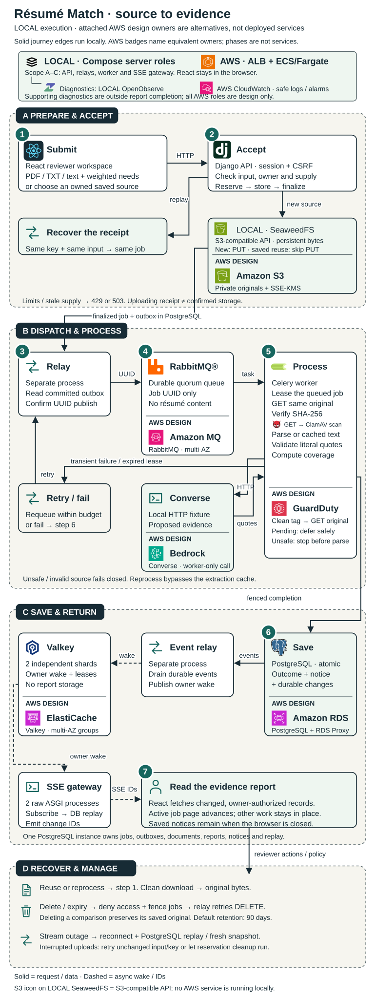

<p align="center">
  
</p>
<h1 align="center">Résumé Match</h1>
<p align="center"><strong>Make résumé evidence easy to inspect.</strong></p>
<p align="center">Weighted requirements, checked source excerpts, and a saved report for human review.</p>
<p align="center">
  <a href="#run-locally">Run locally</a> ·
  <a href="#how-it-works">Architecture</a> ·
  <a href="#documentation">Documentation</a> ·
  <a href="CONTRIBUTING.md">Contributing</a>
</p>
<p align="center">
  <a href="https://github.com/junrillg/resume-match-bedrock/actions/workflows/check.yml"></a>
  <a href="backend/pyproject.toml"></a>
  <a href="compose.yaml"></a>
</p>

A real disposable comparison through the local HTTP → queue → worker → SSE path:

```json
{
  "accepted_status": 202,
  "ok": true,
  "score": 100,
  "sse_change_count": 8,
  "cleanup": {
    "fixture_records_removed": true,
    "originals_physically_removed": true
  }
}
```

*Selected fields from `make sample` output, verified 11 November 2026 with synthetic data and the local provider. [Run it yourself →](#run-locally)*

Upload a PDF/TXT, paste text, or reuse a saved original. Choose weighted skill requirements and inspect the supporting quotes beside each result. Accepted comparisons continue when you leave the page; saved in-app notifications link back to the outcome.

| Capability | What you can do |
| --- | --- |
| Inspect evidence | Review literal source excerpts and see which requirements lack evidence. The application validates quotes and calculates weighted coverage. |
| Keep working | Submit background comparisons, navigate elsewhere, then return through persistent notifications and report links. |
| Manage originals | Reuse or re-extract stored sources, download clean originals, and request deletion of a document and its related reports. |
| Follow the system | Inspect queue delivery, worker activity, stored records, object storage, fan-out, and correlated logs through local service viewers. |

Coverage is **matched weight ÷ total weight × 100**. It measures evidence in the document; a person reviews the excerpts and makes any hiring decision.

## Run locally

Requires GNU Make 3.81+, a POSIX shell, Python 3.12+, `openssl`, and Docker Compose supporting `--wait`. Allocate **at least 8 GiB** to Docker. ClamAV reserves 4 GiB, uses AMD64 emulation on ARM64, and downloads signatures on first startup.

```sh
make help
make up
make sample
```

Open <http://127.0.0.1:8088>. Run `make credentials` **in a private terminal** for the generated logins. Sign in, select **Use synthetic sample**, then **Analyze evidence**. The built-in sample produces **80%** coverage: Python, Django, and React have excerpts; PostgreSQL does not.

`make sample` is a separate disposable HTTP → queue → worker → SSE comparison. It expects **100%**, reports job/request IDs, and removes its own original and fixture records. The default Compose runtime uses a separate local deterministic Converse provider; **no AWS account or paid model call is needed**.

```sh
make status    # Service health
make logs      # Follow logs; Ctrl-C stops following
make down      # Stop containers; preserve volumes
```

If the sample fails because ClamAV loaded stale signatures, let its update finish, run `docker compose restart scanner`, wait for scanner health in `make status`, then rerun `make sample`. This was needed during the verified startup.

`make restart` also preserves data. Keep the ignored `.env` with initialized volumes: changing passwords does not update existing services. [Startup, viewers, and operating details →](docs/implementation-guide.md#service-inspection)

## How it works

[](docs/architecture.md)

*Connected local lifecycle with official AWS icons attached at their service boundaries; cloud design is not deployed. [Open the full-size, horizontally scrollable diagram →](docs/assets/architecture-lifecycle.html)*

React submits the selected source and requirements to Django. For new uploads, Django reserves identity in PostgreSQL, stores the original in SeaweedFS, then commits the queued job and outbox. A separate relay publishes only the job UUID to RabbitMQ. The Celery worker verifies the original, passes ClamAV checks, extracts evidence through the provider, and validates quotes before committing the report, notification, and durable change event.

An event relay signals the owner's Valkey shard. Dedicated asynchronous SSE gateways wake the browser for targeted, authorized reads. PostgreSQL owns saved state and replay; Valkey supplies wakeups and connection leases. Retry keys, worker leases, and cleanup reconciliation cover interrupted work. A queued receipt confirms stored source and dispatch intent; an `uploading` reservation still requires unchanged-input retry.

The separate Terraform design maps this flow to S3, GuardDuty, ECS/Fargate, RDS/RDS Proxy, Amazon MQ, Valkey, and Bedrock. **AWS is source/mock-plan verified, not deployed.** [Local architecture →](docs/architecture.md) · [AWS service journey →](docs/aws-service-journey.md)

## Documentation

- [Operating reference](docs/implementation-guide.md): service addresses, permissions, API/source map, log search, and verification commands.
- [Architecture](docs/architecture.md) and [upload-to-score Mermaid views](docs/upload-to-score-mermaid.md): ownership, handoffs, retries, and outcomes.
- [Document lifecycle](docs/document-lifecycle.md): storage, scan gates, reuse, configurable 90-day retention, and deletion.
- [Design and decisions](docs/design.md): requirements, tradeoffs, measured evidence, and acceptance boundaries.
- [AWS deployment guide](infra/terraform/README.md): prerequisites, mocked checks, bootstrap, and preservation.

## Development and limits

After `make up`, run `make test` for the existing suites or `make verify` for image builds, tests, Django checks, migration drift, and credential-free Terraform mock plans. Terraform checks require **1.15.8** and registry access. CI runs `make check`, which additionally **fails while formatter/linter, backend type, and security-scan gates remain unconfigured**. See [contributing](CONTRIBUTING.md) for focused commands.

Use synthetic data only with the local HTTP/debug, single-node runtime. PDF/TXT uploads are limited to 1 MiB, 10 PDF pages, and 30,000 extracted characters; OCR and DOCX are unsupported. Owners have a 20-new-comparison daily limit. Storage administration can read raw/quarantined originals across accounts and is a privileged operator surface.

One million connected users and 100 comparisons/second are planning inputs, not demonstrated capacity. Cloud deployment, failover, federation, backup restoration, and model evaluation require separate acceptance evidence. [Measured local envelope →](docs/decisions/0009-event-driven-completion.md)

Licensed under [MIT](LICENSE). Third-party marks retain their owners’ terms; see the [architecture asset notices](docs/assets/architecture-lifecycle-NOTICE.md) and [AWS icon notices](docs/assets/aws/NOTICE.md). No private vulnerability-reporting channel is currently documented; do not include credentials, candidate data, or sensitive vulnerability details in public reports.
