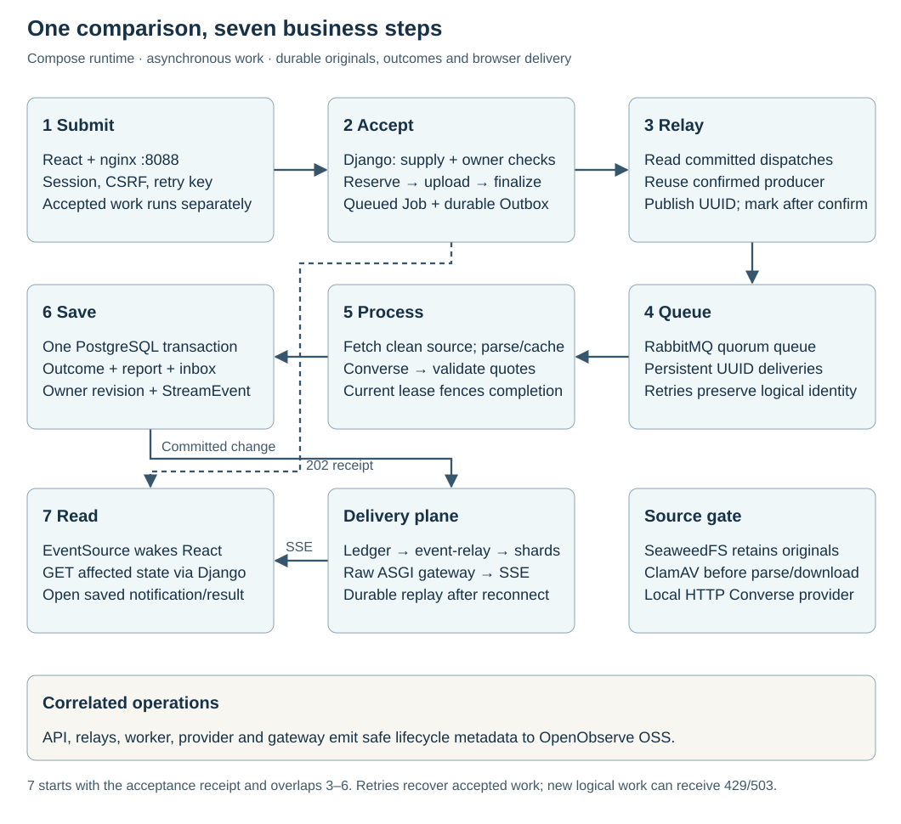

# Résumé Match · Evidence workbench

Reviewers upload or reuse a résumé, set weighted requirements and receive a coverage score with supporting source quotes. Private object storage retains the original; PostgreSQL owns document identity, processing state and results. After acceptance, reviewers can leave the processing page and continue working; a saved in-app notification links to the completed report.



## One comparison, end to end

1. **Submit:** React sends a PDF/TXT, pasted text or saved document ID with requirements and a retry key.
2. **Accept:** Django reserves new document/job identity in PostgreSQL, stores the original, then atomically queues the job and its outbox. Reuse skips the new upload.
3. **Relay:** a separate process publishes the committed job UUID and waits for broker confirmation.
4. **Queue:** RabbitMQ retains that UUID; document content stays out of messages.
5. **Process:** a leased worker fetches and verifies the original, passes the malware gate, parses or reuses versioned extraction, and validates proposed evidence.
6. **Save:** application code checks the current document/lease, calculates coverage and atomically commits one report, its completion notification and a durable change event.
7. **Read:** the event relay wakes the owner's Valkey shard; an asynchronous SSE gateway signals the browser to fetch only changed, authorized state. The active processing page advances on success; notifications elsewhere leave the current page intact.

A queued receipt confirms stored source and dispatch intent. A concurrent replay may instead return an **uploading** reservation: storage is not yet confirmed and interrupted uploads require unchanged-input retry. Neither receipt promises a completed report. Notifications persist across refresh and sign-out; they appear when the user returns to the app. [Admission and recovery →](docs/architecture.md)

The delivery design targets **one million simultaneously connected users**, with durable replay, independent fan-out shards and bounded asynchronous gateways. This is a capacity target, not a measured result. [Transport, bounds and verification →](docs/decisions/0009-event-driven-completion.md). The detailed topology and AWS deployment references are being aligned with this runtime milestone.

## Original files and application records


The local flow uses persistent SeaweedFS S3-compatible storage, ClamAV, PostgreSQL and RabbitMQ. Originals, extracted text and associated results follow the configurable **90-day** project policy. Owners can download clean originals, compare them again, reprocess them or request deletion. [Document lifecycle →](docs/document-lifecycle.md)

The separate AWS Terraform design uses private S3, GuardDuty Malware Protection for S3, ECS/Fargate, RDS, Amazon MQ and Bedrock. Official-icon diagrams show their responsibilities. Local execution and mocked configuration checks do not establish AWS deployment or managed-service behavior. [AWS journey →](docs/aws-service-journey.md)

## Run with Docker

```sh
./scripts/lab up
```

Allow at least 8 GiB for Docker; ClamAV reserves 4 GiB and uses AMD64 emulation on ARM64. Initial signature updates require internet access. Open <http://127.0.0.1:8088>; run `./scripts/lab credentials` in your private terminal for generated logins. The synthetic sample returns **80%**. The same startup connects the service viewers below.

`./scripts/lab down` preserves volumes. Keep their ignored `.env`; replacing passwords does not update initialized services. `./scripts/lab help` lists commands.

## Inspect the running flow

| Surface | Local address | View |
| --- | --- | --- |
| Application | <http://127.0.0.1:8088> | Owned documents, processing/results pages and saved notifications |
| RabbitMQ Management | <http://127.0.0.1:15672/#/queues> | Queue backlog, consumers and delivery activity |
| Flower | <http://127.0.0.1:5555/tasks> | Celery task events and worker heartbeat |
| pgAdmin | <http://127.0.0.1:5050> | Read-only document/job/outbox/result/notification and stream revision/event records |
| Fan-out viewer | <http://127.0.0.1:8089> | Read-only connections to both independent Valkey shards |
| SeaweedFS admin | <http://127.0.0.1:23646/files?path=/buckets/resume-originals> | Privileged, read-only storage inventory |
| OpenObserve | <http://127.0.0.1:5080> | Correlated application/process events |
| ClamAV | `docker compose exec scanner clamdtop` | Live terminal scan queue and signature state |

All web listeners bind loopback and use generated private logins. Storage administration
can read raw/quarantined originals across accounts; it is a synthetic-only operator
surface. Flower task completion does not establish comparison success. [Access,
permissions and observed behavior →](docs/implementation-guide.md#service-inspection)

## Engineering references

- [Architecture](docs/architecture.md): request, storage, dispatch, processing and visible outcome.
- [Upload-to-score Mermaid diagrams](docs/upload-to-score-mermaid.md): end-to-end flow, function links, retries and document lifecycle.
- [Design and decisions](docs/design.md): requirements, alternatives and actual delivery boundaries.
- [Implementation reference](docs/implementation-guide.md): source/API map, log search and verification.
- [AWS deployment](infra/terraform/README.md): prerequisites, mocked checks, bootstrap and preservation.

**Limits:** local HTTP/debug and single-node services are restricted to synthetic data. Coverage measures source evidence, not candidate quality. OCR and DOCX are unsupported. Cloud deployment, failover, capacity, federation and model evaluation require separate acceptance evidence.
