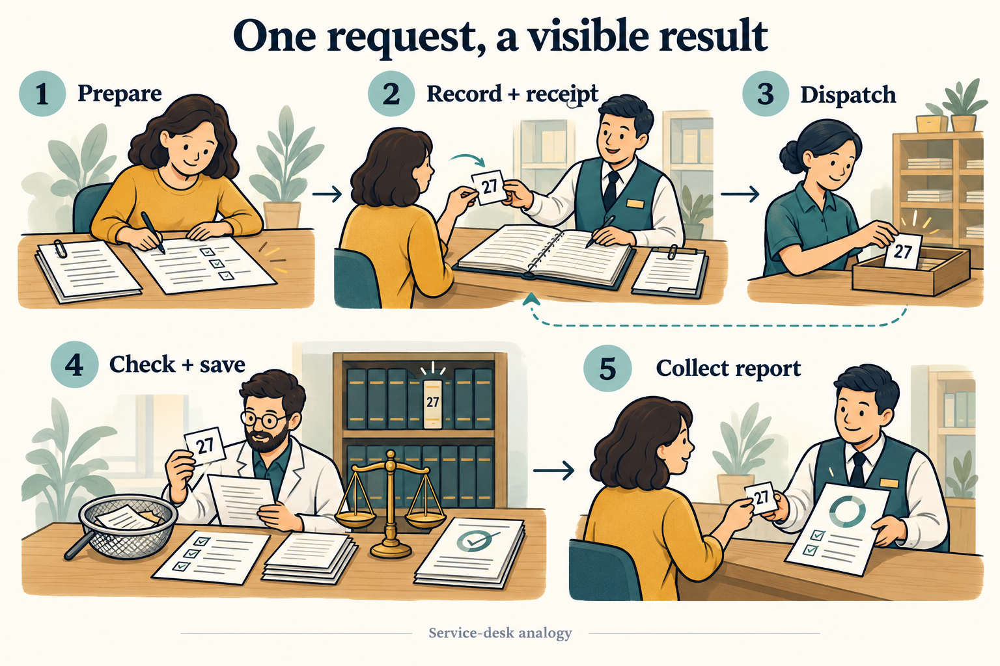

# Résumé Match · Evidence workbench

A reviewer pastes résumé text or selects a PDF/TXT file, sets skill weights and clicks
**Analyze evidence**. The page receives a job receipt, tracks its state, then displays
a score and supporting source quotes.

We designed the Django + React system to keep accepted work safe during interruptions.
A background worker validates the evidence; application code calculates weighted coverage.



The ledger represents PostgreSQL; the dispatch tray represents RabbitMQ; the specialist
represents the worker. The browser checks its receipt to collect the saved report.
The picture groups relay/queue as Dispatch and processing/save as Check + save.
It omits redelivery, claim checks and concurrent polling.
[The technical diagram](docs/architecture.md) expands those responsibilities into the seven steps below.

## One comparison, end to end

1. **Submit:** React sends the selected document, weighted requirements and a key that identifies retries of the same comparison.
2. **Accept:** Django commits the job and dispatch intent together in PostgreSQL, then returns `202 Accepted`.
3. **Relay:** the relay reads that intent and waits for broker confirmation before marking it sent.
4. **Queue:** RabbitMQ retains the job ID, rather than document content, for worker delivery.
5. **Process:** a Celery worker claims the job for a bounded time, extracts proposed evidence and validates the quotes.
6. **Save:** code checks that the worker still owns the claim, computes weighted coverage and commits one result.
7. **Read:** React reads durable progress and the report. Request IDs connect safe logs across services in OpenObserve.

The database remains the source of truth when delivery repeats or the broker is unavailable.
Provider calls may repeat; the guarantee is at most one committed result per job.

## Run with Docker

Start Docker with Compose, then run from this repository:

```sh
./scripts/lab up
```

Open <http://127.0.0.1:8088> and use `./scripts/lab credentials` **in your private terminal**
for the generated login. Load the synthetic sample and submit it: the expected score is **80%**.
The log viewer runs at <http://127.0.0.1:5080>.

`./scripts/lab down` stops the stack and retains its volumes. Keep the ignored `.env`
with those volumes; it holds their existing passwords. `./scripts/lab help` lists commands.

## Review the design

- [One request in three phases](docs/architecture.md#one-request-in-three-phases): admission, processing and result rendering.
- [Recovery and boundaries](docs/architecture.md#failure-and-recovery): what survives interruptions and what the design guarantees.
- [Decisions](docs/decisions/0001-durable-background-work.md): why PostgreSQL, RabbitMQ and bounded workers.
- [Implementation reference](docs/implementation-guide.md): source map, API, log search, checks and observed results.

Local checks cover concurrent admission, duplicate workers, broker interruption and
log-viewer failure. [Log search screenshot](docs/assets/log-search.png).

**Boundaries:** use synthetic data. This is a single-node local HTTP deployment with
Django debug enabled. Scores measure literal evidence coverage, not candidate quality.
PDF OCR and DOCX are unsupported. AWS calls stay disabled; Bedrock has mocked contract
tests only. Production identity, availability, security and model evaluation need further design.
