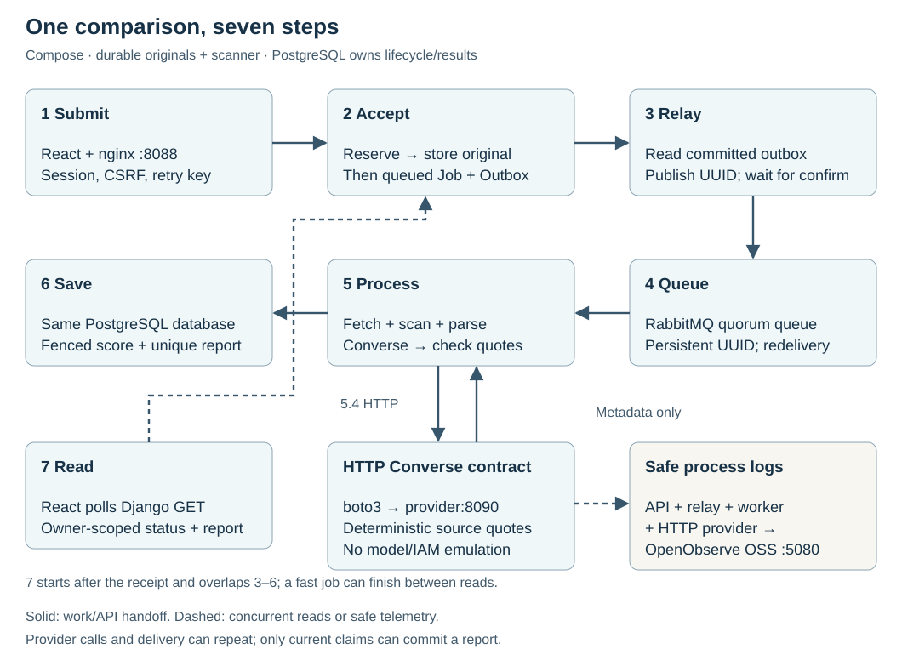

# Résumé Match · Evidence workbench

A Django + React architecture lab for parsing résumés and reviewing transparent,
weighted skill coverage. AWS Bedrock proposes quoted evidence; application code
validates the quotes and calculates the score. The default demo stays entirely local.



## Understand and rebuild

Start with [the scenario and vocabulary](docs/design.md), trace [the shipped architecture](docs/architecture.md),
read [the decisions](docs/decisions/0001-durable-background-work.md), then use
[the independent rebuild guide](docs/implementation-guide.md). [Research](docs/research.md)
explains the contracts; [learning resources](docs/learning-resources.md) provide optional
LinkedIn Learning and public video/tutorial support. The UI tracks durable job progress, and the
local log viewer traces one request across API, relay and worker.

## Run locally

Install Docker with Compose and start your Docker runtime. From the repository root:

```sh
./scripts/lab up
```

Open <http://127.0.0.1:8088>. The script generates private, ignored `.env` credentials,
builds the images, waits for PostgreSQL and RabbitMQ health, runs migrations, and starts
Gunicorn behind nginx serving the React production build. It creates the synthetic `lab`
account once. Use `./scripts/lab credentials` in your own terminal to view its password.
The app uses loopback port 8088 and the log viewer uses loopback port 5080;
PostgreSQL and RabbitMQ stay on the Compose network.
AWS remains disabled. The UI submits durable jobs for a separate Celery worker to process,
then polls their state. New comparisons are accepted only through the jobs API;
the matches API retains read/delete access to existing reports.

`./scripts/lab down` stops containers while retaining database, broker and log volumes. Your
existing development SQLite database is separate and untouched. Keep `.env` with the named
volumes: regenerating its passwords does not change passwords already initialized in them.
Use `./scripts/lab help` for commands. The stack is a local HTTP learning environment with
synthetic data and Django debug enabled, not an internet deployment.

## Search one job across services

Open <http://127.0.0.1:5080>, sign in with the log-viewer login shown by
`./scripts/lab credentials` in your private terminal, and select the `resume_match` log
stream in the `default` organization. Choose a time range that includes the submission
(for example Past 1 Hour), enable SQL mode, copy its request ID and search:

```sql
SELECT * FROM "resume_match"
WHERE request_id = 'PASTE_REQUEST_UUID'
ORDER BY _timestamp ASC
```

API admission, relay confirmation, worker progress, retries, failures and recovery emit
fixed event names plus validated IDs and enum/numeric metadata. Document text, titles,
evidence, usernames, filenames, credentials and raw exceptions are excluded. The dedicated
OpenTelemetry exporter never captures root/application exception logs.
Completion events include elapsed time; failures add an error code.

Export uses a 256-record queue, batches of 32, a one-second schedule and a 0.5-second HTTP
timeout. It never flushes or waits in the business path. Events can be lost when the queue
fills, the viewer is unavailable or a process exits; this is not a durable audit ledger.
Viewer failure does not prevent jobs from completing. For the synthetic outage drill,
run `docker compose stop openobserve`, submit a comparison, verify completion, then
restore the viewer with `docker compose start openobserve`.
[See the verified cross-service search](docs/assets/log-search.png).

OpenObserve OSS v1.1.1 is pinned by digest, with a static HTTP health probe added to its
distroless image. It runs nonroot with a 1 GiB container limit, 64/16 MiB memtable/in-memory
file limits, a 256 MiB query pool and caches disabled. Three-day retention is checked hourly
with a 120-minute file-delete delay; a 1024 MiB free-space circuit breaker protects disk.
These settings do not impose a hard byte quota on its named volume. `lab up` adds a missing
viewer password atomically while preserving existing secrets and owner-only `.env` permissions.

nginx uses Docker DNS to refresh the API address after container recreation, avoiding stale
upstream 502 responses. This uses the [OSS upstream resolver](https://nginx.org/en/docs/http/ngx_http_upstream_module.html)
available in the pinned nginx version. See [ADR 0004](docs/decisions/0004-searchable-observability.md).

## What you can review

- Paste a résumé or upload a selectable-text PDF / UTF-8 TXT file up to 1 MiB.
- Define explicit weighted requirements and inspect evidence for each skill.
- Review the score, missing mentions, and your latest 100 saved results; delete a result.
- Inspect the Bedrock adapter and mocked failure tests; live AWS activation is deferred.

The score measures weighted **literal evidence coverage**, not candidate quality or a
hiring recommendation. It does not infer skill aliases or validate competence,
experience duration, negation, or document truth. Review every quote. PDF OCR and DOCX
are outside this slice. Use synthetic data: saved evidence may contain personal data.

## Asynchronous jobs API

Authenticated `POST /api/jobs/` accepts the same résumé/requirements multipart form plus a
UUID `Idempotency-Key` header, and returns HTTP 202 with a job ID and status. Repeating the
same key and normalized payload returns that job without another quota charge; changing
the payload under that key returns 409. `GET /api/jobs/` lists your latest 100 jobs;
`GET /api/jobs/<id>/` returns queued/running/succeeded/failed state, attempts, safe error code
and a completed match when available. `DELETE /api/jobs/<id>/` removes the job and result.
Session cookies and CSRF apply to these endpoints too.

Job admission and an outbox event commit together in PostgreSQL. The relay sends only a job
UUID through an explicitly declared durable RabbitMQ queue, confirms persistent delivery,
then marks the event sent. The worker claims a fenced 90-second lease, computes outside
the database transaction and commits one result. Duplicate deliveries are safe. Transient
provider failures receive at most three claims with finite backoff; the relay recovers
expired leases and stale queued wakeups, with a ten-minute total deadline. No result backend,
Redis, Beat, or Celery retry state is required.

Privacy changes for asynchronous jobs: extracted résumé text is temporarily stored in the
database while queued/running, and cleared on success/failure or removed on deletion.
Evidence excerpts remain in the result until deletion. Clearing live rows does not erase
historical database backups; use synthetic data in this lab.

## Verify

```sh
./scripts/lab test
docker compose exec -T api python manage.py check
docker compose exec -T api python manage.py makemigrations --check --dry-run
```

Optional frontend unit/build checks require local Node.js 22.12+ and npm. These do not
replace running the complete Compose stack:

```sh
cd frontend
npm ci
npm test
npm run build
```

Verified locally: 62 backend tests pass on Compose PostgreSQL, including concurrent
idempotent admission, duplicate workers and deletion/completion fencing. The existing
15 frontend tests pass; the TypeScript/Vite production build also succeeds in Docker.
Three startup-helper tests pass.
The Compose smoke check covers nginx, session cookies, CSRF rejection, login, an 80% match,
saved history and deletion. All seven service health checks pass, including OpenObserve.
Real-broker experiments confirm queued work while the worker is paused, HTTP 202 during
a broker outage, durable messages surviving a broker restart, and completion after a worker
restart. Completed jobs produced one result and cleared their temporary source text.
Search returned eight complete lifecycle records across the three application services;
full records contained no document or credential fields. With the viewer stopped, a job
was accepted in 0.057 seconds and completed at 80% in 1.643 seconds. An isolated Compose
project with fresh volumes started from `lab up`, processed its first 80% job, and exported
four searchable events. Its volumes were removed and the original stack/history restored.
The fictional UI sample scores 80%, confirmed through Chrome on desktop and a mobile
viewport. [See the evidence report screenshot](docs/assets/workbench.png).

Tests cover scoring and extraction boundaries, owner isolation, enforced CSRF, file
validation, and mocked provider failures. They do not establish live Bedrock access or
model accuracy. See [the architecture case study](docs/architecture.md) for decisions,
failure behavior, current official sources and production limits.

## Bedrock integration boundary

Compose deliberately runs the local demo and mounts no AWS credentials. The Bedrock
adapter is implemented and tested with mocked SDK responses; live account access and
model behavior remain unverified.

A later authorized integration needs an approved account, region, Converse model and spend
limit, server-side worker credentials, matching API/worker provider configuration, and
resource-scoped `bedrock:InvokeModel` permission. Review model support, cross-region
inference and invocation logging first. Credentials never belong in browser code, Git or
command arguments. The adapter bounds timeouts, attempts and tokens; provider failures
never fall back to a demo score.

## Code map

| Path | Responsibility |
| --- | --- |
| `backend/matching/services.py` | File parsing, extraction prompt, Bedrock boundary, evidence validation and score formula |
| `backend/matching/views.py` | Session API, validation, quotas and owner-scoped result access |
| `backend/matching/models.py` | Jobs, outbox, unique results and quota counters |
| `backend/matching/jobs.py` | Fenced worker claims, finite retries, outbox relay and recovery |
| `backend/matching/test_jobs.py` | Durable job state and PostgreSQL concurrency tests |
| `backend/matching/tests.py` | Backend behavior and provider contract tests |
| `backend/matching/telemetry.py` / `backend/matching/test_telemetry.py` | Allowlisted events, bounded export and privacy/outage regressions |
| `frontend/src/` | React forms, authenticated requests, score evidence and history |
| `docs/assets/architecture.mmd` | Editable implementation diagram |

This is an enterprise-oriented learning baseline, not a certified enterprise deployment.
Production needs an operational design for SSO/RBAC, organization isolation, storage
retention, network protections, abuse controls, operational alerts and model evaluation.
