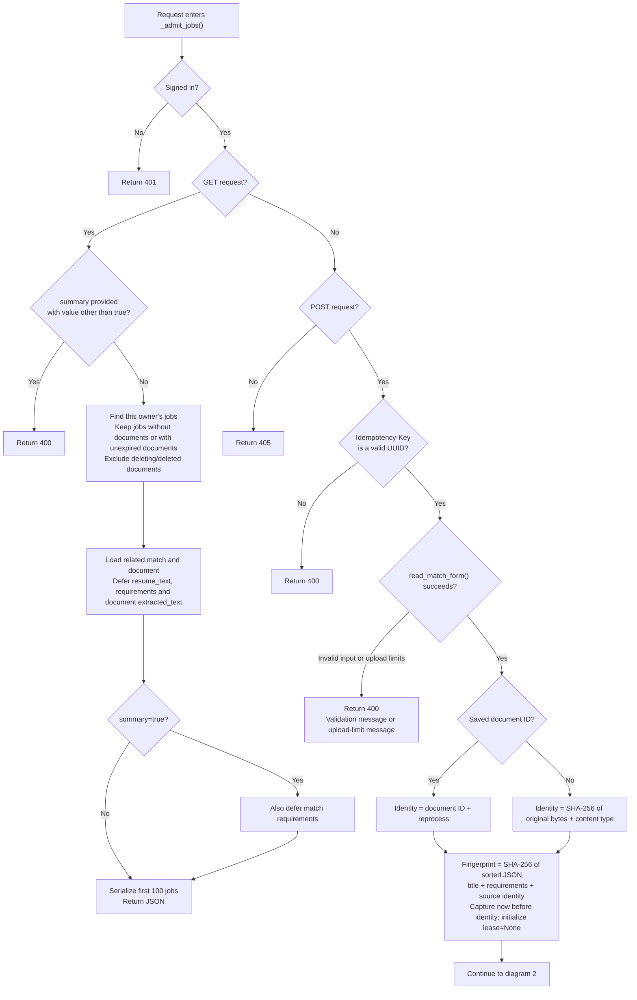
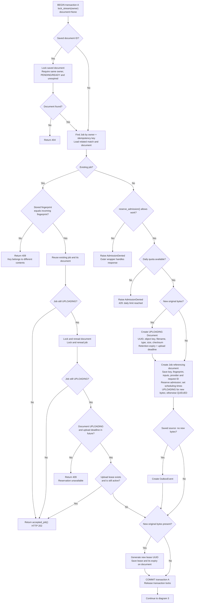
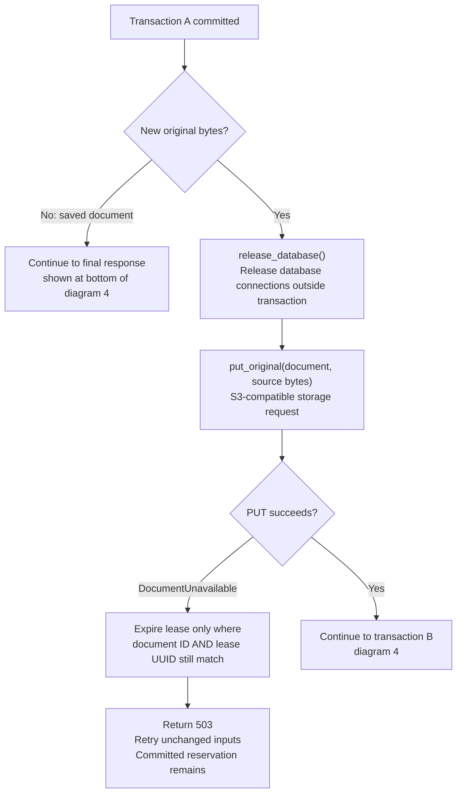
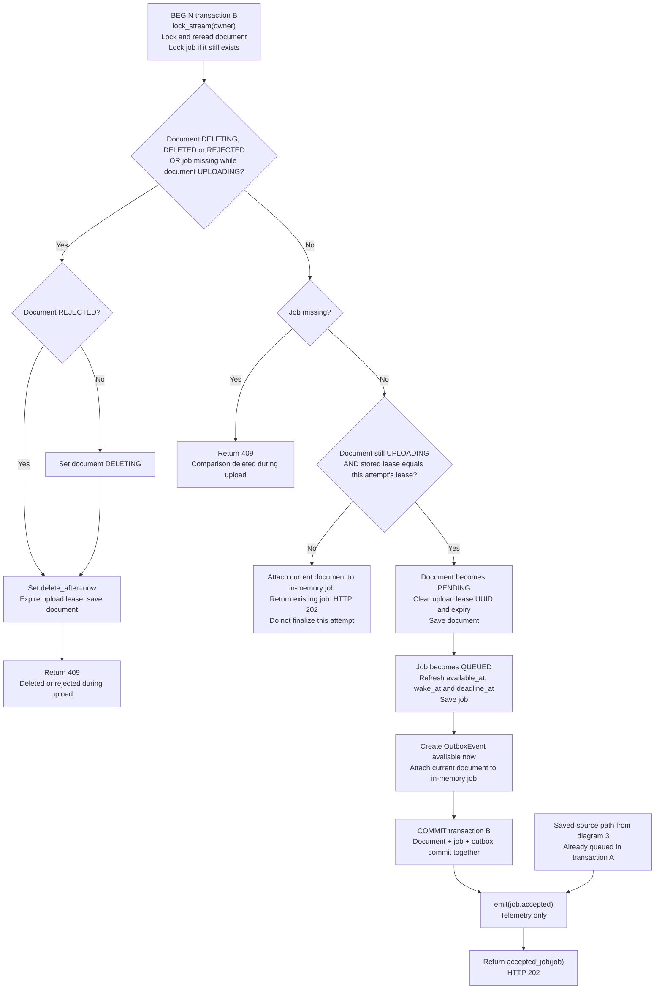

# _admit_jobs(): step-by-step Mermaid walkthrough

Read these four diagrams alongside [the exact function at revision 5b74706](https://github.com/junrillg/resume-match-bedrock/blob/5b74706828b6aaa35f61bfce563aa0f6dc6e7065/backend/matching/views.py#L283). Source snapshot: `5b74706828b6aaa35f61bfce563aa0f6dc6e7065`, inspected 19 October 2026.

[End-to-end diagrams](upload-to-score-mermaid.md) · [Notion notebook](https://app.notion.com/p/3fd71e91a0f6816585fdf556f98829ab)

These diagrams cover every explicit branch in the selected function, lines 283–396. Helper internals, unexpected exceptions and deployment behavior are outside this function-level map. HTTP 202 returns the current job; it can still be uploading, processing, completed or failed. Creating this reference does not answer the pending learner checkpoint.

## 1. Request routing and validation

[Code: lines 283–308](https://github.com/junrillg/resume-match-bedrock/blob/5b74706828b6aaa35f61bfce563aa0f6dc6e7065/backend/matching/views.py#L283)

## 2. Transaction A: reuse or reserve

[Code: lines 309–357](https://github.com/junrillg/resume-match-bedrock/blob/5b74706828b6aaa35f61bfce563aa0f6dc6e7065/backend/matching/views.py#L309)

The owner lock remains held throughout this transaction. The saved-document check precedes the idempotency lookup. Matching retries avoid new admission and quota charges.

A normal return inside `atomic()` exits normally and commits; raising `AdmissionDenied` rolls back this transaction. The surrounding `admit_jobs()` wrapper translates that exception into an HTTP response. Neither a normal error response nor a 202 automatically implies rollback.

## 3. Upload outside the transaction

[Code: lines 358–365](https://github.com/junrillg/resume-match-bedrock/blob/5b74706828b6aaa35f61bfce563aa0f6dc6e7065/backend/matching/views.py#L358)

Saved-document submissions skip the PUT. New originals go from Django to the configured S3-compatible store. Local SeaweedFS and AWS S3 are configuration choices; this map does not establish a deployed AWS upload.

The storage request is outside the SQL transaction. Failure can leave the object outcome uncertain; expiring this attempt's lease does not delete the committed reservation or expire a newer attempt's lease.

## 4. Transaction B: finalize only the current attempt

[Code: lines 366–396](https://github.com/junrillg/resume-match-bedrock/blob/5b74706828b6aaa35f61bfce563aa0f6dc6e7065/backend/matching/views.py#L366)

The finalizer checks the lease UUID, not lease expiry. Expiry allows a later request to take over; a replacement UUID prevents the older attempt from finalizing. An expired lease does not cancel an in-flight PUT. Deletion/rejection guards precede this lease check so a late successful PUT restores cleanup intent instead of reviving deleted data.

`PENDING` means awaiting worker processing, not already scanned or parsed. The outbox persists dispatch intent for the relay; it does not call Celery here. `emit()` records telemetry. `accepted_job()` serializes current job state with HTTP 202, a Location header and Retry-After.

## Reference and verification

Main path: validate → reserve in PostgreSQL → upload original → verify current lease → atomically commit PENDING document + QUEUED job + OutboxEvent → return 202.

The function uses owner/document/job locks and durable records to handle retries and concurrent attempts. Helper internals can produce further exceptions; database and object storage do not share an atomic commit. Runtime behavior and hosted rendering are separate from source and Mermaid-syntax verification.

Pending learner checkpoint, preserved: “Attempt A finishes its PUT after attempt B has replaced its lease. Should A queue the job and create an outbox event, or return the current job without finalizing?”
