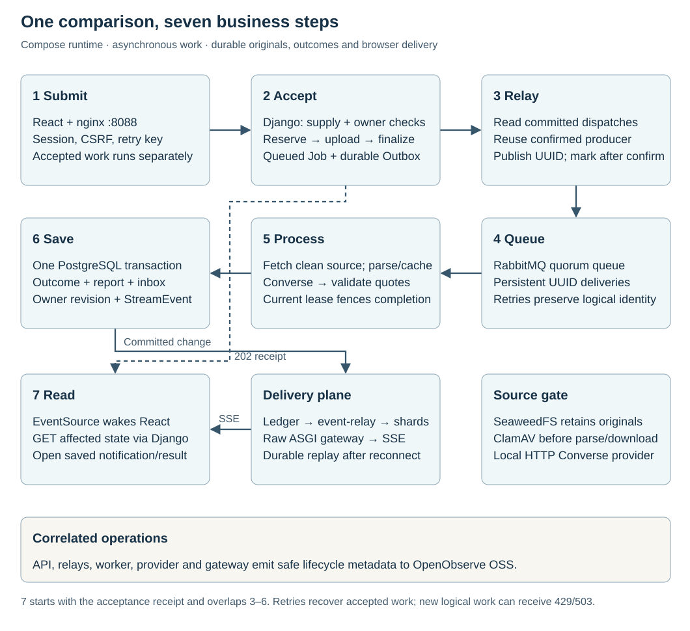
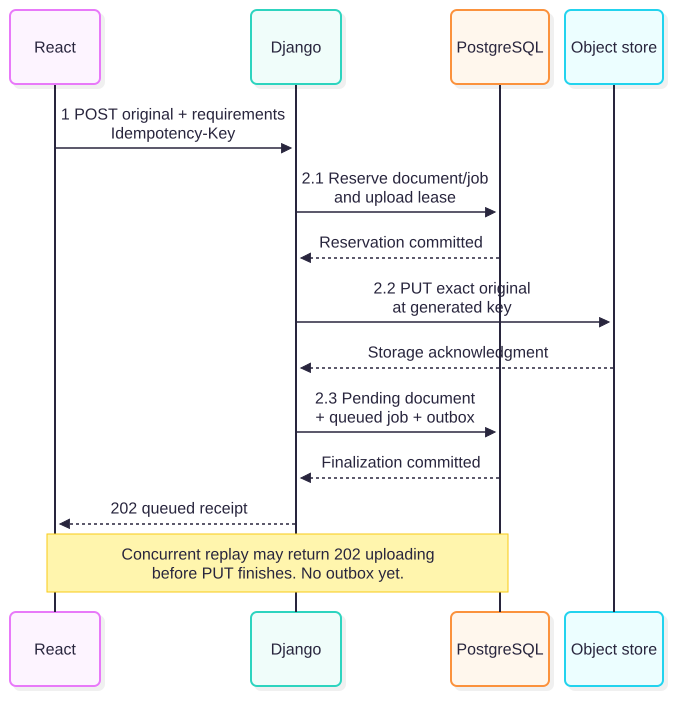
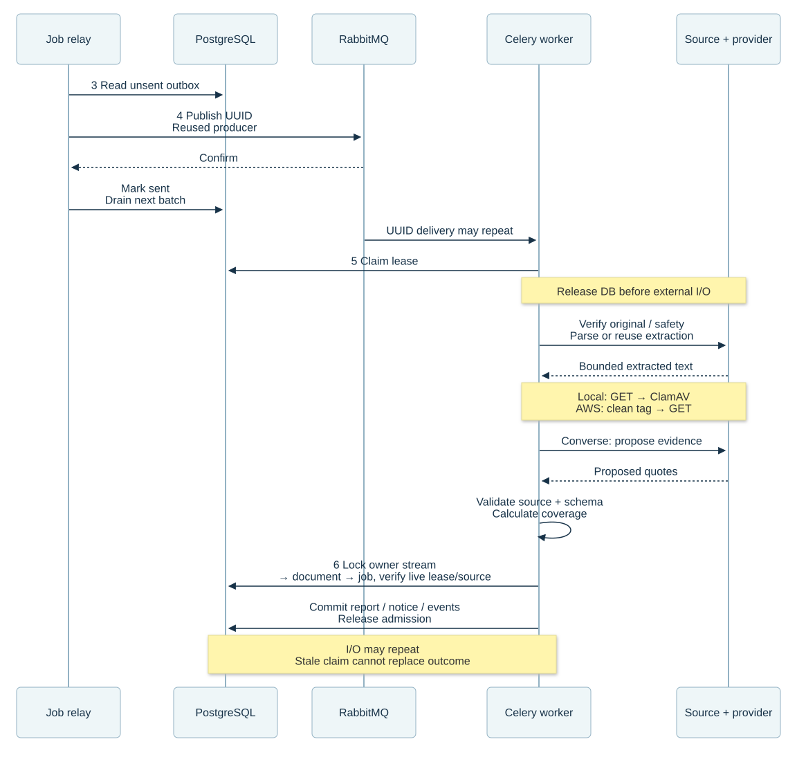
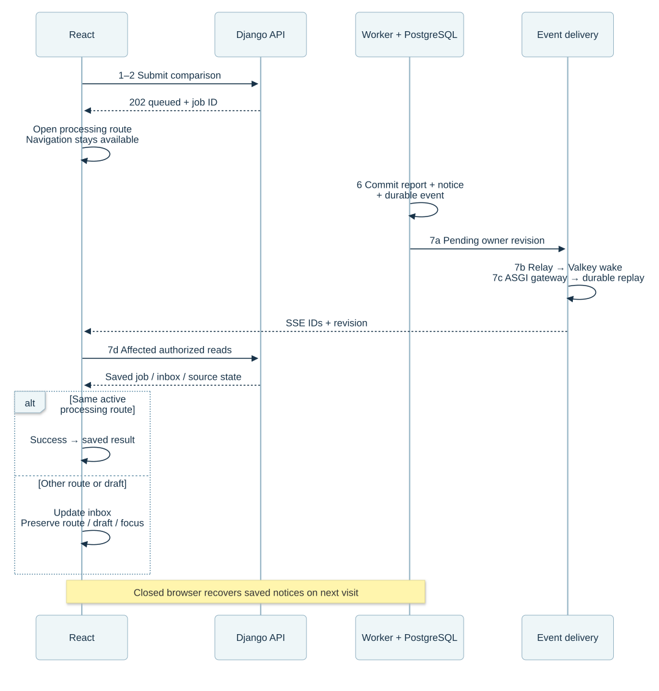
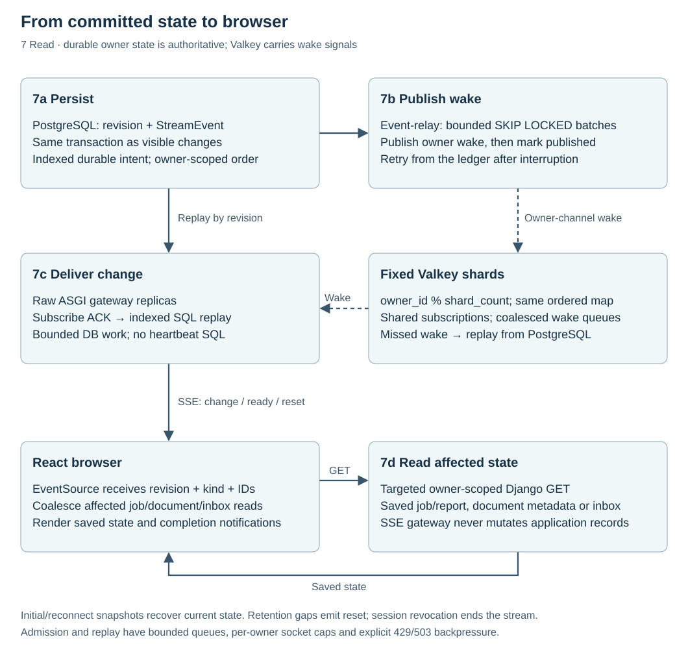
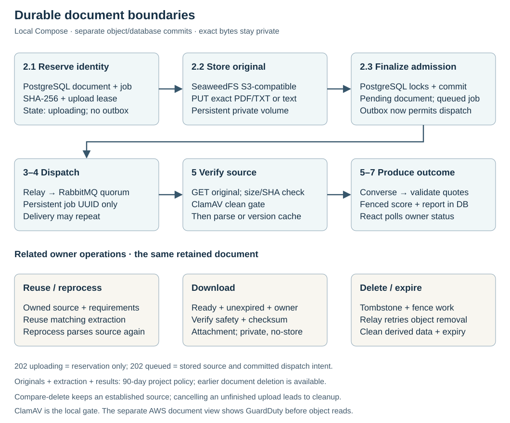
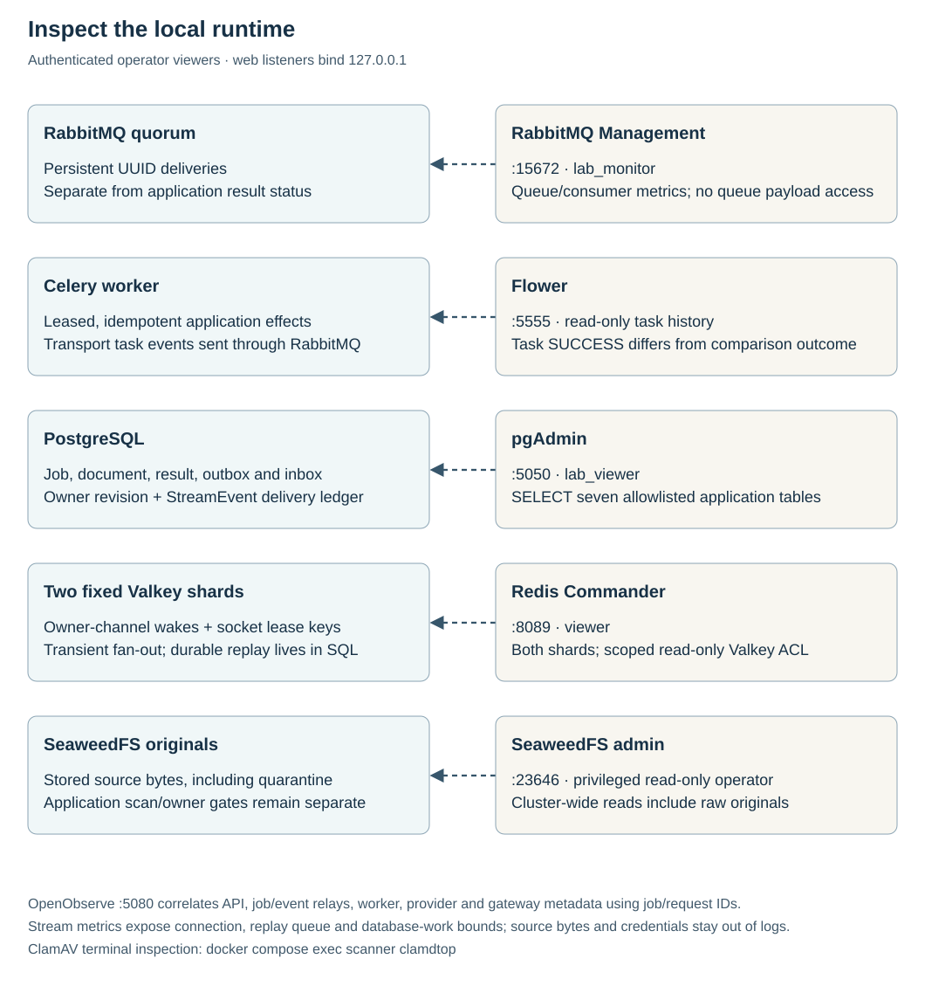
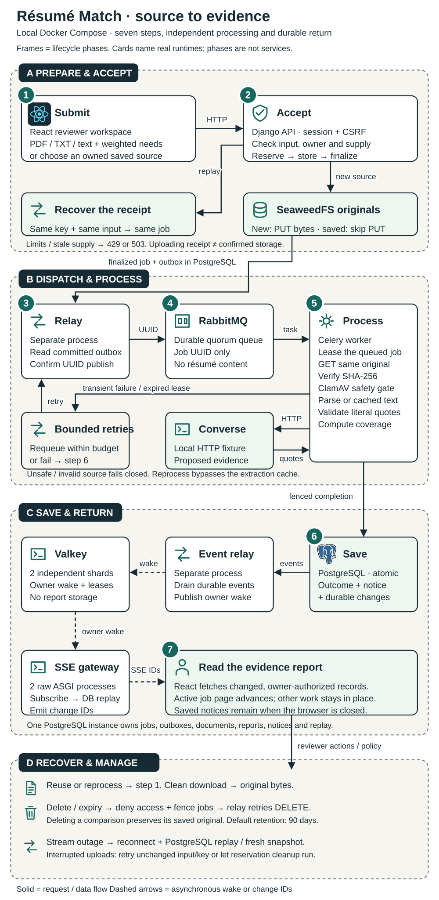

# Résumé comparison execution

A reviewer uploads or reuses a résumé, requests weighted evidence analysis and receives a report. Object storage preserves the original; PostgreSQL owns identity, lifecycle, dispatch intent and results. Processing runs independently. Durable change signals tell the browser which authorized records to read.



The canonical steps are **1 Submit · 2 Accept · 3 Relay · 4 Queue · 5 Process · 6 Save · 7 Read**. Solid arrows carry work; dashed arrows show concurrent reads or diagnostic metadata. [Requirements and decisions](design.md) establish the scope.

For the complete function-level trace, open the [upload-to-score Mermaid diagrams](upload-to-score-mermaid.md): overview, admission, RabbitMQ/Celery dispatch, retrieval/scoring and recovery/lifecycle. Each diagram has an editable source.

## 1–2 · Submit, store and admit

React sends multipart input and a UUID retry key through nginx. Django checks the session, CSRF, limits, ownership and payload identity before changing durable state. Unchanged-key recovery precedes new-work admission. New logical jobs must fit owner, rate and active-work budgets with fresh broker/worker supply and acceptable queue age; rejection returns `429` or `503` with retry guidance.



[Diagram source](assets/admission-sequence.mmd)

Object PUT and database finalization are separate operations. The outbox exists only after confirmed source storage and finalization. A concurrent same-key request may receive an `uploading` reservation; it does not prove storage or queueing. An interrupted upload requires retrying the original unchanged input/key, or reservation expiry and cleanup. Saved-document comparison skips PUT and commits a new queued job/outbox against the owned, unexpired source.

## 3–6 · Dispatch, verify source and save



[Diagram source](assets/processing-sequence.mmd)

The local worker fetches and checksum-checks bytes, then calls ClamAV; AWS checks the GuardDuty clean tag before GET, with a bucket policy enforcing the same gate. The diagram groups that boundary rather than implying identical scanner order. Every comparison verifies the source; matching extraction can avoid parsing again. Explicit reprocessing parses it again.

Object, scanner and provider I/O release database connections. Completion locks owner stream state, then document, then job and rejects deleted/expired source or a stale lease. The terminal transaction commits the outcome, one owner-visible completion notice and durable owner revisions, then releases the admission reservation atomically. Intermediate retries create no notice. Delivery/provider calls may repeat; one job/result relationship prevents duplicate committed reports. Worker execution can precede the relay's sent-marker commit. There is no total order across independent processes.

## 7 · Continue work and return to the outcome



[Diagram source](assets/completion-sequence.mmd) · [Delivery decision](decisions/0009-event-driven-completion.md)

After a finalized receipt, React opens `/jobs/<id>` with navigation available. The reviewer can start another comparison or leave. PostgreSQL saves a completion/failure notification with the terminal outcome. `/notifications` links to `/results/<job-id>` on success or the job's safe failure page. **Mark as read** is a separate, idempotent action; report access never waits for it.

Only the same active processing page advances automatically. Completion elsewhere preserves the current route, draft and focus. One SSE stream per visible authenticated tab receives minimal change identifiers. Hidden/offline tabs close it; reconnect performs authorized reconciliation. A closed browser finds saved notices on the next visit. This is in-app delivery.



The event relay marks pending publication only after the owner-shard wake succeeds. Valkey distributes wakeups and connection leases; PostgreSQL owns replay and results. A separate raw ASGI gateway multiplexes subscriptions, authenticates sessions and bounds database work. Subscribe acknowledgement precedes replay. Heartbeats perform no SQL. Stale cursors request a fresh snapshot; stream outages use jittered reconnect.

Owner-authorized detail reads support direct result links. Session, navigation and deletion fences reject stale responses. [Timing, routes and operating contract →](implementation-guide.md#browser-state-and-isolation)


## Stored originals and lifecycle



Owners can download a ready original through an authorized, attachment-only, no-store response, create further comparisons or reprocess. Document deletion/expiry first blocks access and fences related jobs, then the relay retries physical deletion. Deleting an established comparison preserves its original. Cancelling the initial unfinished upload instead schedules that unready source for cleanup. [Lifecycle and cross-store recovery →](document-lifecycle.md)

## Failure and recovery

| Boundary | Durable response |
| --- | --- |
| PUT or finalization interrupted | Reservation/key survive; same-input retry or deadline cleanup; no unready outbox |
| Broker/worker supply unavailable | New logical admission returns `503`; already accepted outbox intent remains recoverable, and confirmation ambiguity can repeat publication |
| Source missing/corrupt or scanner unavailable | No parse/provider/download bypass; visible bounded failure |
| GuardDuty scan pending | Requeue without using provider-attempt budget, within ten-minute job deadline |
| Worker interrupted | Lease/deadline reconciliation; stale completion cannot overwrite another claim |
| Source deleted/expired | Access denied and work fenced; failed object DELETE remains retryable |
| Fan-out/gateway unavailable | Durable events/outcomes remain; publication retries and jittered reconnect/replay recover state, without automatic REST polling |
| Viewer unavailable | Bounded best-effort diagnostic loss; business processing continues |

The provider budget is three claims with 2/4-second retry backoff and a ten-minute job deadline; leases last 90 seconds. Cloud scan pending uses its separate deferral within that deadline. [Exact operating/source reference →](implementation-guide.md)

## Inspect service boundaries



[Diagram source](assets/service-inspection.mmd)

RabbitMQ Management exposes backlog and consumers; Flower consumes task events;
pgAdmin reads seven application/stream record tables; the read-only fan-out viewer inspects both Valkey shards; SeaweedFS admin inspects storage.
OpenObserve correlates API/relay/worker/provider events and exposes event-relay/gateway delivery health, while `clamdtop`
shows the scanner's queue and signature state. These surfaces accompany the existing
seven business steps and do not become part of request completion.

Task completion is a transport observation: the application can reject a document
while Flower shows `SUCCESS`. PostgreSQL owns the comparison outcome. Database and
storage viewers are privileged synthetic-only operator surfaces; read-only storage
access includes raw/quarantined files and is separate from application owner/safety
checks. [Access, permissions and current verification →](implementation-guide.md#service-inspection)

## Evidence and deployment limits

The synthetic weights Python 3, Django 3, React 2 and unmatched PostgreSQL 2 produce **80%**. Application code validates literal quotes and skill mentions, then scores matched weight / total weight. This measures document evidence, not competence, truth or fairness.

Real Compose checks exercised originals, ClamAV, PostgreSQL, queued processing, storage/scanner outages and cleanup. Searchable metadata connects API, relay, worker and the HTTP provider; no document, filename, object key, signed URL or credential is logged. [Log search and evidence →](implementation-guide.md#search-one-job-across-services)

The [AWS service journey](aws-service-journey.md) uses separate Terraform and official-icon diagrams. It is source/mock-plan verified, not deployed. Local single-node services do not establish managed failover, capacity, organization identity, backup restoration or model quality. Those checks remain deployment acceptance work.


## Local services and AWS counterparts

The overview preserves the connected local lifecycle and adds a separate **role
mapping** below it: Compose runs locally; the AWS column is the existing Terraform
design, source/mock-plan checked and not deployed. AWS icons identify cloud
counterparts, never a local container. The check is that each mapped service has
a labeled local owner, an authentic cloud icon, a source reference and the
important semantic difference; provisioning and runtime changes are excluded.

| Visible mapping anchor | Local → AWS design | Source evidence and boundary |
| --- | --- | --- |
| `map-compute` · A–C | Compose application processes → ECS on Fargate, behind ALB | [Compose](../compose.yaml), [compute.tf](../infra/terraform/compute.tf), [ingress.tf](../infra/terraform/ingress.tf); Python runtimes remain separate roles |
| `map-originals` · phases A / D | SeaweedFS S3 API → private Amazon S3 + SSE-KMS | [documents.client](../backend/matching/documents.py), [documents.tf](../infra/terraform/documents.tf); API compatibility does not establish managed durability |
| `map-safety` · step 5 | ClamAV after GET → GuardDuty for S3 clean tag before GET | [documents.get_original / scan_bytes](../backend/matching/documents.py), [documents.tf](../infra/terraform/documents.tf); different engine and scan ordering, both fail closed |
| `map-records` · steps 2 / 6 | PostgreSQL → RDS PostgreSQL + RDS Proxy | [data.tf](../infra/terraform/data.tf), [database_proxy.tf](../infra/terraform/database_proxy.tf); SQL owns results and replay in both environments |
| `map-queue` · step 4 | RabbitMQ quorum queue → Amazon MQ for RabbitMQ | [celery.py](../backend/config/celery.py), [data.tf](../infra/terraform/data.tf); same UUID job contract, different failover guarantees |
| `map-fanout` · phase C | Two Valkey shards → ElastiCache for Valkey groups | [Compose](../compose.yaml), [fanout.tf](../infra/terraform/fanout.tf); ephemeral wakeups/leases, not result storage |
| `map-evidence` · step 5 | Local deterministic HTTP Converse fixture → Amazon Bedrock Converse | [services.py](../backend/matching/services.py), [compute.tf](../infra/terraform/compute.tf), [identity.tf](../infra/terraform/identity.tf); fixture execution does not validate model quality |
| `map-operations` · Support | OpenObserve via OTLP → CloudWatch logs/alarms | [Compose](../compose.yaml), [monitoring.tf](../infra/terraform/monitoring.tf), [data.tf](../infra/terraform/data.tf); diagnostics stay outside business completion |

The cloud lifecycle and supporting identity/network services remain in the
[AWS service journey](aws-service-journey.md).

Mapping update verified on 11 November 2026: eight source-backed pairs, embedded
official icons, exact HTML/SVG export, local links and 830px native raster passed
including one independent material review. No application/runtime changes were made.

## Connected overview and coverage

[Open the editable, scrollable overview](assets/architecture-overview.html) ·
[View the standalone SVG](assets/architecture-overview.svg) ·
[Asset sources and notices](assets/architecture-overview-NOTICE.md).



This overview answers how a reviewer gets from source input to checked evidence in
**local Docker Compose**. Seven numbered milestones follow the existing canonical
steps; the first four dashed frames group lifecycle phases, not deployments.
The fifth frame maps local roles to the existing AWS design with official icons;
its paired symbols are not request hops or a deployment claim. Cards identify
real runtime owners. PostgreSQL references denote the same database. Solid arrows
carry requests/data; dashed arrows carry asynchronous wakes or change identifiers.

The scoped acceptance checks are source-backed transitions, visible recovery and
cleanup, real runtime boundaries, legible labels at 830px, accessible contained
scrolling at mobile width, embedded assets and identical HTML/SVG topology.
Cloud counterpart mapping is included; deployment, provisioning, capacity, model quality, low-level HTTP exchanges
and operator viewer internals remain in their existing references.

| ID / phase and visible anchor | Actor / owner and transformation | Store / handoff; next or alternative | Source evidence |
| --- | --- | --- | --- |
| A1 `submit` | Reviewer / React: selected PDF, TXT, text or owned source plus weighted requirements → request | Browser draft → HTTP through nginx; saved source can reprocess | [App.tsx](../frontend/src/App.tsx), [nginx.conf](../frontend/nginx.conf) |
| A2 `accept` | Django authenticates owner, validates input/key and checks finite fresh supply → reservation | PostgreSQL identity; `429`/`503` rejects new work | [views._admit_jobs](../backend/matching/views.py), [admission](../backend/matching/admission.py) |
| A3 `original` and edge to `relay` | Django stores new exact bytes → finalizes pending document, queued job and outbox | SeaweedFS PUT and SQL commit are separate; saved reuse skips PUT | [views._admit_jobs](../backend/matching/views.py), [documents.put_original](../backend/matching/documents.py) |
| A4 `receipt`, upload strip | Same-key reviewer retry / Django recovers same-input job | Uploading is a reservation, not storage confirmation; unchanged-input retry or deadline cleanup | [views._admit_jobs](../backend/matching/views.py), [documents.reconcile_documents](../backend/matching/documents.py) |
| B3–4 `relay` → `queue` | Separate job relay publishes committed UUID through a confirmed producer → RabbitMQ quorum queue | Durable outbox → repeatable UUID delivery, without document content | [jobs.relay_once / publish_job](../backend/matching/jobs.py), [relay_jobs](../backend/matching/management/commands/relay_jobs.py), [celery config](../backend/config/celery.py) |
| B5 `process` | Celery worker claims lease → fetches original, checks hash and ClamAV, parses/reuses versioned extraction | SeaweedFS → checked text / SQL extraction cache; explicit reprocess skips cache | [jobs.run_job](../backend/matching/jobs.py), [documents.document_text / get_original](../backend/matching/documents.py) |
| B5 `provider`, HTTP/quotes edges | Worker invokes local HTTP Converse fixture → proposed quotes → literal validation and coverage | Separate provider process; provider does not own the score | [services.extract_evidence / validate_evidence / calculate_score](../backend/matching/services.py), [local_converse](../backend/local_converse.py), [Compose](../compose.yaml) |
| B recovery `retry` and connecting edges | Transient failure or expired lease → requeue within budget or terminal failure at step 6 | SQL outbox → relay; stale/deleted/expired work cannot overwrite results; unsafe input fails closed | [jobs.finish_job / recover_jobs](../backend/matching/jobs.py), [documents.document_text](../backend/matching/documents.py) |
| C6 `save` | Worker / PostgreSQL commits fenced terminal outcome, notice and change events atomically | One result per job; failure also saves a notice; no intermediate retry notice | [jobs.finish_job](../backend/matching/jobs.py), [notifications.persist_completion](../backend/matching/notifications.py), [models.TrackedMutation / Match](../backend/matching/models.py) |
| C `event-relay` → `fanout` → `gateway` | Separate event relay publishes owner wake; two independent Valkey shards wake two raw ASGI gateways | PostgreSQL remains replay truth; gateway subscribes before replay, streams identifiers | [events](../backend/matching/events.py), [event_gateway](../backend/event_gateway.py), [Compose](../compose.yaml) |
| C7 `read` | React responds with targeted authorized reads → reviewer sees report or failure notice | Active processing page advances; other routes/drafts remain; closed browser finds saved notices later | [workspaceEvents](../frontend/src/workspaceEvents.ts), [App.tsx](../frontend/src/App.tsx), [views](../backend/matching/views.py) |
| D management strips | Reviewer download/reuse/reprocess/delete or retention expiry → source/result lifecycle | Ready-only owner download; deletion fences access/work before retried physical DELETE; comparison deletion preserves original | [views.document_download / document_detail / job_detail](../backend/matching/views.py), [documents.tombstone / reconcile_documents](../backend/matching/documents.py) |
| D stream recovery strip | Stream loss / visible tab return → reconnect and replay or fresh snapshot | Saved SQL outcomes survive fan-out loss; no recurring REST polling fallback | [workspaceEvents](../frontend/src/workspaceEvents.ts), [events.replay](../backend/matching/events.py), [event_gateway](../backend/event_gateway.py) |

Artifact checks on 11 November 2026: HTML/SVG byte agreement, unique SVG IDs,
accessible title/description, embedded marks, absence of scripts/remote rendering
loads and local links passed. The exact figure was raster-inspected at 830px; labels, arrows, branch continuity
and vendor marks passed after one bounded independent material review. The page uses a named focusable horizontal
scroll region and a minimum 830px diagram width; source inspection establishes those
rules. A real browser/mobile geometry pass remains blocked by the unavailable
browser host. Source inspection and static rendering do not establish runtime or
cloud acceptance.

To export after editing the authoritative HTML, extract its outer SVG (the last
closing SVG also encloses the nested React mark):

```sh
python3 - <<'PYEXPORT'
from pathlib import Path
source = Path('docs/assets/architecture-overview.html').read_text()
Path('docs/assets/architecture-overview.svg').write_text(
    source[source.index('<svg'):source.rindex('</svg>') + 6] + '\n'
)
PYEXPORT
```
