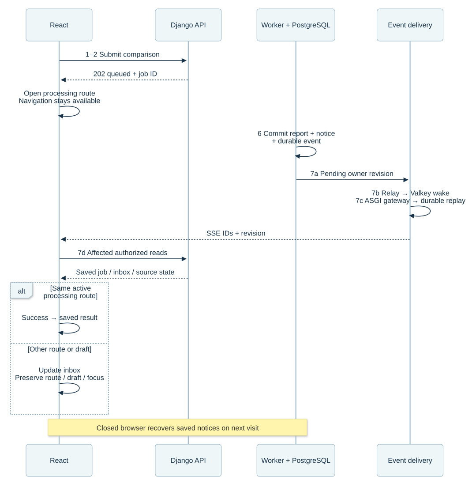
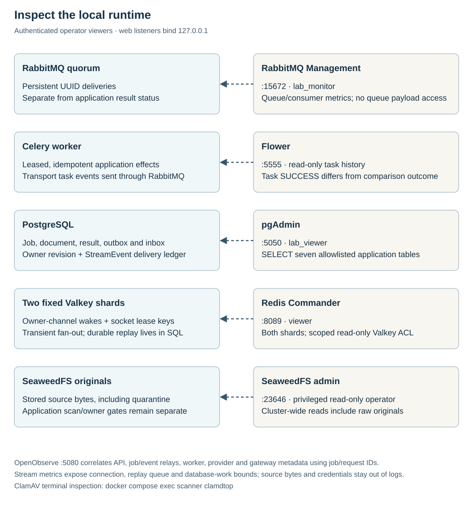

# Résumé comparison execution

A reviewer uploads or reuses a résumé, requests weighted evidence analysis and receives a report. Object storage preserves the original; PostgreSQL owns identity, lifecycle, dispatch intent and results. The browser reads persisted status while processing runs independently.

The canonical steps are **1 Submit · 2 Accept · 3 Relay · 4 Queue · 5 Process · 6 Save · 7 Read**. Solid arrows carry work; dashed arrows show concurrent reads or diagnostic metadata. [Requirements and decisions](design.md) establish the scope.

For the complete function-level trace, open the [upload-to-score Mermaid diagrams](upload-to-score-mermaid.md): overview, admission, RabbitMQ/Celery dispatch, retrieval/scoring and recovery/lifecycle. Each diagram has an editable source.

## 1–2 · Submit, store and admit

React sends multipart input and a UUID retry key through nginx. Django checks the session, CSRF, limits, ownership and payload identity before changing durable state.

[Diagram source](assets/admission-sequence.mmd)

Object PUT and database finalization are separate operations. The outbox exists only after confirmed source storage and finalization. A concurrent same-key request may receive an `uploading` reservation; it does not prove storage or queueing. An interrupted upload requires retrying the original unchanged input/key, or reservation expiry and cleanup. Saved-document comparison skips PUT and commits a new queued job/outbox against the owned, unexpired source.

## 3–6 · Dispatch, verify source and save

[Diagram source](assets/processing-sequence.mmd)

The local worker fetches and checksum-checks bytes, then calls ClamAV; AWS checks the GuardDuty clean tag before GET, with a bucket policy enforcing the same gate. The diagram groups that boundary rather than implying identical scanner order. Every comparison verifies the source; matching extraction can avoid parsing again. Explicit reprocessing parses it again.

Provider work occurs outside database locks. Completion locks document then job and rejects deleted/expired source or a stale lease. The terminal transaction saves the outcome and one owner-visible completion notice together; intermediate retries create no notice. Delivery/provider calls may repeat; one job/result relationship prevents duplicate committed reports. Worker execution can precede the relay's sent-marker commit. There is no total order across independent processes.

## 7 · Continue work and return to the outcome

[Diagram source](assets/completion-sequence.mmd) · [Decision and alternatives](decisions/0008-nonblocking-completion.md)

After a finalized receipt, React opens `/jobs/<id>` with navigation available. The reviewer can start another comparison or leave. PostgreSQL saves a completion/failure notification with the terminal outcome. `/notifications` links to `/results/<job-id>` on success or the job's safe failure page. **Mark as read** is a separate, idempotent action; report access never waits for it.

Only the same active processing page advances automatically. Completion elsewhere preserves the current route, draft and focus. Bounded background reads pause while hidden/offline and reconcile on return; a closed browser finds its saved notices on the next visit. This is in-app delivery.

Owner-authorized detail reads support direct result links. Session, navigation and deletion fences reject stale responses. [Timing, routes and operating contract →](implementation-guide.md#browser-state-and-isolation)

## Stored originals and lifecycle

Owners can download a ready original through an authorized, attachment-only, no-store response, create further comparisons or reprocess. Document deletion/expiry first blocks access and fences related jobs, then the relay retries physical deletion. Deleting an established comparison preserves its original. Cancelling the initial unfinished upload instead schedules that unready source for cleanup. [Lifecycle and cross-store recovery →](document-lifecycle.md)

## Failure and recovery

| Boundary | Durable response |
| --- | --- |
| PUT or finalization interrupted | Reservation/key survive; same-input retry or deadline cleanup; no unready outbox |
| Broker unavailable | Committed outbox remains unsent; confirmation ambiguity can repeat publication |
| Source missing/corrupt or scanner unavailable | No parse/provider/download bypass; visible bounded failure |
| GuardDuty scan pending | Requeue without using provider-attempt budget, within ten-minute job deadline |
| Worker interrupted | Lease/deadline reconciliation; stale completion cannot overwrite another claim |
| Source deleted/expired | Access denied and work fenced; failed object DELETE remains retryable |
| Viewer unavailable | Bounded best-effort diagnostic loss; business processing continues |

The provider budget is three claims with 2/4-second retry backoff and a ten-minute job deadline; leases last 90 seconds. Cloud scan pending uses its separate deferral within that deadline. [Exact operating/source reference →](implementation-guide.md)

## Inspect service boundaries

[Diagram source](assets/service-inspection.mmd)

RabbitMQ Management exposes backlog and consumers; Flower consumes task events;
pgAdmin reads the five application record tables; SeaweedFS admin inspects storage.
OpenObserve correlates API/relay/worker/provider lifecycle events, while `clamdtop`
shows the scanner's queue and signature state. These surfaces accompany the existing
seven business steps and do not become part of request completion.

Task completion is a transport observation: the application can reject a document
while Flower shows `SUCCESS`. PostgreSQL owns the comparison outcome. Database and
storage viewers are privileged synthetic-only operator surfaces; read-only storage
access includes raw/quarantined files and is separate from application owner/safety
checks. [Access, permissions and current verification →](implementation-guide.md#service-inspection)

## Evidence and deployment limits

The synthetic weights Python 3, Django 3, React 2 and unmatched PostgreSQL 2 produce **80%**. Application code validates literal quotes and skill mentions, then scores matched weight / total weight. This measures document evidence, not competence, truth or fairness.

Real Compose checks exercised originals, ClamAV, PostgreSQL, queued processing, storage/scanner outages and cleanup. Searchable metadata connects API, relay, worker and the HTTP provider; no document, filename, object key, signed URL or credential is logged. [Log search and evidence →](implementation-guide.md#search-one-job-across-services)

The [AWS service journey](aws-service-journey.md) uses separate Terraform and official-icon diagrams. It is source/mock-plan verified, not deployed. Local single-node services do not establish managed failover, capacity, organization identity, backup restoration or model quality. Those checks remain deployment acceptance work.
