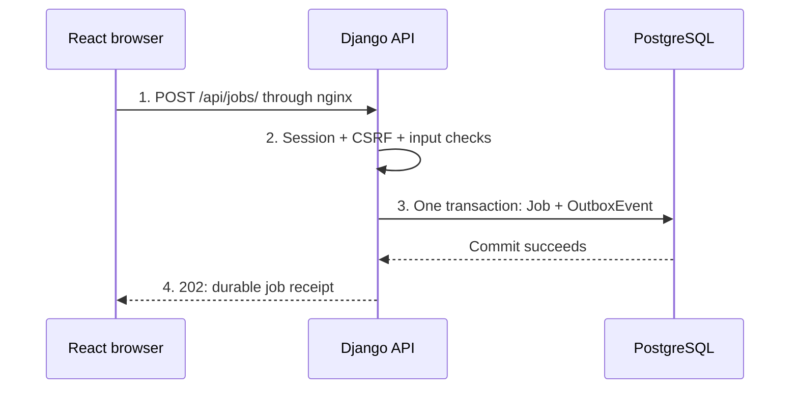
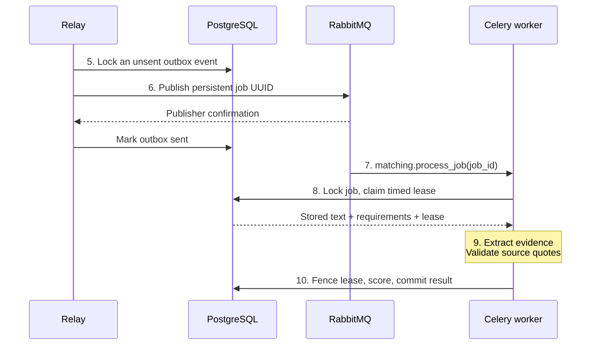
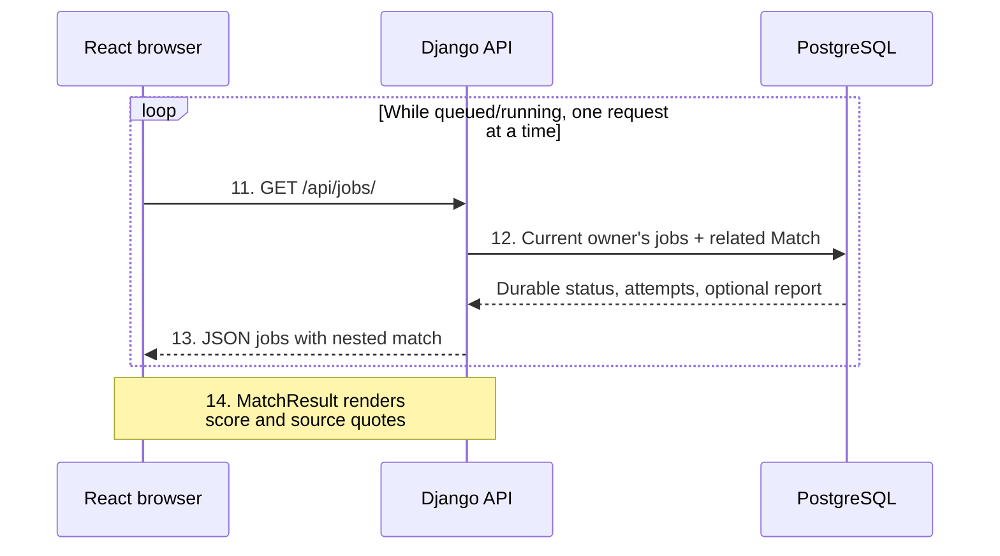
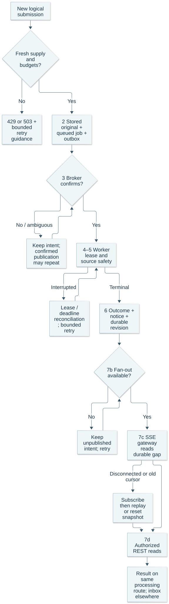
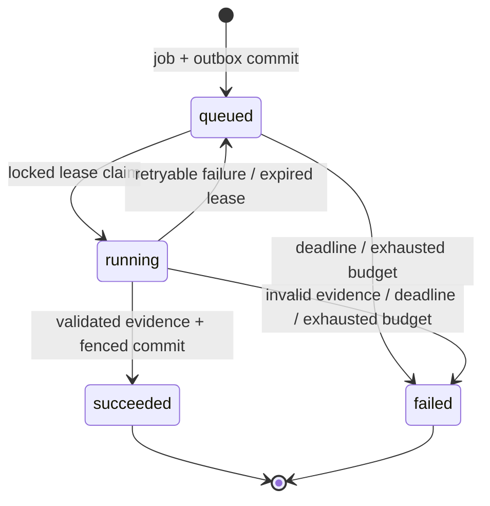
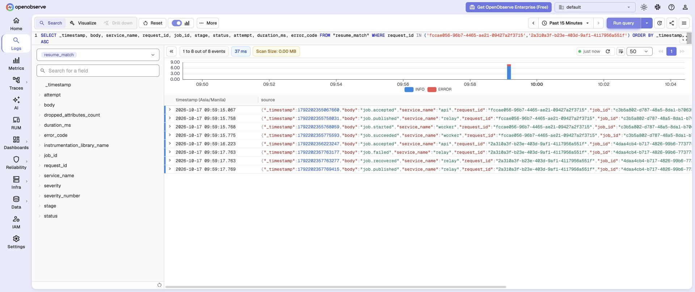
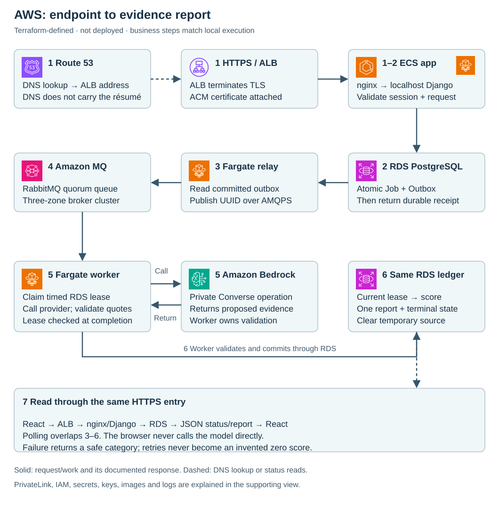

# Résumé comparison execution

Read [the scenario and vocabulary](design.md) first. This reference implements one
enterprise reliability pattern: durable admission of slow work, repeatable delivery,
and one committed result. We designed it as a résumé review aid and verify it using synthetic documents.

Solid numbered arrows carry business work. Dotted arrows carry diagnostic metadata
or the explicitly disabled external-provider option. All local services start together
with `./scripts/lab up`; database and broker ports remain private to Compose.

## One request in three phases

The synthetic sample mentions Python, Django and React. Their weights are 3, 3 and 2;
PostgreSQL adds an unmatched weight of 2. Validated coverage is `(3 + 3 + 2) / 10 = 80%`.
The score describes document evidence, not candidate quality.

### 1. Admit the request

Form events update React state; submit sends only the selected text or file. The API
helper sends CSRF and same-origin credentials; the submit handler supplies the retry key. nginx forwards
`/api/` to Django. Middleware establishes request identity before the view validates input.

The transaction also checks owner-scoped idempotency and charges the daily quota once.
`202` confirms a durable receipt; it does not promise a score or require a working broker.
A repeated unchanged submission can recover that same receipt.

### 2. Dispatch and process

The relay publishes a wakeup after the database commit. A broker confirmation and a
worker result are separate facts; PostgreSQL remains the business ledger.

Extraction runs outside the claim transaction. Completion locks the job again and checks
its current, unexpired lease token before saving one result and clearing temporary text.
Delivery and provider calls may repeat; the result relationship is unique per job.
A worker can consume the confirmed message before the relay commits its sent marker;
the sequence shows responsibilities, not a cross-process ordering guarantee.

### 3. Read and render the result

The browser polls the **owner's job collection**, not the detail endpoint. Each response
embeds any completed report; the UI derives its selected result from that server state.

Polling starts after a one-second delay, with a ten-second deadline per request. It stops
at terminal state and pauses on network errors. A fast local job can finish between polls,
so `running` need not appear on screen. Failed jobs display an error category without a score.

The [source handoffs](implementation-guide.md#source-handoffs) map these three phases to
exact functions, proxy configuration and route declarations.

## Failure and recovery

- **Broker down:** admission remains possible while PostgreSQL is available. Unsent
  outbox intent survives. If confirmation or its database update is uncertain,
  publication can repeat.
- **Duplicate or interrupted worker:** a short locked claim and token-fenced completion
  protect effects. The relay reconciles expired leases and stale queued wakeups.
- **Transient extraction failure:** at most three claims, 2/4-second retry backoff and a
  ten-minute job deadline. Permanent invalid evidence fails safely. No demo fallback.
- **Stale completion or deletion:** an old lease cannot overwrite a newer attempt;
  deletion and completion lock the same job. A unique job/result relationship prevents
  duplicate committed reports. Provider calls can still repeat or incur repeated charges.
- **Browser/network error:** same-payload manual retry retains its key. Changed inputs
  use a new key. The server rejects a conflicting payload under an existing key.
- **Log viewer down:** bounded background telemetry can lose events; business state
  remains in PostgreSQL. Stdout is a fallback, not a durable audit ledger.

Real broker/worker pause and restart experiments verified durable delivery and eventual
single-result completion. PostgreSQL concurrency tests cover duplicate claims, fenced
completion and deletion races. Expired leases and exhaustion are tested; a mid-provider
process kill has not been measured as a live cloud experiment.

## Data, AI and authorization boundaries

Only bounded, selectable text is parsed; no OCR or DOCX. PDF normalization remains in
the API; evidence extraction is the worker responsibility. Queue messages contain only
the job UUID. Temporary source text stays in PostgreSQL until terminal state or deletion;
evidence excerpts remain until report deletion. Backups may retain old rows.

The default provider is a local literal extractor. The Bedrock adapter has mocked SDK
tests; no AWS credentials are mounted and no calls are authorized. System instructions
are separated from document data, but that alone is not an injection guarantee. Quotes
must appear in the source and contain a bounded skill mention; negation, truth and
positive experience still require human judgment.

Sessions identify reviewers; owner-scoped queries protect jobs/results. CSRF protects
browser mutations including login. This is account isolation, not organization tenancy.
The UI clears drafts, files and private state on logout/authentication loss and rejects
stale responses. See [ADR 0002](decisions/0002-evidence-and-data-boundaries.md).

## Follow the operational path

API, relay and worker export fixed lifecycle metadata to OpenObserve through bounded
OpenTelemetry background batches. Correlate using the request/job IDs shown in the UI.
See [ADR 0004](decisions/0004-searchable-observability.md), the [exact log search](implementation-guide.md#search-one-job-across-services)
and [verification evidence](implementation-guide.md#verified-local-behavior). Lifecycle logs exclude document text, quotes, prompts, provider payloads,
filenames, usernames, credentials, cookies, headers and raw exceptions.

| Safe field | Operational question |
| --- | --- |
| timestamp | When was this event observed? Cross-process arrival order can differ. |
| service_name / event | Which process reached which lifecycle boundary? |
| request_id / job_id | Which submission connects these events and database state? |
| status | Is work queued, running, terminal or awaiting publication? |
| attempt | Is this the first claim or a bounded retry? |
| duration_ms | How long did the measured processing boundary take? |
| error_code | Which safe failure category should be investigated? |

Not every event has every field. These are logs, not a distributed trace or a metrics
dashboard. Job IDs are useful search fields; they are unsuitable as one metric label
per job. Best-effort diagnostics do not replace the persisted attempt/deadline ledger.

## What a broader deployment would add

This separate diagram is a design discussion. Production work includes SSO/RBAC and
tenant policy; TLS/network protections; malware scanning; capacity and availability
targets; backups and restore drills; retention/deletion across backups; alerts; provider
spend limits; model/fairness evaluation and legal review for the intended use. No
throughput, SLA or production readiness is certified.

Kafka is omitted because there are no independent replay consumers or retained stream
requirements. Redis is omitted because no cache bottleneck or separate result backend
is needed. More boxes would not strengthen this flow's stated guarantees.

The illustration explains validation before scoring; it is not infrastructure. Continue
with [the implementation reference](implementation-guide.md), [ADRs](decisions/0001-durable-background-work.md)
and [research](research.md).
