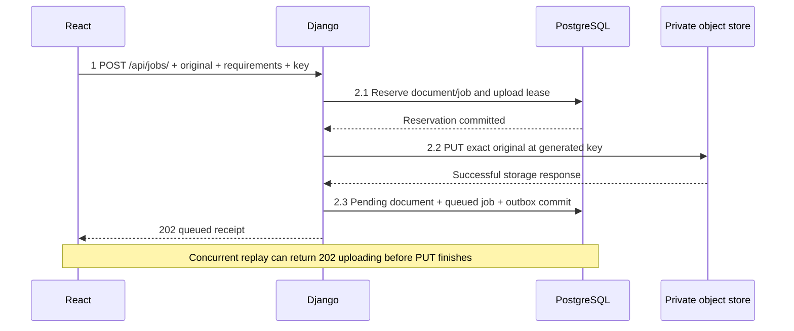
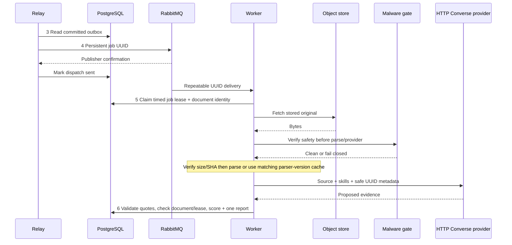
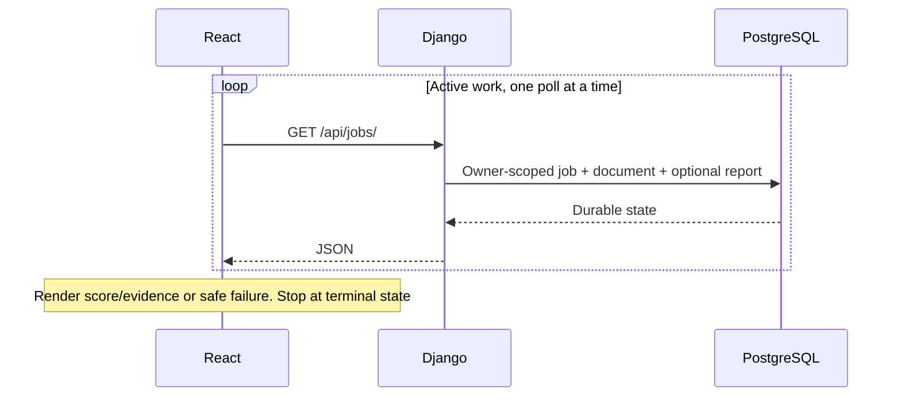

# Résumé comparison execution

A reviewer uploads or reuses a résumé, requests weighted evidence analysis and receives a report. Object storage preserves the original; PostgreSQL owns identity, lifecycle, dispatch intent and results. The browser reads persisted status while processing runs independently.

The canonical steps are **1 Submit · 2 Accept · 3 Relay · 4 Queue · 5 Process · 6 Save · 7 Read**. Solid arrows carry work; dashed arrows show concurrent reads or diagnostic metadata. [Requirements and decisions](design.md) establish the scope.

## 1–2 · Submit, store and admit

React sends multipart input and a UUID retry key through nginx. Django checks the session, CSRF, limits, ownership and payload identity before changing durable state.

Object PUT and database finalization are separate operations. The outbox exists only after confirmed source storage and finalization. A concurrent same-key request may receive an `uploading` reservation; it does not prove storage or queueing. An interrupted upload requires retrying the original unchanged input/key, or reservation expiry and cleanup. Saved-document comparison skips PUT and commits a new queued job/outbox against the owned, unexpired source.

## 3–6 · Dispatch, verify source and save

The local worker fetches and checksum-checks bytes, then calls ClamAV; AWS checks the GuardDuty clean tag before GET, with a bucket policy enforcing the same gate. The diagram groups that boundary rather than implying identical scanner order. Every comparison verifies the source; matching extraction can avoid parsing again. Explicit reprocessing parses it again.

Provider work occurs outside database locks. Completion locks document then job and rejects deleted/expired source or a stale lease. Delivery/provider calls may repeat; one job/result relationship prevents duplicate committed reports. Worker execution can precede the relay's sent-marker commit. There is no total order across independent processes.

## 7 · Read and render

Polling starts after a one-second delay, with a ten-second request timeout; a fast job may finish between reads. Failed polling pauses updates without changing durable work. Unchanged-input retry retains admission identity; changed input receives a new key. Authentication loss clears private UI state.

## Stored originals and lifecycle

Owners can download a ready original through an authorized, attachment-only, no-store response, create further comparisons or reprocess. Document deletion/expiry first blocks access and fences related jobs, then the relay retries physical deletion. Deleting an established comparison preserves its original. Cancelling the initial unfinished upload instead schedules that unready source for cleanup. [Lifecycle and cross-store recovery →](document-lifecycle.md)

## Failure and recovery

| Boundary | Durable response |
| --- | --- |
| PUT or finalization interrupted | Reservation/key survive; same-input retry or deadline cleanup; no unready outbox |
| Broker unavailable | Committed outbox remains unsent; confirmation ambiguity can repeat publication |
| Source missing/corrupt or scanner unavailable | No parse/provider/download bypass; visible bounded failure |
| GuardDuty scan pending | Requeue without using provider-attempt budget, within ten-minute job deadline |
| Worker interrupted | Lease/deadline reconciliation; stale completion cannot overwrite another claim |
| Source deleted/expired | Access denied and work fenced; failed object DELETE remains retryable |
| Viewer unavailable | Bounded best-effort diagnostic loss; business processing continues |

The provider budget is three claims with 2/4-second retry backoff and a ten-minute job deadline; leases last 90 seconds. Cloud scan pending uses its separate deferral within that deadline. [Exact operating/source reference →](implementation-guide.md)

## Evidence and deployment limits

The synthetic weights Python 3, Django 3, React 2 and unmatched PostgreSQL 2 produce **80%**. Application code validates literal quotes and skill mentions, then scores matched weight / total weight. This measures document evidence, not competence, truth or fairness.

Real Compose checks exercised originals, ClamAV, PostgreSQL, queued processing, storage/scanner outages and cleanup. Searchable metadata connects API, relay, worker and the HTTP provider; no document, filename, object key, signed URL or credential is logged. [Log search and evidence →](implementation-guide.md#search-one-job-across-services)

The [AWS service journey](aws-service-journey.md) uses separate Terraform and official-icon diagrams. It is source/mock-plan verified, not deployed. Local single-node services do not establish managed failover, capacity, organization identity, backup restoration or model quality. Those checks remain deployment acceptance work.
