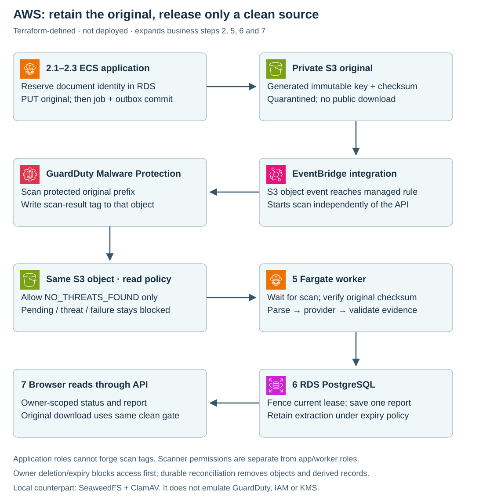
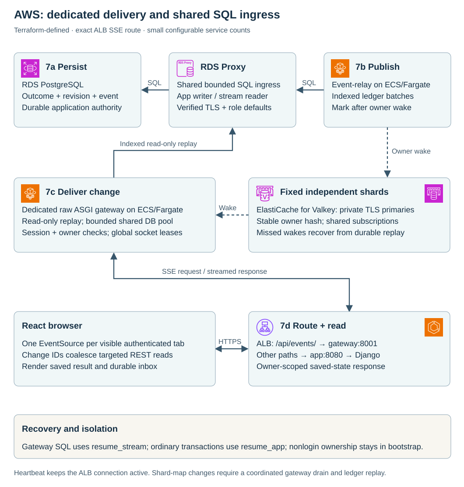
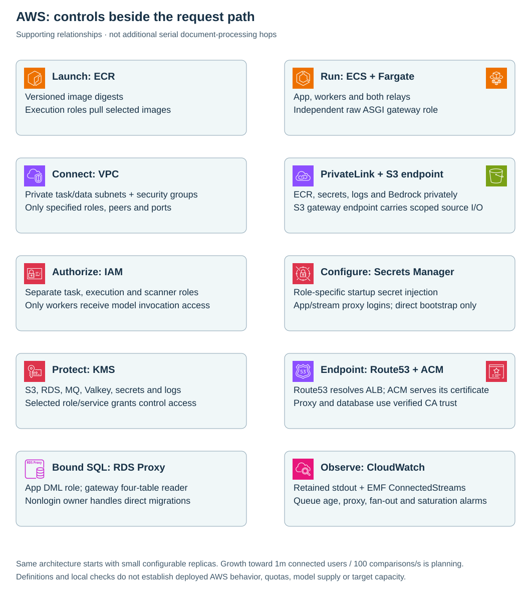

# One comparison across AWS

The AWS design preserves the same seven business steps as local execution: a reviewer submits or reuses an original, background work validates evidence, and the browser reads a durable report. Original objects and application records have separate owners; neither a queue nor the model owns the result.

**Local execution verified; AWS deployment defined and mock-plan checked, not deployed.** The [local architecture](architecture.md) and this view share **1 Submit · 2 Accept · 3 Relay · 4 Queue · 5 Process · 6 Save · 7 Read**.

## 1–2 · Reach the application, store the original and admit

Route 53 resolves the endpoint; it does not proxy documents. ACM supplies the ALB certificate. The HTTPS load balancer reaches a private ECS/Fargate task containing nginx and Django, which validates session, CSRF, ownership and retry identity. New logical admission checks owner fairness, finite rate/active budgets and fresh processing supply; `429`/`503` rejects new work while previously accepted jobs remain recoverable.

Application connections use RDS Proxy with a separate read/write login. RDS PostgreSQL first records a new source reservation and upload lease. The application releases its database connection and PUTs exact bytes into private S3, then commits pending document + queued job + outbox in RDS. Object storage and RDS are separate consistency boundaries. A concurrent `202 uploading` means reservation only; the finalized queued receipt confirms storage/admission. Reusing an owned source skips a new PUT.

S3 retains originals under generated `originals/` keys with SSE-KMS. S3 notifications reach EventBridge; GuardDuty Malware Protection for S3 manages its scan rule, reads new objects through its service role, and writes the scan-result tag. This is scanner integration, not an additional comparison queue. Application roles cannot forge the tag. A bucket policy denies original reads until `NO_THREATS_FOUND`, except the scanning role itself.

## 3–4 · Dispatch committed work

The Fargate relay reads the RDS outbox and drains productive batches through a reused confirmed producer, publishing only the job UUID over TLS to Amazon MQ for RabbitMQ. Confirmation permits its sent marker; worker delivery may begin before that marker commits. The application declares the quorum queue; the managed broker spans three availability zones. RDS owns business state when confirmation or delivery repeats.

## 5–6 · Verify source, extract evidence and save

The Fargate worker obtains an RDS lease, checks the GuardDuty result, fetches S3 bytes and verifies size/SHA-256. Pending scan tags defer processing within the ten-minute job deadline without consuming provider-attempt budget. Failed, unsupported or inaccessible scans fail closed. A parser-version cache avoids repeated parsing; explicit reprocessing reads/parses the retained source again.

External object, scanner and model work holds no database connection. Only the worker invokes Bedrock Converse through PrivateLink. Bedrock returns proposed quotes; application code checks source/skill evidence, computes coverage and saves one report and its terminal in-app notification in the same RDS transaction after locking owner stream → document → job and verifying the current source/lease. That transaction also records durable delivery events and releases admission capacity. Delivery and model calls may repeat, but a stale attempt cannot overwrite the committed result.

## 7 · Return the outcome and manage the source

React opens a resumable processing route after acceptance. The event relay publishes the committed owner revision to its stable ordered Valkey shard. PostgreSQL owns recovery and outcomes; Valkey supplies ephemeral wakes and bounded owner connection leases. A dedicated raw ASGI gateway subscribes before replay, authenticates sessions through its SELECT-only RDS Proxy identity, and emits minimal change IDs over SSE.

The ALB routes exactly `/api/events/` to gateway port 8001; ordinary REST/UI requests reach nginx/API on 8080. The browser then reads only affected authorized records. Only the same processing page advances to its result. Elsewhere the durable inbox updates without replacing a draft. Hidden/offline tabs disconnect; reconnect reconciles saved state, and stream failure does not initiate automatic REST polling.

Owners can retrieve a ready original through an authorized attachment response, reuse it, reprocess it, or request deletion. Expiry/deletion fence access and work before retried S3 cleanup. [Lifecycle policy →](document-lifecycle.md)

## Supporting responsibilities

| Role | Service and boundary |
| --- | --- |
| Launch | ECR supplies immutable application images. The shared S3 gateway endpoint preserves ECR layer access alongside narrowly scoped document operations. |
| Private networking | VPC routes/security groups restrict peers and ports; PrivateLink reaches ECR, secrets, logs and Bedrock. No NAT or general internet egress is needed by the selected cloud scan design. |
| Authorization | IAM separates execution, direct bootstrap, API upload/download, worker read/model, relay delete, event relay, gateway and scanner integration permissions. Delivery roles cannot read originals or invoke Bedrock. |
| Configuration | Secrets Manager injects startup secrets. Bootstrap alone retrieves the RDS-managed master secret. |
| Encryption | KMS protects configured objects, database, messaging, images, secrets and logs. S3-mediated permissions are constrained by service and object encryption context. |
| Operations | CloudWatch receives safe container events and monitors admission/queue age, event lag, stream connections, proxy pressure and shard health. Optional existing SNS destinations deliver operational alarms; these are separate from the application completion inbox. |

DNS/certificate validation, image publication, secret provisioning, scan-plan readiness and database bootstrap precede normal admission. They are [deployment dependencies](../infra/terraform/README.md), not invented sequential request hops.

## Local counterpart and limits

| Responsibility | Local | AWS | Unproven by local execution |
| --- | --- | --- | --- |
| Entry/compute | Loopback nginx + Django | Route 53/ACM/ALB + ECS/Fargate | Public TLS, scaling and federation |
| Originals | Persistent SeaweedFS S3 API | Private S3 + SSE-KMS | Managed durability, IAM and lifecycle execution |
| Malware gate | ClamAV daemon + definition checks | GuardDuty + EventBridge + clean tag | Same engine, tag timing or AWS enforcement |
| Records/results | PostgreSQL; dedicated read-only viewer | Multi-AZ RDS + RDS Proxy | Restore, failover, pooling/pinning and real cloud TLS |
| Delivery | Relay + single-node RabbitMQ quorum queue | Relay + three-zone Amazon MQ | Multi-node/zone recovery |
| Connected delivery | Two independent Valkey shards + two ASGI processes | Private encrypted multi-AZ Valkey groups + independently scaled gateway/event relay | Managed failover, fleet reconnect/API load and actual socket capacity |
| Evidence API | SDK → deterministic HTTP Converse service | Worker role → private Bedrock | Model quality, quotas, billing or managed inference |
| Diagnostics | OTLP → OpenObserve | Stdout → CloudWatch/alarms | Equivalent dashboards or cloud ingestion |

## Implementation and Terraform

Exact source and resource map

| Boundary | Application | Terraform |
| --- | --- | --- |
| Entry/admission | [admit_jobs / document_download](https://github.com/junrillg/resume-match-bedrock/blob/4e69a31653b4dd78de6ac35ff59bace3b798ac6e/backend/matching/views.py) · route declarations in `backend/config/urls.py` | [ingress.tf](https://github.com/junrillg/resume-match-bedrock/blob/4e69a31653b4dd78de6ac35ff59bace3b798ac6e/infra/terraform/ingress.tf) · [compute.tf](https://github.com/junrillg/resume-match-bedrock/blob/4e69a31653b4dd78de6ac35ff59bace3b798ac6e/infra/terraform/compute.tf) |
| Object/scanner access | [source and scanner adapter](https://github.com/junrillg/resume-match-bedrock/blob/4e69a31653b4dd78de6ac35ff59bace3b798ac6e/backend/matching/documents.py) | [documents.tf](https://github.com/junrillg/resume-match-bedrock/blob/4e69a31653b4dd78de6ac35ff59bace3b798ac6e/infra/terraform/documents.tf): originals bucket, policies, scan role/plan and notifications |
| Metadata/leases/results | [Document / Job / Match](https://github.com/junrillg/resume-match-bedrock/blob/4e69a31653b4dd78de6ac35ff59bace3b798ac6e/backend/matching/models.py) · [relay_once / run_job / finish_job](https://github.com/junrillg/resume-match-bedrock/blob/4e69a31653b4dd78de6ac35ff59bace3b798ac6e/backend/matching/jobs.py) | [data.tf](https://github.com/junrillg/resume-match-bedrock/blob/4e69a31653b4dd78de6ac35ff59bace3b798ac6e/infra/terraform/data.tf): RDS and MQ |
| Queue declaration | `backend/config/celery.py` | [data.tf](https://github.com/junrillg/resume-match-bedrock/blob/4e69a31653b4dd78de6ac35ff59bace3b798ac6e/infra/terraform/data.tf): three-zone MQ |
| Model boundary | [Converse / evidence validation](https://github.com/junrillg/resume-match-bedrock/blob/4e69a31653b4dd78de6ac35ff59bace3b798ac6e/backend/matching/services.py) | `identity.tf` worker model grant and `network.tf` Bedrock endpoint |
| Event delivery | [events.py](https://github.com/junrillg/resume-match-bedrock/blob/4e69a31653b4dd78de6ac35ff59bace3b798ac6e/backend/matching/events.py) · [raw ASGI gateway](https://github.com/junrillg/resume-match-bedrock/blob/4e69a31653b4dd78de6ac35ff59bace3b798ac6e/backend/event_gateway.py) · `frontend/src/workspaceEvents.ts` | `fanout.tf`, `database_proxy.tf`, exact route in `ingress.tf`, bounds in `scaling.tf` |
| Network/identity | `backend/config/settings.py` cloud TLS/config | [network.tf](https://github.com/junrillg/resume-match-bedrock/blob/4e69a31653b4dd78de6ac35ff59bace3b798ac6e/infra/terraform/network.tf) · [identity.tf](https://github.com/junrillg/resume-match-bedrock/blob/4e69a31653b4dd78de6ac35ff59bace3b798ac6e/infra/terraform/identity.tf) |
| Logs | [allowlisted emit](https://github.com/junrillg/resume-match-bedrock/blob/4e69a31653b4dd78de6ac35ff59bace3b798ac6e/backend/matching/telemetry.py) | `monitoring.tf` and `data.tf` log groups |

The [deployment runbook](../infra/terraform/README.md) covers real-account prerequisites, protected state, images, bootstrap, ACTIVE scanner checks, enablement and preservation. Mocked plans verify configuration invariants, not actual IAM enforcement or scan operation. Capacity, managed failover, restore-time deletion reconciliation, alert ownership and model evaluation remain deployment acceptance work.

Valkey is selected for live owner fan-out; it is separate from the RabbitMQ job queue and PostgreSQL replay ledger. Kafka and Step Functions have no additional required responsibility in this flow. CloudFront, API Gateway and Cloud Map are also omitted deliberately. S3 originals are an implemented design addition under [ADR 0006](decisions/0006-durable-document-lifecycle.md), superseding the earlier storage exclusion in [ADR 0005](decisions/0005-aws-service-journey.md).

## Capacity and deployment profile

The initial AWS profile has three gateways (maximum twelve), two API tasks and two workers, with independent scale controls. Admission starts at two logical jobs/second, 32 active jobs and two per owner; these inputs must rise with measured worker/model supply. Three private `/20` subnets, explicit connection/client/target budgets and connection/CPU/memory policies preserve a configurable growth path. RDS Proxy bounds connection supply rather than adding SQL execution capacity.

One million connected users and 100 comparisons/second remain planning inputs, not the small profile's capacity claim. Lifetime-driven reconnects create full-reconciliation traffic even without changes; gateway socket count alone cannot size REST, database or provider supply. [Bounds, evidence and deployment decision →](decisions/0010-bounded-deployment.md)
