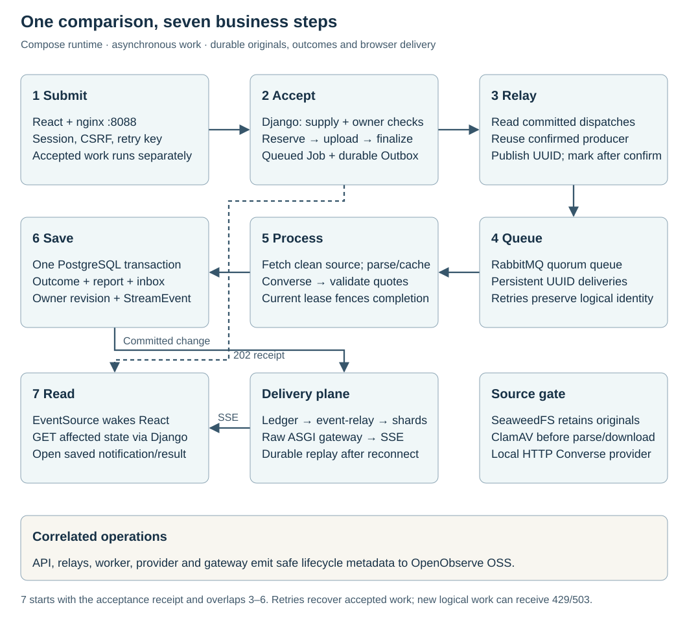

# Résumé review design

The system preserves an uploaded original, processes comparisons independently of the browser and returns checked evidence with an application-owned score. Its core boundaries are durable source storage, recoverable dispatch, fenced results and owner-controlled retrieval/deletion.

## Requirements and data ownership

| Input or record | Contract / owner |
| --- | --- |
| Original | PDF/TXT up to 1 MiB; pasted UTF-8 snapshot; private object storage retains exact bytes |
| Document record | PostgreSQL owns account, generated key, checksum, media type, lifecycle and expiry |
| Extraction | Up to 10 PDF pages / 30,000 characters; PostgreSQL cache records parser version |
| Comparison | 1–20 unique weighted requirements; PostgreSQL job/outbox/result records |
| Completion | One terminal notification per job; owner inbox/read state shares source/job retention |
| Access | Authenticated owner, CSRF on browser mutations, clean-only attachment download |
| Retention | Configurable 90-day policy for documents/derived results; earlier owner deletion |

These are project requirements, not industry capacity targets. Admission permits 20 logical jobs per owner per UTC day. Account isolation is implemented; organization tenancy and federated identity are separate deployment requirements. No automated hiring decision is made.

## Scale inputs

The architecture target is **1,000,000 simultaneously connected users** and a peak
**100 comparisons/second**. Browser tabs, upload reuse, service time and provider token
quotas affect the resulting infrastructure budget. Initial execution starts small with
the same event-driven code path; increasing capacity must not require replacing polling
or an in-memory durability substitute. [Delivery design and measured local envelope →](decisions/0009-event-driven-completion.md)

The local run verifies 1,000 connected owners and one real queued comparison. It does
not measure the target processing rate or million-user capacity. Deployment sizes and
capacity evidence remain distinct from the implemented mechanisms.
The deployment definition follows [ADR 0010](decisions/0010-bounded-deployment.md):
small initial replicas, independently scalable SSE/fan-out, bounded database and
processing supply, and credential-free infrastructure checks. Its configuration and
local mechanisms are verified; no managed-cloud capacity or deployment is implied.

## Flow and consistency

Steps **1 Submit · 2 Accept · 3 Relay · 4 Queue · 5 Process · 6 Save · 7 Read** are shared across the [architecture](architecture.md), [document lifecycle](document-lifecycle.md) and [AWS journey](aws-service-journey.md).

Unchanged-key recovery precedes new-work limits. New logical jobs reserve finite owner/global capacity only when sampled broker/worker supply is fresh and queue age is acceptable; `429`/`503` rejection leaves accepted work intact.

New-source admission has three boundaries: reserve document/job identity in PostgreSQL; PUT the original; then commit pending document + queued job + outbox together. The object service and database do not share a transaction. Reserved-upload identity, leases, deadlines and reconciliation close partial-write/deletion failures. A concurrent replay can return `202 uploading`; only a finalized queued receipt confirms stored source. Saved-source reuse queues another comparison without uploading again.

After commit, the relay publishes only a UUID through a reused confirmed producer, draining productive batches without an unconditional sleep. A separate bounded maintenance loop samples supply and reconciles leases/cleanup. The worker fetches verified source, passes the malware gate, parses or reuses matching extraction, calls the evidence provider, validates quotes, and saves a fenced score/result and terminal notification atomically. External source/scanner/provider I/O releases database connections. Completion locks owner stream → document → job and atomically adds durable owner revisions and releases admission. The event relay and SSE gateway signal targeted authorized reads. At-least-once delivery and provider calls can repeat; the database permits one committed report per job.

## Service choices

| Responsibility | Local service | Decision |
| --- | --- | --- |
| Entry and owner access | React/nginx + Django | [Runtime](decisions/0003-container-runtime.md) |
| Originals and integrity | SeaweedFS S3-compatible storage | [Durable lifecycle](decisions/0006-durable-document-lifecycle.md) |
| Metadata, state and results | PostgreSQL | [Background work](decisions/0001-durable-background-work.md) |
| Delivery and reconciliation | Relay + RabbitMQ + Celery worker | [Background work](decisions/0001-durable-background-work.md) |
| Connected browser delivery | PostgreSQL event ledger + event relay + two independent Valkey shards + two raw ASGI gateway processes | [Durable events](decisions/0009-event-driven-completion.md) |
| Untrusted-file gate | ClamAV locally; GuardDuty in AWS design | [Durable lifecycle](decisions/0006-durable-document-lifecycle.md) |
| Proposed evidence | Separate HTTP Converse service / Bedrock | [Evidence boundary](decisions/0002-evidence-and-data-boundaries.md) |
| Correlated diagnostics | OpenObserve + bounded OTLP export | [Observability](decisions/0004-searchable-observability.md) |

Valkey supplies owner-channel wakeups and bounded connection leases, not a cache or the source of business truth. PostgreSQL owns replay and saved outcomes. Kafka has no retained-stream consumer here. Business scope stays small while storage/recovery/access mechanisms remain complete for the stated flow.

## Service inspection

The local runtime includes a connected inspection surface for every selected service.
Viewer coverage is part of the operating contract, including startup, private access,
meaningful sample activity and documented interpretation. It does not change the seven
business steps or authorize AWS access. [ADR 0007](decisions/0007-service-inspection.md)
records the service inventory and least-privilege boundaries.

| Service boundary | Inspection surface | What it establishes |
| --- | --- | --- |
| React/nginx + Django API | Existing application plus browser Network panel | Request/status/response and owner-visible report |
| Celery worker | Flower at `127.0.0.1:5555/tasks` | Worker heartbeat and transport task lifecycle; comparison outcome remains in PostgreSQL |
| RabbitMQ | Management at `127.0.0.1:15672/#/queues` | Quorum queue, consumers, ready/unacknowledged messages and delivery activity |
| PostgreSQL | pgAdmin at `127.0.0.1:5050`, dedicated read-only database role | Document/job/outbox/result/notice plus stream-state/event records; seven allowlisted tables |
| SeaweedFS | Authenticated read-only `weed admin` at `127.0.0.1:23646/files?path=/buckets/resume-originals` | Cluster/bucket/object inventory; privileged raw-object visibility is separate from the owner-scoped application |
| Valkey fan-out | Read-only viewer at `127.0.0.1:8089` | Two independent owner-wake shards and bounded connection leases; no result-store claim |
| API/relay/worker/provider/event-relay/gateway diagnostics | Existing OpenObserve | Correlated, payload-free lifecycle events and delivery/admission health |
| Relay | OpenObserve plus supported process/heartbeat inspection | Dispatch intent and publication/recovery without inventing a separate relay GUI |
| ClamAV | Official `clamdtop` terminal dashboard, plus health and OpenObserve safety events | Scan queue, memory/signature readiness and rejection; daemon port stays private |
| Local Converse provider | OpenObserve and existing health endpoint | Separate HTTP hop and safe success/rejection state; no live Bedrock console claim |
| Initialization/migrations | Compose completion state and bounded operational output | Successful prerequisite completion; no extra permanent dashboard |

All new host listeners bind loopback. Separate viewer passwords are generated into the existing
owner-only ignored environment and shown only by the explicit private credentials
command. Existing credentials and named volumes remain intact. Monitoring must not
require enabling Celery remote-control commands or exposing raw database, S3, scanner,
filer/master, gRPC or AMQP ports. SeaweedFS administration is a privileged synthetic-only
operator surface: read-only is cluster-wide and does not imply owner-scoped or
clean-only reads. Its separate login must not be presented as an application user
account. Research must resolve any viewer capability or privilege uncertainty before
wiring that viewer; an unavailable GUI must be reported with its supported inspection
alternative, never silently skipped.

## Inspection evidence

RabbitMQ, Flower and SeaweedFS populated browser checks passed in the earlier viewer milestone. SQL privilege checks establish the seven-table read-only boundary; pgAdmin's final populated connection review remains pending. Later SSE runtime checks exercised both wake shards and two gateway processes. Source/runtime checks do not replace a hosted interface review. [Observed results and operating reference →](implementation-guide.md#service-inspection)

## Failure boundaries

Object outage leaves recoverable upload identity, not a processable missing source. Unavailable supply rejects new logical work; already accepted broker intent and outcomes stay durable. Fan-out publication and browser reconnection recover from the PostgreSQL event ledger. Pending cloud scans defer provider work within the job deadline; failed/unavailable scanning fails closed. Token checks prevent stale completion. Document deletion/expiry denies access and fences related work before retried object cleanup. Diagnostics can fail without failing business processing.

The [lifecycle reference](document-lifecycle.md) defines source and derived-data cleanup, the seven-day cloud backup window, and restore-time reconciliation. Local logs retain three days; configured CloudWatch logs retain 30 days. Malware scanning reduces risk, and retained evidence can still be personal data.

## Delivery record

Existing history is preserved. Research and ADR 0006 were committed before the durable-storage changes; subsequent verified milestones are recorded with their actual commits in the [implementation reference](implementation-guide.md#actual-build-history). The source-retention portions of ADRs 0002/0005 are superseded; their earlier decisions remain traceable.

| Durable-document milestone | Acceptance |
| --- | --- |
| Research/design | Primary sources, data inventory and lifecycle/recovery decision |
| Local processing | Real object/scanner flow, PostgreSQL isolation/concurrency, outage and cleanup checks |
| AWS configuration | Private S3/scanner/IAM/endpoint/KMS wiring and mocked plan assertions |
| Document UI | Source selection, authorized download/reprocess/deletion and verified status/error states |
| Architecture communication | Matching diagrams, source links, operating contracts and evidence |

The [research](research.md) supports these choices. Passing local checks and mocked Terraform plans does not certify cloud operation, high availability or universal production readiness.

## Processing and completion journey

The event-delivery milestone is governed by [ADR 0009](decisions/0009-event-driven-completion.md):
**one million simultaneous users**, dedicated asynchronous SSE delivery, durable event
recovery and bounded event-driven reads. Its deployment target and measured local
capacity are separate. The local implementation replaces recurring browser polling
with SSE signals and targeted authorized reads. Stream heartbeats do not query the
database; fan-out recovery reconciles the durable revision ledger. Terraform defines
that same path with small initial capacity. [Delivery topology](architecture.md#7--continue-work-and-return-to-the-outcome) and the [AWS journey](aws-service-journey.md) show both execution and connected delivery.

[ADR 0008](decisions/0008-nonblocking-completion.md) defines the shipped processing, inbox and result routes. Action pending state is separate from worker progress; saved completion notices survive leaving the page. A paused-worker browser run verified a second submission, an unchanged off-route draft, explicit notification access, result refresh, read persistence and completion while the app tab was closed. The design, durable inbox and UI were verified and published as separate milestones.

## Repository presentation · 11 November 2026

Audience: reviewers exploring the evidence workbench and engineers running its local
synthetic flow. Keep the existing name and product palette (`#172b35`, `#17665f`,
`#f6f5ef`, `#b9d4bd`). The README follows identity → proof → capabilities → first use →
system → deeper documentation. Application redesign, cloud deployment, remote settings,
commit/push and new policy commitments are outside this change.

Acceptance: claims and commands trace to source; the logo works at 32/88 px on light
and dark grounds; the social PNG matches its editable source and is 1280 × 640 under
1 MB; local links resolve; the overview represents input, durable acceptance,
processing, saved outcome, delivery and recovery. Stop after one independent material
review and corrections. Browser-only checks remain explicit if access is unavailable.

| Surface | Status | Evidence / next action |
| --- | --- | --- |
| Identity | Implemented, raster-inspected | Original source-document/evidence-seal [logo](assets/logo.svg); existing palette retained; 32/88 px inspections passed. |
| README and participation | Implemented, source-checked | [README](../README.md), [contributing](../CONTRIBUTING.md); commands, real workflow target and provider boundaries checked against source. |
| Product proof and first use | Executed and verified | `make up` completed; `make sample` returned 202, score 100, eight SSE changes and successful fixture/original cleanup. Selected actual JSON fields appear in README. |
| System explanation | Implemented, source/raster-checked | Connected [local overview](assets/architecture-lifecycle.html) and source coverage ledger in [architecture](architecture.md); AWS remains a separately labeled design. |
| GitHub metadata | Prepared locally | Proposed values below; no remote settings changed. |
| Rendering | Partly verified; browser blocked | Native SVG raster inspection available. Browser inventory returned “browser access host is unavailable”; desktop/mobile light/dark README and HTML interaction checks remain unverified. |
| License and security policy | MIT implemented; reporting channel owner-deferred | Owner selected MIT; [LICENSE](../LICENSE) added. Vendor asset notices retained. No private reporting channel or maintainer commitment invented. |

### Prepared GitHub metadata

- Description: `Résumé evidence workbench with weighted requirements, checked source excerpts, durable background jobs, and a source-grounded AWS Bedrock design.`
- Homepage: leave unset; no hosted application verified.
- Topics: `resume-matching`, `evidence-review`, `react`, `django`, `postgresql`, `celery`, `rabbitmq`, `valkey`, `docker-compose`, `aws-bedrock`, `terraform`.
- Social image: [social-preview.png](assets/social-preview.png), editable [SVG](assets/social-preview.svg). Prepared, not uploaded.

The mark and social source are original project artwork; no vendor marks appear in
these identity assets. System text uses Arial/Helvetica with system fallback; no fonts
or image resources load remotely. The social PNG follows the [GitHub image size
and format guidance](https://docs.github.com/en/repositories/managing-your-repositorys-settings-and-features/customizing-your-repository/customizing-your-repositorys-social-media-preview), checked 11 November 2026.

### Executed checks and remaining limits

`make help`, `make test-cli` (10 tests) and `docker compose config --quiet` passed.
`make up` built and started the local services with Python 3.13 on PATH. Initial
sample processing failed closed because clamd had loaded 20-day-old signatures
before the updated database was available. Restarting only the scanner loaded fresh
signatures; the repeated `make sample` passed HTTP acceptance, broker dispatch,
worker/provider execution, saved result/notification, durable ledger, SSE and
owner-authorized retrieval. Both fixture-record and physical-original cleanup passed.
The README documents the observed scanner reload workaround; application code is
unchanged. Default system Python is 3.10 here, so documented Python 3.12+ must be on PATH.

Successful synthetic job: `eac74967-9d2a-49be-a7da-189c34394bd4`; request:
`1ce1d86e-ec13-479b-aa38-5c3e3421595b`. The app was left running and root HTTP 200
was verified at `http://127.0.0.1:8088/`. No broader suite or cloud check was run for
this documentation change. Local success does not establish managed AWS behavior.

The actual social export and logo were inspected using native SVG rasterization;
ImageMagick's internal SVG renderer was rejected because it omitted strokes and
misplaced title glyphs. The delivered PNG uses the correctly rendered SVG. Diagram
raster inspection at 830 px and source/export checks supplement, but do not replace,
the blocked live browser/mobile/GitHub render checks. One independent material review
identified retry-branch connectivity and caption containment; those were corrected.

Final static acceptance: 120 changed-document local links/anchors passed; all three
new SVGs passed XML, unique-ID, accessible-name and embedded-resource checks;
HTML/SVG export bytes agree. Social PNG is 1280 × 640, 52,279 bytes. `pandoc --from
gfm --to html` accepted the README; this is parsing evidence, not live GitHub
rendering. `git diff --check` passed. No new application dependency or exporter
pipeline was added.
