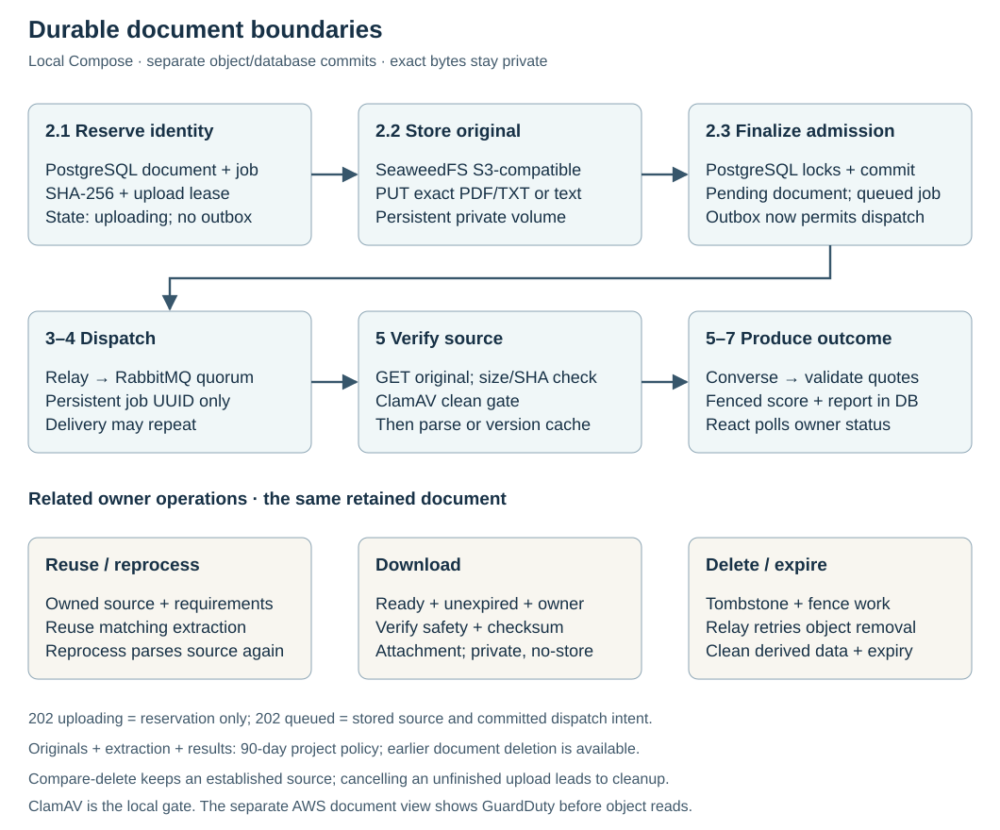
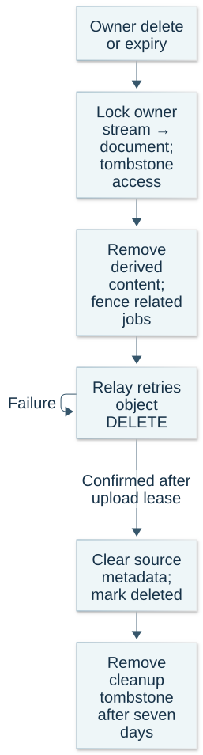

# Original documents and lifecycle

Original bytes belong in private object storage; the database owns identity and application state. A comparison references a retained document, allowing another requirement set or explicit reprocessing without asking the owner to upload again.

## What is retained

| Data | Durable owner | Policy |
| --- | --- | --- |
| Exact PDF/TXT or UTF-8 pasted snapshot | Private SeaweedFS object locally / S3 in AWS | Configurable 90 days; earlier owner deletion |
| Owner, UUID, generated key, SHA-256, size/type and lifecycle | PostgreSQL / RDS | Source policy; cleanup identity retained briefly |
| Extracted text and parser version | Document row | Source policy; successful comparisons do not discard it |
| Requirements, status, scores and quoted evidence | Job/result rows | Associated document expiry/deletion |
| Diagnostic metadata | OpenObserve / CloudWatch | Local three days / configured cloud 30 days |
| Cloud database backups | RDS | Seven days; restore-time expiry/deletion reconciliation |

This is project policy, not a universal legal retention standard. A new comparison does not extend the source's expiry. Existing legacy reports remain readable with **source unavailable**; discarded original bytes cannot be reconstructed from old extracted text.

## Admission across two stores

Unchanged-key recovery precedes new-work supply/fairness limits. External object/scanner/model I/O releases database connections; accepted work keeps recovery even when new admission is unavailable.

1. Reserve a Document and uploading Job with checksum, opaque UUID key and upload lease.
2. PUT exact bytes outside the database transaction; bounded content and media checks precede storage.
3. Under owner-stream → document → job locks, verify current upload identity, mark the document pending, and commit queued job + outbox.

Only the third boundary admits processable work. A concurrent replay may receive `202 uploading` from step 1. A PUT outage returns a safe error while retaining retry identity; database finalization failure can leave a tracked object awaiting the same-input retry or cleanup. Reconciliation expires abandoned reservations after one hour. Late PUT success racing deletion restores cleanup intent rather than queueing new work.

## Safety and reuse

The worker checks stored length/SHA-256 and scans before parsing or provider invocation. Locally ClamAV requires current-enough definitions; cloud reads require GuardDuty's `NO_THREATS_FOUND` tag. Missing, rejected or unavailable scanning cannot silently succeed. A clean result reduces risk without proving a document harmless.

A matching parser version can reuse extracted text, but each comparison still verifies the stored source and safety gate. Reprocessing reads and parses the retained source again. Owner-authorized downloads recheck lifecycle after I/O, return an attachment with `private, no-store` and `nosniff`, and remain unavailable for pending/rejected/deleting/expired sources.

## Deletion and expiry

[Diagram source](assets/document-deletion.mmd)

An established comparison can be deleted independently while its reusable document remains. Cancelling its initial unfinished upload is different: a late successful PUT or expired upload reservation causes source cleanup. The application does not publish work for an unready original.

An owner-stream/document-locked tombstone records durable workspace changes and immediately hides access and removes related comparison/results, then object deletion retries. Upload leases bound the interval before cleanup confirmation; stale worker completion cannot recreate a removed result. Rejected source bytes are removed while its safe failed comparison remains visible until policy expiry. The deleted cleanup tombstone remains for seven days before removal.

The AWS bucket is newly created without enabled versioning. S3 lifecycle expires originals as a delayed backstop; application clocks enforce access/derived-data expiry. Terraform blocks automatic bucket destruction. Enabling future versioning, replication or backups requires historical-version erasure and restore reconciliation, not just delete markers.

## Implementation and evidence

[Admission](../backend/matching/views.py), [source/scanner/reconciliation](../backend/matching/documents.py), [lease-fenced completion](../backend/matching/jobs.py), [Document schema](../backend/matching/models.py), and [Terraform storage controls](../infra/terraform/documents.tf) implement these boundaries. [ADR 0006](decisions/0006-durable-document-lifecycle.md) records the alternatives; [research](research.md#durable-document-storage-review--2026-10-18) records checked primary sources.

Local checks cover byte-for-byte retrieval, repeated comparison/reprocessing, owner isolation, infected input, unavailable storage/scanner, partial admission recovery, deletion races and restart persistence. Cloud KMS/IAM, GuardDuty operation and managed durability remain unverified until actual deployment. Generated UUID keys plus checksum checks protect the application workflow; this is not WORM storage or protection against every compromised privileged role.
