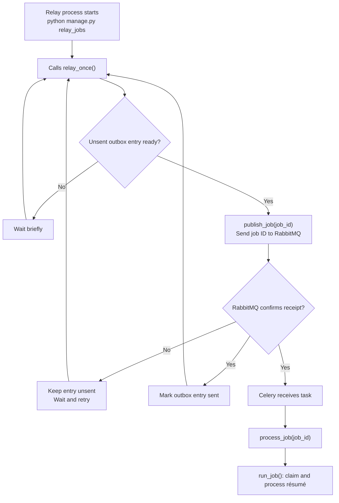

# Relay jobs: high-level walkthrough

Start with the running relay process. It reads committed dispatch instructions from PostgreSQL and sends Celery tasks through RabbitMQ. Celery processes jobs separately while the relay continues dispatching.

Source snapshot: [`a245bde29f3abede2a61c746a067658e5ca5e22c`](https://github.com/junrillg/resume-match-bedrock/tree/a245bde29f3abede2a61c746a067658e5ca5e22c), inspected 19 October 2026.

[End-to-end diagrams](upload-to-score-mermaid.md) · [Previous: API admission](admit-jobs-walkthrough.md) · [Notion notebook](https://app.notion.com/p/3fd71e91a0f6816585fdf556f98829ab)

## What to remember

- **Outbox:** the database to-do list of jobs to dispatch. The queued job and its outbox entry were committed together earlier.
- **Relay:** finds due entries whose `sent_at` is empty, locks each selected entry, and publishes its job UUID.
- **RabbitMQ:** holds the task message. It carries the job ID, not the résumé bytes.
- **Celery:** receives `matching.process_job` and calls `run_job(job_id)`.
- **Confirmation:** the broker accepted the task; scoring has not necessarily finished. Marking the outbox sent and Celery starting work can occur independently after broker acceptance.

## Follow the code in order

1. [relay_jobs.Command.handle()](https://github.com/junrillg/resume-match-bedrock/blob/a245bde29f3abede2a61c746a067658e5ca5e22c/backend/matching/management/commands/relay_jobs.py#L22): runs the relay loop with a reused producer. Connection failures trigger reconnect attempts; maintenance is separate from the productive dispatch loop.
2. [relay_once()](https://github.com/junrillg/resume-match-bedrock/blob/a245bde29f3abede2a61c746a067658e5ca5e22c/backend/matching/jobs.py#L188): locks due, unsent outbox entries using `skip_locked=True`, publishes a bounded batch and saves `sent_at` after publication succeeds. The diagram compresses the batch loop and outer waiting/reconnection into one repeating path.
3. [publish_job()](https://github.com/junrillg/resume-match-bedrock/blob/a245bde29f3abede2a61c746a067658e5ca5e22c/backend/matching/jobs.py#L175): sends `matching.process_job` with the UUID to `resume.match.quorum`.
4. [Queue configuration](https://github.com/junrillg/resume-match-bedrock/blob/a245bde29f3abede2a61c746a067658e5ca5e22c/backend/config/celery.py#L13): durable RabbitMQ quorum queue. Publisher confirmations are enabled in settings.
5. [process_job()](https://github.com/junrillg/resume-match-bedrock/blob/a245bde29f3abede2a61c746a067658e5ca5e22c/backend/matching/tasks.py#L6): Celery task wrapper calling `run_job()`; unexpected interruptions are logged with a stable error code.
6. [run_job()](https://github.com/junrillg/resume-match-bedrock/blob/a245bde29f3abede2a61c746a067658e5ca5e22c/backend/matching/jobs.py#L104): next lesson, starting with the worker's database claim and lease.

## Retry boundary

Failed publication leaves the entry unsent. A crash after broker acceptance but before the database commits `sent_at` can publish the task again. Worker database checks and leases guard processing effects; this is not an exactly-once-delivery promise.

This is a high-level map of dispatch, not the full maintenance, recovery or scoring implementation. Source and Mermaid syntax can be verified without running a broker; live delivery, cloud configuration and hosted visual rendering are separate checks. Saving this reference does not complete a learner checkpoint.
