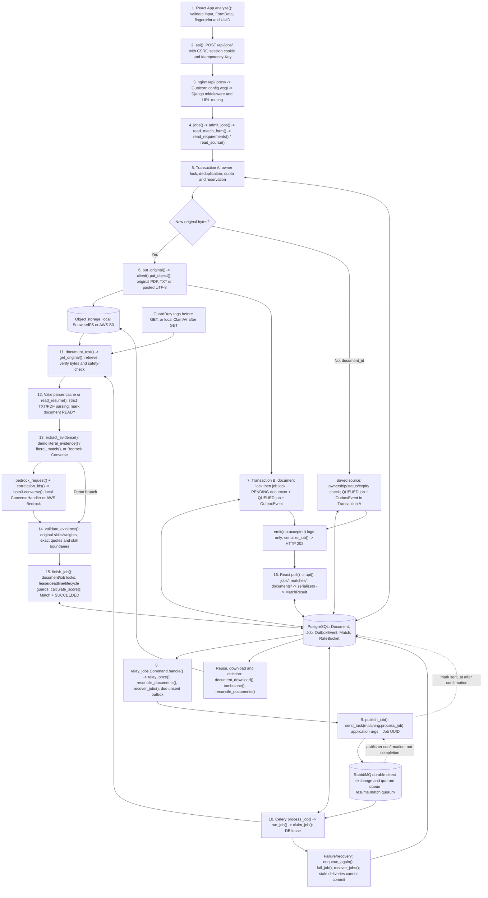
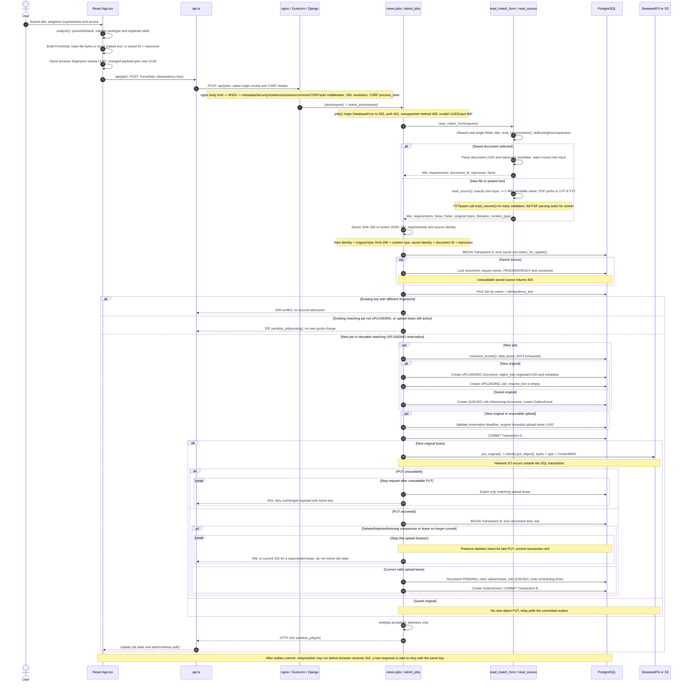
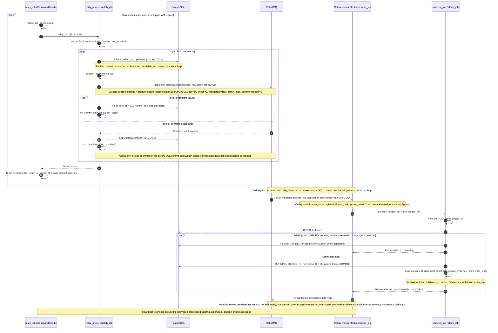
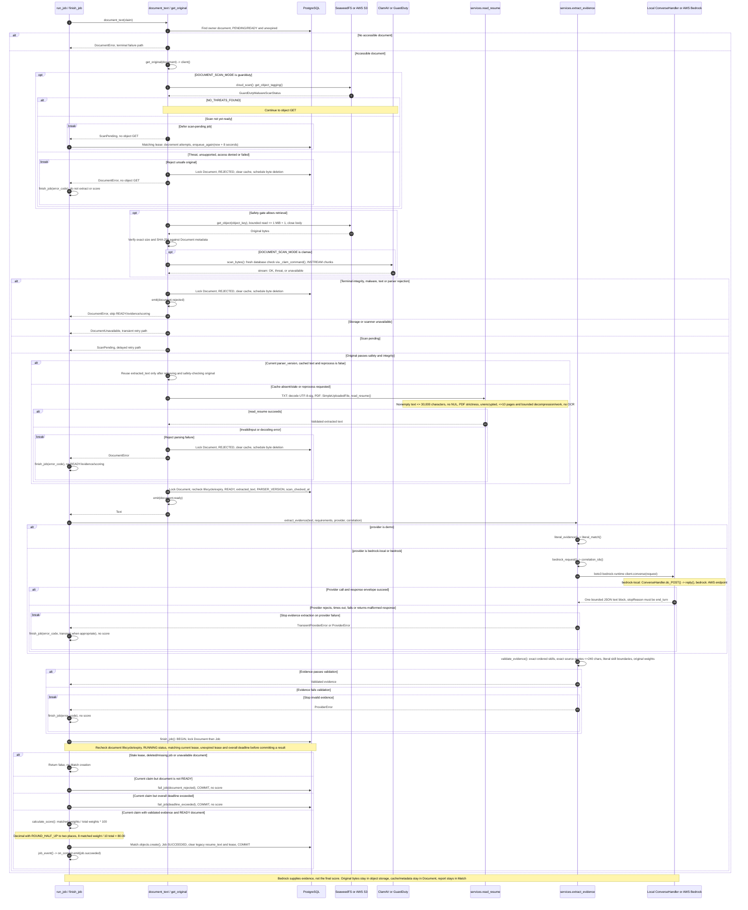
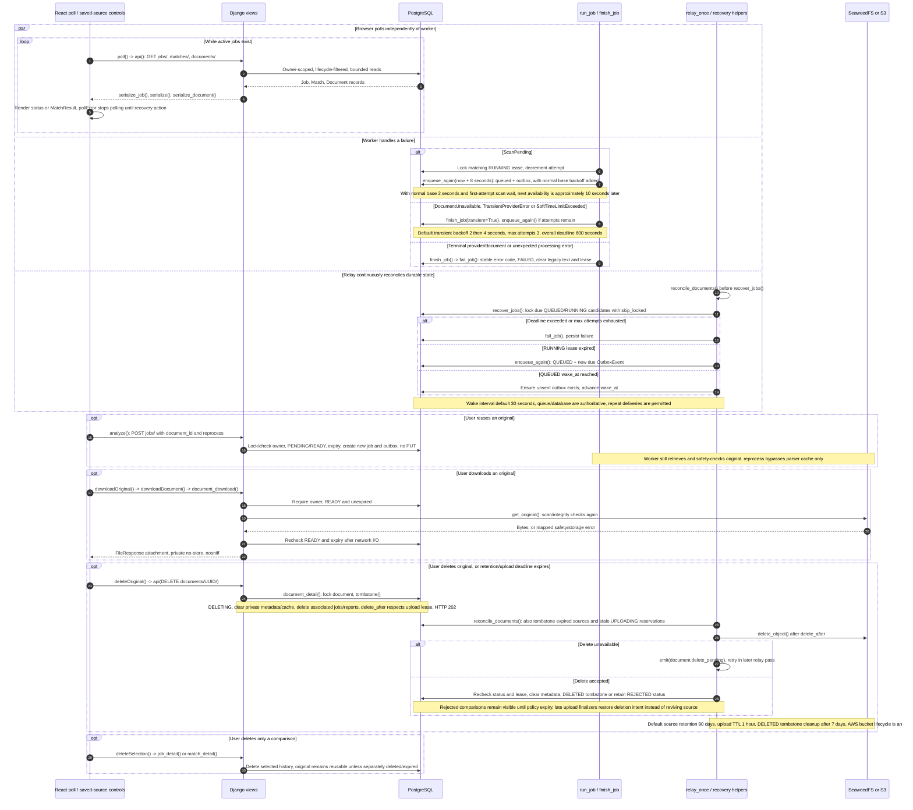

# Résumé Match: original upload to scored report (Mermaid)

This page contains actual Mermaid source in fenced `mermaid` blocks. GitHub renders these blocks as diagrams. In Notion, use a code block with its language set to Mermaid and enable its diagram view. Each diagram also has an editable `.mmd` source beside this page under `assets/`.

**Source snapshot:** [`b0b8e58f1776b89a1bf3a7eede0a83266daf63f1`](https://github.com/junrillg/resume-match-bedrock/tree/b0b8e58f1776b89a1bf3a7eede0a83266daf63f1), inspected on 18 October 2026. Later documentation/viewer-only changes do not change the application flow described here. This is source evidence, not proof of an active AWS deployment or a passing runtime/test run.

## How to read it

1. Follow the overview, then the numbered sequence diagrams.
2. `alt` means mutually exclusive branches; `opt` means optional behavior; `loop` repeats work; `par` means independent activities can overlap.
3. SQL transaction boundaries are explicit. Object-storage and provider network calls are outside their surrounding SQL critical sections.
4. `emit()` and `job_event()` record telemetry. `OutboxEvent` plus `publish_job()` dispatch work.

Local Compose uses PostgreSQL, RabbitMQ, Celery, an S3-compatible SeaweedFS service and ClamAV. The AWS configuration defines S3 and GuardDuty scanning. The `demo`, `bedrock-local` and `bedrock` evidence providers are separate choices. Using an S3 API locally does not establish that originals were sent to AWS.

## Coverage boundary

The diagrams cover the application flows for submitting, storing, dispatching, retrieving, safety-checking, parsing, scoring, polling, retrying, recovering, reusing, downloading and deleting an original. They include both newly uploaded and saved-source branches and the material failure/concurrency boundaries. The function registry below links the named application helpers and supporting callbacks.

This is complete within that stated application-flow boundary. Library/SDK/network implementation internals, full infrastructure provisioning bodies, database migration bodies, tests and unrelated account administration are outside scope. Real documents, credentials and environment values are excluded. Creating this map does not complete the learner checkpoint.

## 1. End-to-end overview

Start here. Solid arrows show the application path; dotted arrows explain publisher confirmation and telemetry boundaries.

[Editable Mermaid source](assets/upload-to-score-overview.mmd)

## 2. Browser, validation, upload and acceptance

New bytes use two SQL transactions with object PUT between them. Saved-source reuse queues inside the first transaction and skips PUT.

[Editable Mermaid source](assets/upload-to-score-admission.mmd)

## 3. Durable dispatch, RabbitMQ and Celery

RabbitMQ carries wakeups. PostgreSQL remains authoritative for whether a job may run and commit.

[Editable Mermaid source](assets/upload-to-score-dispatch.mmd)

## 4. Retrieval, safety, parsing, evidence and scoring

Successful scanning and integrity checks precede parser-cache reuse. Every rejection/error branch stops that successful path.

[Editable Mermaid source](assets/upload-to-score-worker.mmd)

## 5. Polling, retries, recovery and original lifecycle

These activities can overlap; they do not wait for a single linear browser-to-worker response.

[Editable Mermaid source](assets/upload-to-score-recovery-lifecycle.mmd)

## State and failure reference

| Boundary | Success | Failure/retry behavior |
|---|---|---|
| Browser request | React keeps latest payload fingerprint and UUID in memory | Unchanged retry reuses key; reload loses that in-memory key; changed payload gets a new key |
| Server admission | Owner-scoped key/fingerprint deduplication and quota under owner lock | Same key/different content: 409; new quota exhaustion: 429; invalid/auth/method/body checks reject before admission |
| New original PUT | UPLOADING reservation -> PUT -> PENDING document + QUEUED job + outbox | Storage 503 expires matching lease; unchanged retry resumes reservation; late PUT cannot revive deletion |
| Saved source | Existing owned, eligible, unexpired original -> new job + outbox | No object PUT; missing/ineligible source rejected; worker must still retrieve and safety-check bytes |
| Relay | Broker confirmation -> commit sent_at | Failure leaves unsent; confirm/SQL crash gap may duplicate delivery |
| Worker claim | QUEUED/due -> RUNNING + lease | Duplicate/not-due work ignored; deadline/attempt limits fail eligible jobs; stale worker cannot commit |
| Safety/cache | Original GET and safety/integrity -> cache or parse -> READY | Threat/integrity/parser errors reject; unavailable dependencies retry; pending GuardDuty scan defers without consuming an attempt |
| Evidence/score | Valid evidence -> guarded finish -> weighted score + Match | Invalid/untrusted evidence never supplies its own score or changes requirement weights |
| Polling | Parallel owner-scoped jobs/matches/documents reads, approximately one-second interval while active | Session loss clears private state; other errors persist and stop polling pending recovery; old/cancelled responses are ignored |
| Source deletion | Immediate inaccessible tombstone, deferred object DELETE and metadata cleanup | Upload leases and post-I/O rechecks prevent stale finalizers/downloads from reviving or delivering deleted originals |

Defaults shown in the diagrams are snapshot configuration defaults, not deployment-wide guarantees: source retention 90 days, upload reservation TTL one hour, lease 90 seconds, attempts three, job deadline 600 seconds, wake interval 30 seconds, retry base two seconds. Scanner-pending work adds eight seconds before normal backoff. DELETED metadata tombstones have a seven-day cleanup grace. Cloud object lifecycle adds a storage policy; it is not a substitute for the application's ownership and status checks.

## Function and source registry

Pinned links below resolve to the inspected application snapshot. The diagrams group related helpers to keep the visual path readable; this index names the supporting helpers and callbacks without adding unrelated flows to the diagram bodies.

| Function | Source |
|---|---|
| `mark_worker_ready` | [backend/config/celery.py:16](https://github.com/junrillg/resume-match-bedrock/blob/b0b8e58f1776b89a1bf3a7eede0a83266daf63f1/backend/config/celery.py#L16) |
| `clear_worker_ready` | [backend/config/celery.py:21](https://github.com/junrillg/resume-match-bedrock/blob/b0b8e58f1776b89a1bf3a7eede0a83266daf63f1/backend/config/celery.py#L21) |
| `ConverseHandler.setup` | [backend/local_converse.py:21](https://github.com/junrillg/resume-match-bedrock/blob/b0b8e58f1776b89a1bf3a7eede0a83266daf63f1/backend/local_converse.py#L21) |
| `ConverseHandler.log_message` | [backend/local_converse.py:25](https://github.com/junrillg/resume-match-bedrock/blob/b0b8e58f1776b89a1bf3a7eede0a83266daf63f1/backend/local_converse.py#L25) |
| `ConverseHandler.reply` | [backend/local_converse.py:28](https://github.com/junrillg/resume-match-bedrock/blob/b0b8e58f1776b89a1bf3a7eede0a83266daf63f1/backend/local_converse.py#L28) |
| `ConverseHandler.do_GET` | [backend/local_converse.py:40](https://github.com/junrillg/resume-match-bedrock/blob/b0b8e58f1776b89a1bf3a7eede0a83266daf63f1/backend/local_converse.py#L40) |
| `ConverseHandler.do_POST` | [backend/local_converse.py:43](https://github.com/junrillg/resume-match-bedrock/blob/b0b8e58f1776b89a1bf3a7eede0a83266daf63f1/backend/local_converse.py#L43) |
| `client` | [backend/matching/documents.py:41](https://github.com/junrillg/resume-match-bedrock/blob/b0b8e58f1776b89a1bf3a7eede0a83266daf63f1/backend/matching/documents.py#L41) |
| `read_source` | [backend/matching/documents.py:54](https://github.com/junrillg/resume-match-bedrock/blob/b0b8e58f1776b89a1bf3a7eede0a83266daf63f1/backend/matching/documents.py#L54) |
| `put_original` | [backend/matching/documents.py:80](https://github.com/junrillg/resume-match-bedrock/blob/b0b8e58f1776b89a1bf3a7eede0a83266daf63f1/backend/matching/documents.py#L80) |
| `_clam_command` | [backend/matching/documents.py:91](https://github.com/junrillg/resume-match-bedrock/blob/b0b8e58f1776b89a1bf3a7eede0a83266daf63f1/backend/matching/documents.py#L91) |
| `scan_bytes` | [backend/matching/documents.py:104](https://github.com/junrillg/resume-match-bedrock/blob/b0b8e58f1776b89a1bf3a7eede0a83266daf63f1/backend/matching/documents.py#L104) |
| `cloud_scan` | [backend/matching/documents.py:132](https://github.com/junrillg/resume-match-bedrock/blob/b0b8e58f1776b89a1bf3a7eede0a83266daf63f1/backend/matching/documents.py#L132) |
| `get_original` | [backend/matching/documents.py:146](https://github.com/junrillg/resume-match-bedrock/blob/b0b8e58f1776b89a1bf3a7eede0a83266daf63f1/backend/matching/documents.py#L146) |
| `document_text` | [backend/matching/documents.py:166](https://github.com/junrillg/resume-match-bedrock/blob/b0b8e58f1776b89a1bf3a7eede0a83266daf63f1/backend/matching/documents.py#L166) |
| `tombstone` | [backend/matching/documents.py:206](https://github.com/junrillg/resume-match-bedrock/blob/b0b8e58f1776b89a1bf3a7eede0a83266daf63f1/backend/matching/documents.py#L206) |
| `reconcile_documents` | [backend/matching/documents.py:222](https://github.com/junrillg/resume-match-bedrock/blob/b0b8e58f1776b89a1bf3a7eede0a83266daf63f1/backend/matching/documents.py#L222) |
| `job_event` | [backend/matching/jobs.py:20](https://github.com/junrillg/resume-match-bedrock/blob/b0b8e58f1776b89a1bf3a7eede0a83266daf63f1/backend/matching/jobs.py#L20) |
| `fail_job` | [backend/matching/jobs.py:26](https://github.com/junrillg/resume-match-bedrock/blob/b0b8e58f1776b89a1bf3a7eede0a83266daf63f1/backend/matching/jobs.py#L26) |
| `enqueue_again` | [backend/matching/jobs.py:36](https://github.com/junrillg/resume-match-bedrock/blob/b0b8e58f1776b89a1bf3a7eede0a83266daf63f1/backend/matching/jobs.py#L36) |
| `claim_job` | [backend/matching/jobs.py:46](https://github.com/junrillg/resume-match-bedrock/blob/b0b8e58f1776b89a1bf3a7eede0a83266daf63f1/backend/matching/jobs.py#L46) |
| `finish_job` | [backend/matching/jobs.py:66](https://github.com/junrillg/resume-match-bedrock/blob/b0b8e58f1776b89a1bf3a7eede0a83266daf63f1/backend/matching/jobs.py#L66) |
| `run_job` | [backend/matching/jobs.py:95](https://github.com/junrillg/resume-match-bedrock/blob/b0b8e58f1776b89a1bf3a7eede0a83266daf63f1/backend/matching/jobs.py#L95) |
| `recover_jobs` | [backend/matching/jobs.py:133](https://github.com/junrillg/resume-match-bedrock/blob/b0b8e58f1776b89a1bf3a7eede0a83266daf63f1/backend/matching/jobs.py#L133) |
| `publish_job` | [backend/matching/jobs.py:163](https://github.com/junrillg/resume-match-bedrock/blob/b0b8e58f1776b89a1bf3a7eede0a83266daf63f1/backend/matching/jobs.py#L163) |
| `relay_once` | [backend/matching/jobs.py:175](https://github.com/junrillg/resume-match-bedrock/blob/b0b8e58f1776b89a1bf3a7eede0a83266daf63f1/backend/matching/jobs.py#L175) |
| `Command.add_arguments` | [backend/matching/management/commands/relay_jobs.py:13](https://github.com/junrillg/resume-match-bedrock/blob/b0b8e58f1776b89a1bf3a7eede0a83266daf63f1/backend/matching/management/commands/relay_jobs.py#L13) |
| `Command.handle` | [backend/matching/management/commands/relay_jobs.py:16](https://github.com/junrillg/resume-match-bedrock/blob/b0b8e58f1776b89a1bf3a7eede0a83266daf63f1/backend/matching/management/commands/relay_jobs.py#L16) |
| `ReadinessMiddleware.__init__` | [backend/matching/middleware.py:11](https://github.com/junrillg/resume-match-bedrock/blob/b0b8e58f1776b89a1bf3a7eede0a83266daf63f1/backend/matching/middleware.py#L11) |
| `ReadinessMiddleware.__call__` | [backend/matching/middleware.py:14](https://github.com/junrillg/resume-match-bedrock/blob/b0b8e58f1776b89a1bf3a7eede0a83266daf63f1/backend/matching/middleware.py#L14) |
| `RequestMetadataMiddleware.__init__` | [backend/matching/middleware.py:23](https://github.com/junrillg/resume-match-bedrock/blob/b0b8e58f1776b89a1bf3a7eede0a83266daf63f1/backend/matching/middleware.py#L23) |
| `RequestMetadataMiddleware.__call__` | [backend/matching/middleware.py:26](https://github.com/junrillg/resume-match-bedrock/blob/b0b8e58f1776b89a1bf3a7eede0a83266daf63f1/backend/matching/middleware.py#L26) |
| `read_resume` | [backend/matching/services.py:36](https://github.com/junrillg/resume-match-bedrock/blob/b0b8e58f1776b89a1bf3a7eede0a83266daf63f1/backend/matching/services.py#L36) |
| `read_requirements` | [backend/matching/services.py:94](https://github.com/junrillg/resume-match-bedrock/blob/b0b8e58f1776b89a1bf3a7eede0a83266daf63f1/backend/matching/services.py#L94) |
| `literal_match` | [backend/matching/services.py:117](https://github.com/junrillg/resume-match-bedrock/blob/b0b8e58f1776b89a1bf3a7eede0a83266daf63f1/backend/matching/services.py#L117) |
| `correlation_ids` | [backend/matching/services.py:131](https://github.com/junrillg/resume-match-bedrock/blob/b0b8e58f1776b89a1bf3a7eede0a83266daf63f1/backend/matching/services.py#L131) |
| `bedrock_request` | [backend/matching/services.py:141](https://github.com/junrillg/resume-match-bedrock/blob/b0b8e58f1776b89a1bf3a7eede0a83266daf63f1/backend/matching/services.py#L141) |
| `literal_evidence` | [backend/matching/services.py:153](https://github.com/junrillg/resume-match-bedrock/blob/b0b8e58f1776b89a1bf3a7eede0a83266daf63f1/backend/matching/services.py#L153) |
| `extract_evidence` | [backend/matching/services.py:163](https://github.com/junrillg/resume-match-bedrock/blob/b0b8e58f1776b89a1bf3a7eede0a83266daf63f1/backend/matching/services.py#L163) |
| `validate_evidence` | [backend/matching/services.py:200](https://github.com/junrillg/resume-match-bedrock/blob/b0b8e58f1776b89a1bf3a7eede0a83266daf63f1/backend/matching/services.py#L200) |
| `calculate_score` | [backend/matching/services.py:220](https://github.com/junrillg/resume-match-bedrock/blob/b0b8e58f1776b89a1bf3a7eede0a83266daf63f1/backend/matching/services.py#L220) |
| `process_job` | [backend/matching/tasks.py:7](https://github.com/junrillg/resume-match-bedrock/blob/b0b8e58f1776b89a1bf3a7eede0a83266daf63f1/backend/matching/tasks.py#L7) |
| `_reset_after_fork` | [backend/matching/telemetry.py:34](https://github.com/junrillg/resume-match-bedrock/blob/b0b8e58f1776b89a1bf3a7eede0a83266daf63f1/backend/matching/telemetry.py#L34) |
| `_get_logger` | [backend/matching/telemetry.py:45](https://github.com/junrillg/resume-match-bedrock/blob/b0b8e58f1776b89a1bf3a7eede0a83266daf63f1/backend/matching/telemetry.py#L45) |
| `emit` | [backend/matching/telemetry.py:66](https://github.com/junrillg/resume-match-bedrock/blob/b0b8e58f1776b89a1bf3a7eede0a83266daf63f1/backend/matching/telemetry.py#L66) |
| `error` | [backend/matching/views.py:24](https://github.com/junrillg/resume-match-bedrock/blob/b0b8e58f1776b89a1bf3a7eede0a83266daf63f1/backend/matching/views.py#L24) |
| `csrf_failure` | [backend/matching/views.py:28](https://github.com/junrillg/resume-match-bedrock/blob/b0b8e58f1776b89a1bf3a7eede0a83266daf63f1/backend/matching/views.py#L28) |
| `not_found` | [backend/matching/views.py:32](https://github.com/junrillg/resume-match-bedrock/blob/b0b8e58f1776b89a1bf3a7eede0a83266daf63f1/backend/matching/views.py#L32) |
| `server_error` | [backend/matching/views.py:36](https://github.com/junrillg/resume-match-bedrock/blob/b0b8e58f1776b89a1bf3a7eede0a83266daf63f1/backend/matching/views.py#L36) |
| `session_payload` | [backend/matching/views.py:40](https://github.com/junrillg/resume-match-bedrock/blob/b0b8e58f1776b89a1bf3a7eede0a83266daf63f1/backend/matching/views.py#L40) |
| `health` | [backend/matching/views.py:47](https://github.com/junrillg/resume-match-bedrock/blob/b0b8e58f1776b89a1bf3a7eede0a83266daf63f1/backend/matching/views.py#L47) |
| `session` | [backend/matching/views.py:58](https://github.com/junrillg/resume-match-bedrock/blob/b0b8e58f1776b89a1bf3a7eede0a83266daf63f1/backend/matching/views.py#L58) |
| `consume_bucket` | [backend/matching/views.py:64](https://github.com/junrillg/resume-match-bedrock/blob/b0b8e58f1776b89a1bf3a7eede0a83266daf63f1/backend/matching/views.py#L64) |
| `login` | [backend/matching/views.py:70](https://github.com/junrillg/resume-match-bedrock/blob/b0b8e58f1776b89a1bf3a7eede0a83266daf63f1/backend/matching/views.py#L70) |
| `logout` | [backend/matching/views.py:95](https://github.com/junrillg/resume-match-bedrock/blob/b0b8e58f1776b89a1bf3a7eede0a83266daf63f1/backend/matching/views.py#L95) |
| `serialize` | [backend/matching/views.py:102](https://github.com/junrillg/resume-match-bedrock/blob/b0b8e58f1776b89a1bf3a7eede0a83266daf63f1/backend/matching/views.py#L102) |
| `read_match_form` | [backend/matching/views.py:106](https://github.com/junrillg/resume-match-bedrock/blob/b0b8e58f1776b89a1bf3a7eede0a83266daf63f1/backend/matching/views.py#L106) |
| `matches` | [backend/matching/views.py:133](https://github.com/junrillg/resume-match-bedrock/blob/b0b8e58f1776b89a1bf3a7eede0a83266daf63f1/backend/matching/views.py#L133) |
| `match_detail` | [backend/matching/views.py:141](https://github.com/junrillg/resume-match-bedrock/blob/b0b8e58f1776b89a1bf3a7eede0a83266daf63f1/backend/matching/views.py#L141) |
| `serialize_document` | [backend/matching/views.py:160](https://github.com/junrillg/resume-match-bedrock/blob/b0b8e58f1776b89a1bf3a7eede0a83266daf63f1/backend/matching/views.py#L160) |
| `serialize_job` | [backend/matching/views.py:166](https://github.com/junrillg/resume-match-bedrock/blob/b0b8e58f1776b89a1bf3a7eede0a83266daf63f1/backend/matching/views.py#L166) |
| `jobs` | [backend/matching/views.py:178](https://github.com/junrillg/resume-match-bedrock/blob/b0b8e58f1776b89a1bf3a7eede0a83266daf63f1/backend/matching/views.py#L178) |
| `admit_jobs` | [backend/matching/views.py:185](https://github.com/junrillg/resume-match-bedrock/blob/b0b8e58f1776b89a1bf3a7eede0a83266daf63f1/backend/matching/views.py#L185) |
| `documents` | [backend/matching/views.py:289](https://github.com/junrillg/resume-match-bedrock/blob/b0b8e58f1776b89a1bf3a7eede0a83266daf63f1/backend/matching/views.py#L289) |
| `document_detail` | [backend/matching/views.py:298](https://github.com/junrillg/resume-match-bedrock/blob/b0b8e58f1776b89a1bf3a7eede0a83266daf63f1/backend/matching/views.py#L298) |
| `document_download` | [backend/matching/views.py:312](https://github.com/junrillg/resume-match-bedrock/blob/b0b8e58f1776b89a1bf3a7eede0a83266daf63f1/backend/matching/views.py#L312) |
| `job_detail` | [backend/matching/views.py:335](https://github.com/junrillg/resume-match-bedrock/blob/b0b8e58f1776b89a1bf3a7eede0a83266daf63f1/backend/matching/views.py#L335) |
| `activeJob` | [frontend/src/App.tsx:9](https://github.com/junrillg/resume-match-bedrock/blob/b0b8e58f1776b89a1bf3a7eede0a83266daf63f1/frontend/src/App.tsx#L9) |
| `reusableDocument` | [frontend/src/App.tsx:10](https://github.com/junrillg/resume-match-bedrock/blob/b0b8e58f1776b89a1bf3a7eede0a83266daf63f1/frontend/src/App.tsx#L10) |
| `documentLabel` | [frontend/src/App.tsx:11](https://github.com/junrillg/resume-match-bedrock/blob/b0b8e58f1776b89a1bf3a7eede0a83266daf63f1/frontend/src/App.tsx#L11) |
| `providerLabel` | [frontend/src/App.tsx:32](https://github.com/junrillg/resume-match-bedrock/blob/b0b8e58f1776b89a1bf3a7eede0a83266daf63f1/frontend/src/App.tsx#L32) |
| `errorText` | [frontend/src/App.tsx:38](https://github.com/junrillg/resume-match-bedrock/blob/b0b8e58f1776b89a1bf3a7eede0a83266daf63f1/frontend/src/App.tsx#L38) |
| `MatchResult` | [frontend/src/App.tsx:42](https://github.com/junrillg/resume-match-bedrock/blob/b0b8e58f1776b89a1bf3a7eede0a83266daf63f1/frontend/src/App.tsx#L42) |
| `App` | [frontend/src/App.tsx:59](https://github.com/junrillg/resume-match-bedrock/blob/b0b8e58f1776b89a1bf3a7eede0a83266daf63f1/frontend/src/App.tsx#L59) |
| `clearPrivateState` | [frontend/src/App.tsx:96](https://github.com/junrillg/resume-match-bedrock/blob/b0b8e58f1776b89a1bf3a7eede0a83266daf63f1/frontend/src/App.tsx#L96) |
| `refreshSession` | [frontend/src/App.tsx:106](https://github.com/junrillg/resume-match-bedrock/blob/b0b8e58f1776b89a1bf3a7eede0a83266daf63f1/frontend/src/App.tsx#L106) |
| `loseSession` | [frontend/src/App.tsx:112](https://github.com/junrillg/resume-match-bedrock/blob/b0b8e58f1776b89a1bf3a7eede0a83266daf63f1/frontend/src/App.tsx#L112) |
| `loadWorkspace` | [frontend/src/App.tsx:118](https://github.com/junrillg/resume-match-bedrock/blob/b0b8e58f1776b89a1bf3a7eede0a83266daf63f1/frontend/src/App.tsx#L118) |
| `load` | [frontend/src/App.tsx:127](https://github.com/junrillg/resume-match-bedrock/blob/b0b8e58f1776b89a1bf3a7eede0a83266daf63f1/frontend/src/App.tsx#L127) |
| `useEffect polling / poll` | [frontend/src/App.tsx:145](https://github.com/junrillg/resume-match-bedrock/blob/b0b8e58f1776b89a1bf3a7eede0a83266daf63f1/frontend/src/App.tsx#L145) |
| `poll` | [frontend/src/App.tsx:151](https://github.com/junrillg/resume-match-bedrock/blob/b0b8e58f1776b89a1bf3a7eede0a83266daf63f1/frontend/src/App.tsx#L151) |
| `perform` | [frontend/src/App.tsx:175](https://github.com/junrillg/resume-match-bedrock/blob/b0b8e58f1776b89a1bf3a7eede0a83266daf63f1/frontend/src/App.tsx#L175) |
| `login` | [frontend/src/App.tsx:189](https://github.com/junrillg/resume-match-bedrock/blob/b0b8e58f1776b89a1bf3a7eede0a83266daf63f1/frontend/src/App.tsx#L189) |
| `logout` | [frontend/src/App.tsx:201](https://github.com/junrillg/resume-match-bedrock/blob/b0b8e58f1776b89a1bf3a7eede0a83266daf63f1/frontend/src/App.tsx#L201) |
| `analyze` | [frontend/src/App.tsx:211](https://github.com/junrillg/resume-match-bedrock/blob/b0b8e58f1776b89a1bf3a7eede0a83266daf63f1/frontend/src/App.tsx#L211) |
| `deleteSelection` | [frontend/src/App.tsx:259](https://github.com/junrillg/resume-match-bedrock/blob/b0b8e58f1776b89a1bf3a7eede0a83266daf63f1/frontend/src/App.tsx#L259) |
| `downloadOriginal` | [frontend/src/App.tsx:273](https://github.com/junrillg/resume-match-bedrock/blob/b0b8e58f1776b89a1bf3a7eede0a83266daf63f1/frontend/src/App.tsx#L273) |
| `deleteOriginal` | [frontend/src/App.tsx:292](https://github.com/junrillg/resume-match-bedrock/blob/b0b8e58f1776b89a1bf3a7eede0a83266daf63f1/frontend/src/App.tsx#L292) |
| `api` | [frontend/src/api.ts:42](https://github.com/junrillg/resume-match-bedrock/blob/b0b8e58f1776b89a1bf3a7eede0a83266daf63f1/frontend/src/api.ts#L42) |
| `cancel` | [frontend/src/api.ts:49](https://github.com/junrillg/resume-match-bedrock/blob/b0b8e58f1776b89a1bf3a7eede0a83266daf63f1/frontend/src/api.ts#L49) |
| `downloadDocument` | [frontend/src/api.ts:71](https://github.com/junrillg/resume-match-bedrock/blob/b0b8e58f1776b89a1bf3a7eede0a83266daf63f1/frontend/src/api.ts#L71) |

## Configuration and transport sources

- [nginx request routing](../frontend/nginx.conf)
- [Django WSGI entrypoint](../backend/config/wsgi.py), [middleware order and limits](../backend/config/settings.py), [URL routes](../backend/config/urls.py)
- [Celery queue setup and worker readiness callbacks](../backend/config/celery.py), [task wrapper](../backend/matching/tasks.py)
- [Document, Job, Match and OutboxEvent models](../backend/matching/models.py)
- [Local service topology and health checks](../compose.yaml)
- [AWS document bucket/scanning configuration](../infra/terraform/documents.tf)

## Protocol interpretation

[Celery task acknowledgements](https://docs.celeryq.dev/en/v5.6.0/userguide/tasks.html) and [RabbitMQ publisher confirmations versus consumer acknowledgements](https://www.rabbitmq.com/docs/confirms) explain why broker acceptance, worker acknowledgement and application completion are different events. JSON application args contain the Job UUID; the Celery envelope also includes framework metadata. `ignore_result=True` disables a Celery result-backend record, not the application's `Match` report.

## Verification

Application-flow facts were checked against the pinned source and the preceding source-indexed architecture atlas. All five diagrams passed Mermaid 12.2.0 syntax parsing; each Markdown fence exactly matches its editable `.mmd` source. All 91 pinned function links were checked, and their linked application files match the source snapshot. Hosted GitHub/Notion visual rendering was not inspected. Application tests, live broker/storage behavior, AWS configuration and deployment were not run for this documentation-only conversion.
