# Upload to score: execution views

The seven business steps share one durable flow: **1 Submit · 2 Accept · 3 Relay · 4 Queue · 5 Process · 6 Save · 7 Read**. Separate delivery detail uses **7a Persist · 7b Publish wake · 7c Deliver change · 7d Read affected state**. A receipt accepts work; the event stream announces changes; authorized REST returns the report.

[Architecture overview](architecture.md) · [Operating contract](implementation-guide.md) · [AWS service journey](aws-service-journey.md)

For the step-by-step API admission lesson, open [_admit_jobs(): four branch-by-branch diagrams](admit-jobs-walkthrough.md). It covers request validation, transaction A, original upload and transaction B.

## End-to-end execution

Original bytes stay private; UUID work messages and minimal owner-change signals have separate responsibilities.

Editable Mermaid source

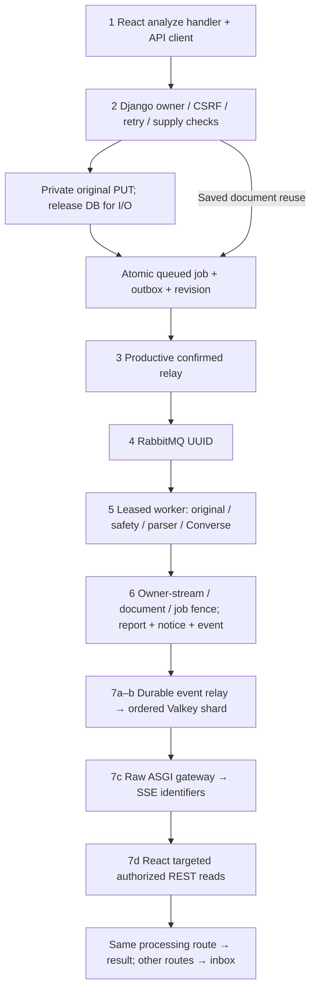

[Source file](assets/upload-to-score-overview.mmd)

## 1–2 · Admission and retry identity

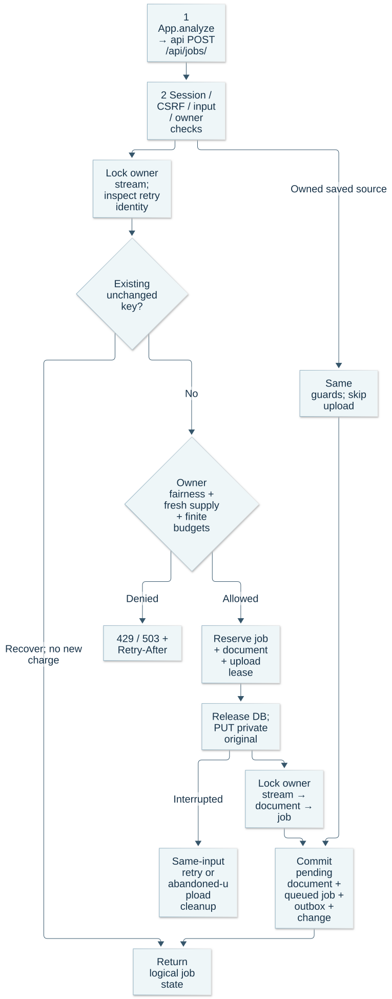

Unchanged-key recovery precedes new-work limits. Only stored, finalized source admits queued processing; an uploading reservation can require unchanged-input retry.

Editable Mermaid source

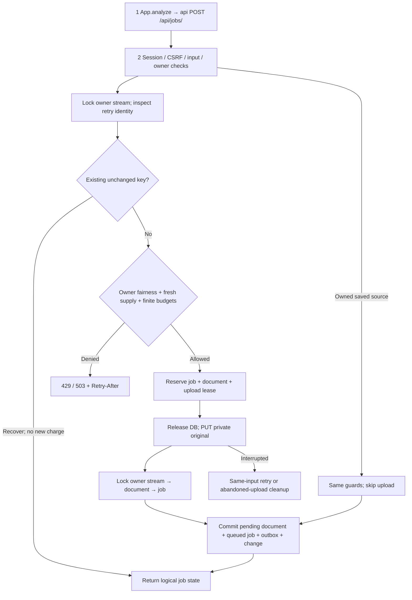

[Source file](assets/upload-to-score-admission.mmd)

## 3–4 · Confirmed dispatch

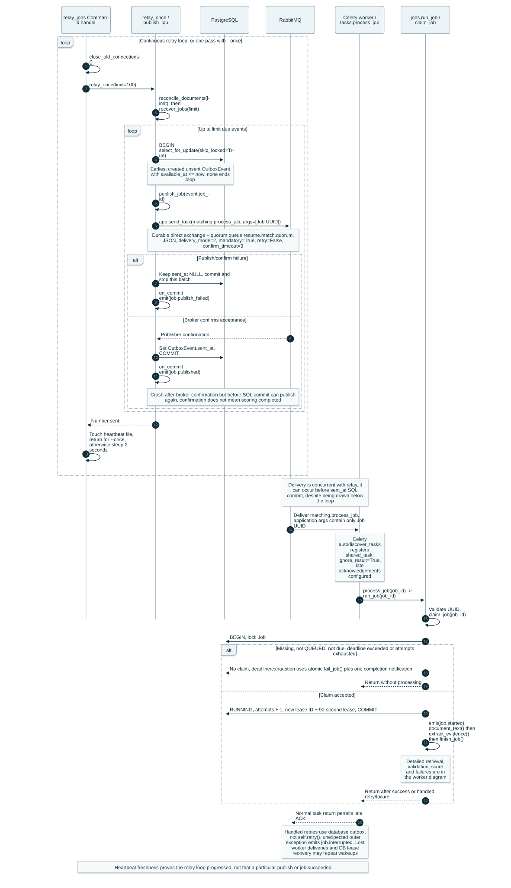

The reused producer drains productive batches. Duplicate delivery is expected; PostgreSQL owns claim and completion authority.

Editable Mermaid source

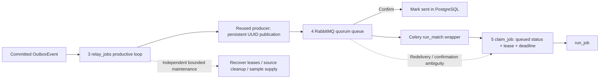

[Source file](assets/upload-to-score-dispatch.mmd)

## 5–6 · Source, evidence and outcome

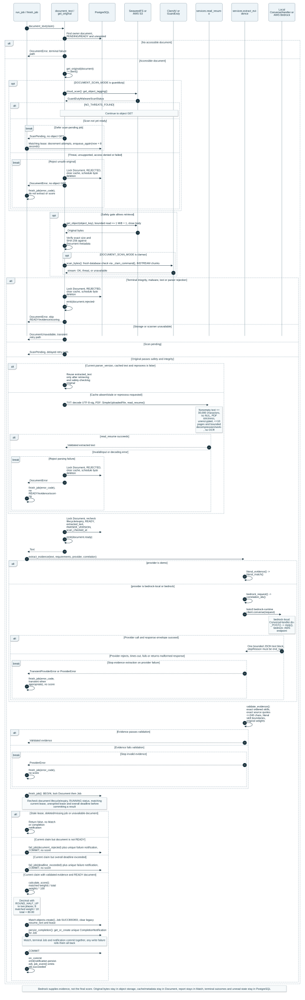

External I/O releases database connections. Integrity/safety gates and quote validation precede the atomic, lease-fenced outcome.

Editable Mermaid source

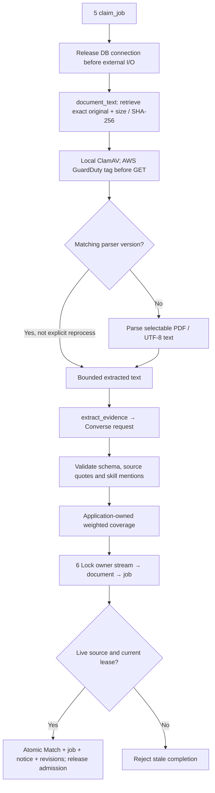

[Source file](assets/upload-to-score-worker.mmd)

## Recovery and source lifecycle

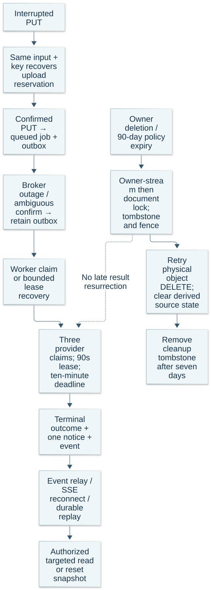

Finite retries recover accepted intent. Deletion first fences access/work and then retries physical cleanup; the configurable source policy remains 90 days.

Editable Mermaid source

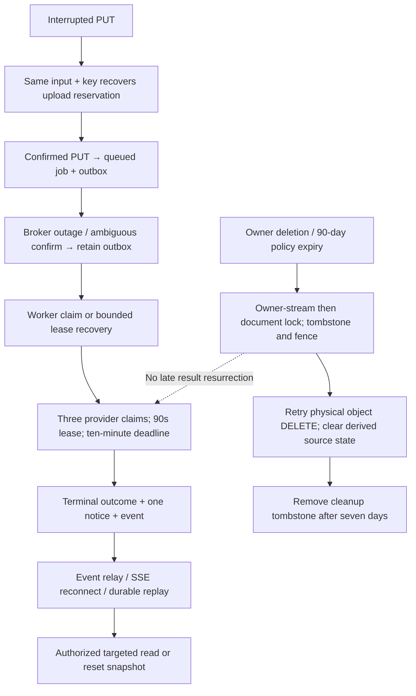

[Source file](assets/upload-to-score-recovery-lifecycle.mmd)

## 7 · Connected delivery and route-safe reads

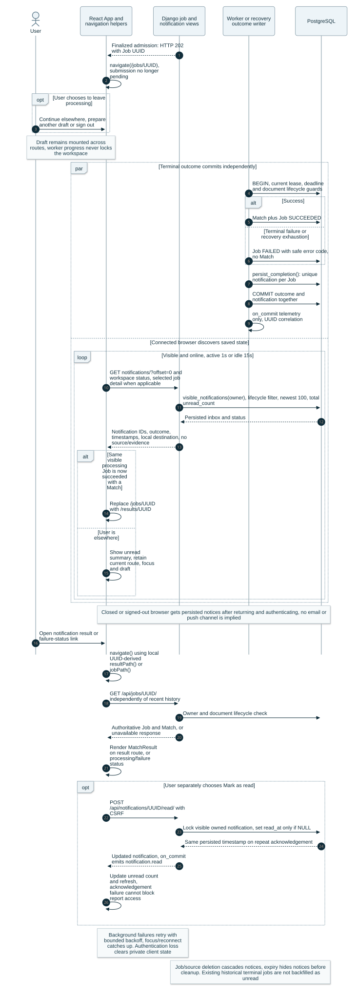

Durable revisions bridge at-most-once wake transport. A change signal triggers bounded affected reads; off-route completion preserves current work.

Editable Mermaid source

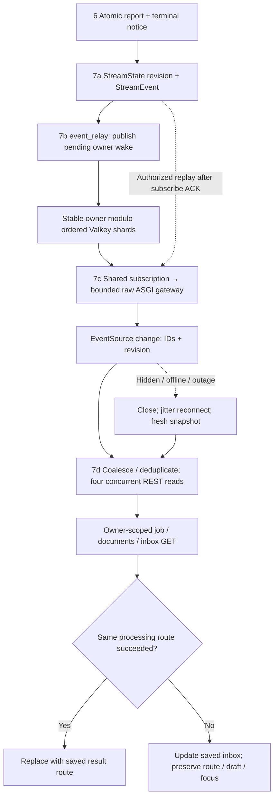

[Source file](assets/upload-to-score-completion.mmd)

## Exact implementation boundaries

These links pin the verified runtime/deployment commit; diagrams describe that source rather than an alternative target. Named handlers connect the user action through every selected service.

| Step | Caller → receiver | Responsibility |
| --- | --- | --- |
| 1 Submit | [analyze → API client](https://github.com/junrillg/resume-match-bedrock/blob/4e69a31653b4dd78de6ac35ff59bace3b798ac6e/frontend/src/App.tsx#L361) | Original/saved ID, requirements and unchanged retry identity |
| 1 HTTP | [api](https://github.com/junrillg/resume-match-bedrock/blob/4e69a31653b4dd78de6ac35ff59bace3b798ac6e/frontend/src/api.ts) | Same-origin session/CSRF and bounded timeout |
| 2 Admission | [admit_jobs](https://github.com/junrillg/resume-match-bedrock/blob/4e69a31653b4dd78de6ac35ff59bace3b798ac6e/backend/matching/views.py#L273) | Owner-stream lock, unchanged-key recovery, reserve/PUT/finalize |
| 2 Supply | [reserve_admission](https://github.com/junrillg/resume-match-bedrock/blob/4e69a31653b4dd78de6ac35ff59bace3b798ac6e/backend/matching/admission.py#L25) | Fair owner/global rate/active budgets, fresh queue/supply gate |
| 2 Source | [put_original](https://github.com/junrillg/resume-match-bedrock/blob/4e69a31653b4dd78de6ac35ff59bace3b798ac6e/backend/matching/documents.py#L81) | Exact bounded bytes; database released before object I/O |
| 3–4 Dispatch | [publish_job / relay_once](https://github.com/junrillg/resume-match-bedrock/blob/4e69a31653b4dd78de6ac35ff59bace3b798ac6e/backend/matching/jobs.py#L175) | Reused confirmed producer; UUID-only persistent delivery |
| 3 Productive loop | [relay_jobs](https://github.com/junrillg/resume-match-bedrock/blob/4e69a31653b4dd78de6ac35ff59bace3b798ac6e/backend/matching/management/commands/relay_jobs.py) | Productive drain and separate bounded maintenance/supply sample |
| 5 Source/process | [run_job](https://github.com/junrillg/resume-match-bedrock/blob/4e69a31653b4dd78de6ac35ff59bace3b798ac6e/backend/matching/jobs.py#L104) | Lease, source verification/safety, parser cache and external-I/O connection release |
| 5 Provider | [extract_evidence](https://github.com/junrillg/resume-match-bedrock/blob/4e69a31653b4dd78de6ac35ff59bace3b798ac6e/backend/matching/services.py#L163) | Converse → schema/source/skill validation → weighted score |
| 6 Commit | [finish_job](https://github.com/junrillg/resume-match-bedrock/blob/4e69a31653b4dd78de6ac35ff59bace3b798ac6e/backend/matching/jobs.py#L72) | Owner-stream → document → job fence; report, notice, revision and admission release |
| 7a–b Event publication | [record_change / relay_events](https://github.com/junrillg/resume-match-bedrock/blob/4e69a31653b4dd78de6ac35ff59bace3b798ac6e/backend/matching/events.py#L25) | Durable owner revision then publish to stable ordered shard |
| 7c Delivery | [Gateway.__call__](https://github.com/junrillg/resume-match-bedrock/blob/4e69a31653b4dd78de6ac35ff59bace3b798ac6e/backend/event_gateway.py#L284) | Session/origin checks; subscribe ACK then bounded replay and SSE |
| 7d Reads/routes | [apply](https://github.com/junrillg/resume-match-bedrock/blob/4e69a31653b4dd78de6ac35ff59bace3b798ac6e/frontend/src/App.tsx#L247) | Authorized affected reads; preserve unrelated route/draft |
| 7d Stream lifecycle | [workspaceEvents](https://github.com/junrillg/resume-match-bedrock/blob/4e69a31653b4dd78de6ac35ff59bace3b798ac6e/frontend/src/workspaceEvents.ts#L21) | One visible-tab EventSource, coalescing, bounded reads and jitter reconnect |
| Inbox | [notifications / notification_read](https://github.com/junrillg/resume-match-bedrock/blob/4e69a31653b4dd78de6ac35ff59bace3b798ac6e/backend/matching/views.py#L209) | Signed keyset cursor and independent idempotent read receipt |
| Source lifecycle | [tombstone / reconcile_documents](https://github.com/junrillg/resume-match-bedrock/blob/4e69a31653b4dd78de6ac35ff59bace3b798ac6e/backend/matching/documents.py#L211) | Immediate access fence, durable change and retried physical cleanup |

## Interpreting the result

- A `202 queued` means original storage and dispatch intent committed; it is not a finished score. `202 uploading` means reservation only.
- New-work `429`/`503` is distinct from accepted-job recovery. No connection failure erases a saved outcome.
- SSE carries identifiers and revisions, never résumé text or the report. Initial/reconnect snapshots and targeted REST remain owner-authorized.
- One saved report and one terminal notice do not imply exactly-once broker/model execution.
- Local 1,000-stream evidence and small AWS defaults are separate from the one-million connection / 100-comparison-per-second planning inputs. [Measured bounds](decisions/0009-event-driven-completion.md#local-verification) · [Deployment bounds](decisions/0010-bounded-deployment.md)
