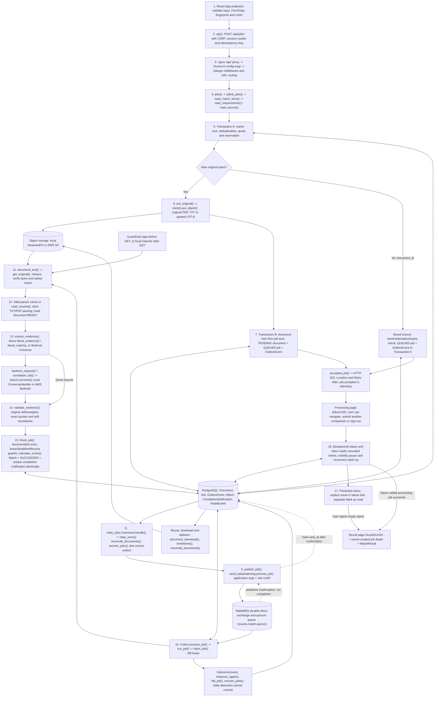
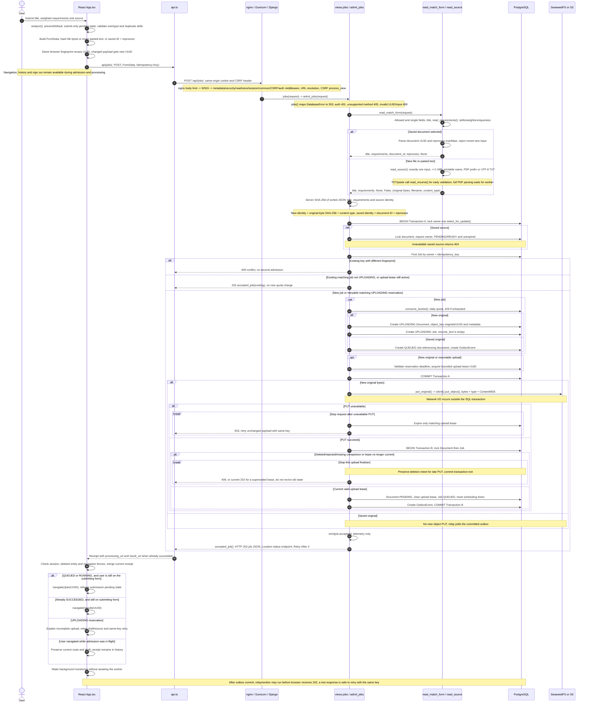
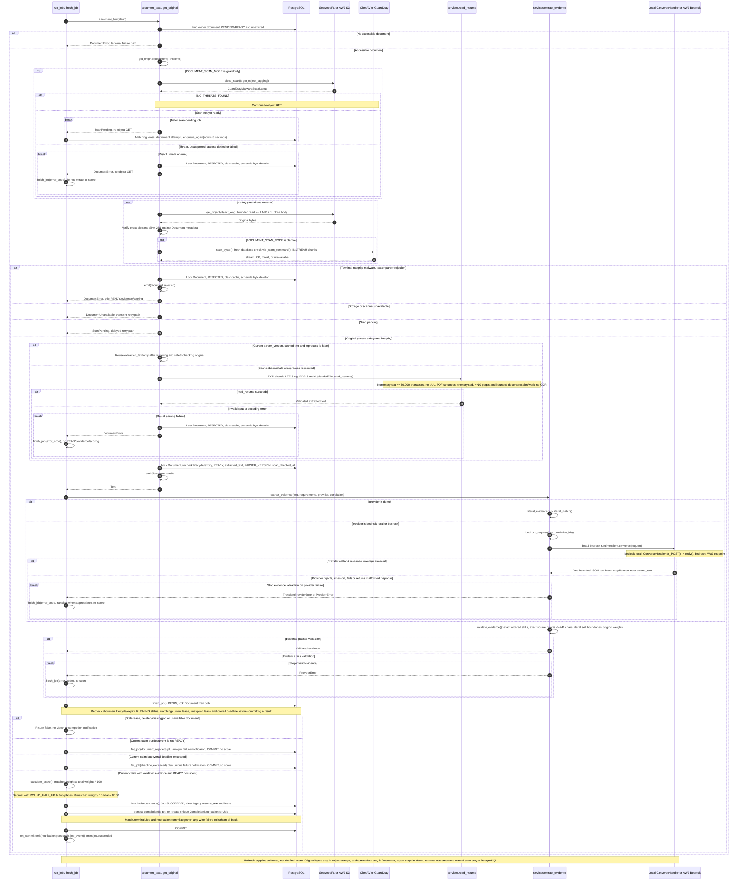
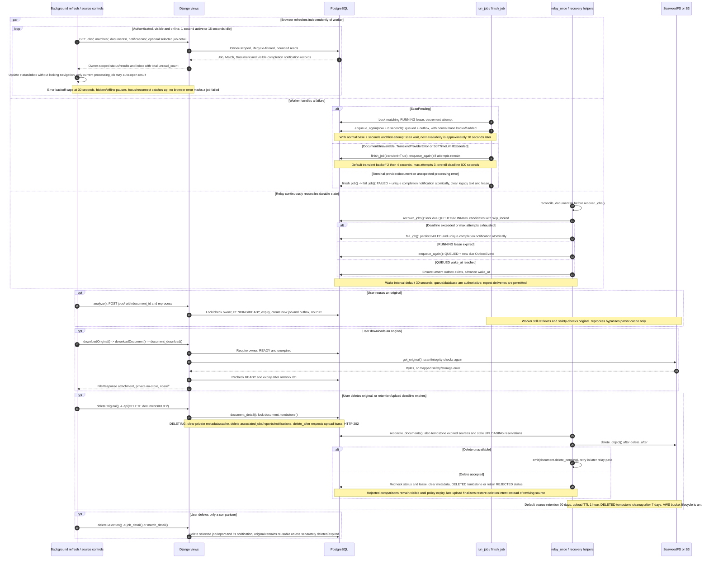
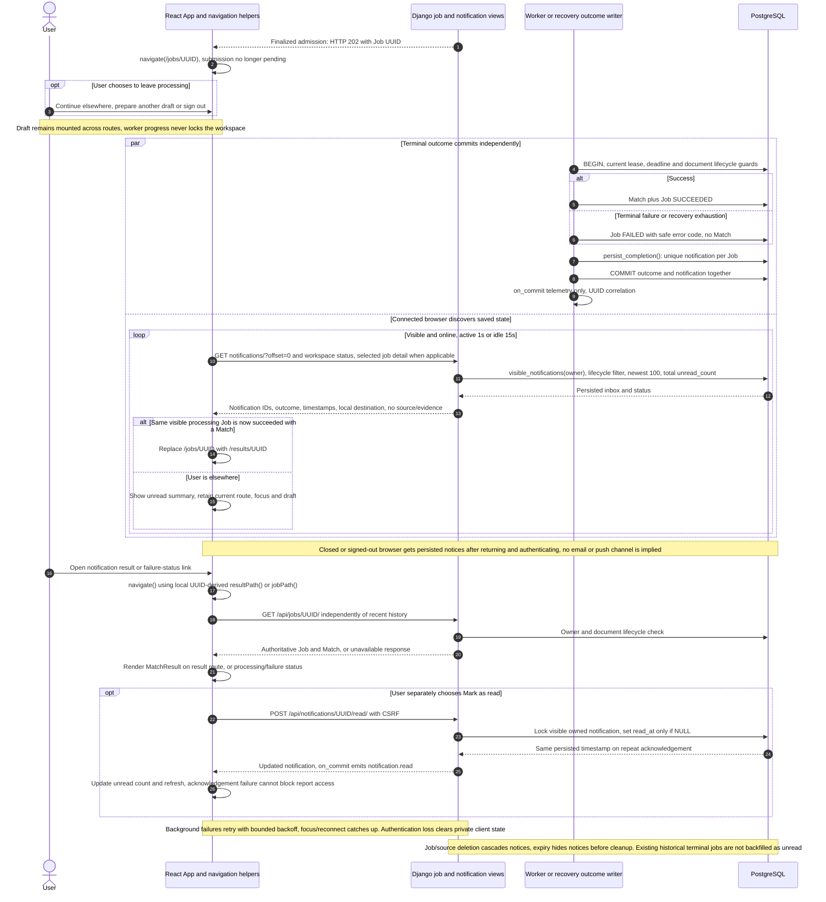

# Document admission, processing and report delivery

The execution maps trace original upload and saved-source reuse through admission, durable dispatch, evidence validation, completion notification and report access. Processing runs independently of browser navigation.

**Source snapshot:** [`880f9b8c820203353593c3eb5905cc13228f950d`](https://github.com/junrillg/resume-match-bedrock/tree/880f9b8c820203353593c3eb5905cc13228f950d), inspected on 19 October 2026. This identifies the implementation; it does not establish an active AWS deployment.

## Execution boundaries

- HTTP 202 is an admission receipt. The processing route can be left immediately; status reads do not hold the UI pending state.
- PostgreSQL controls admission, leases, outcomes and unread notifications. RabbitMQ carries repeatable wakeups; publisher confirmation is separate from job completion.
- Object PUT/GET, safety checks and provider calls occur outside their surrounding SQL critical sections. The diagrams show the relevant commit boundaries.
- Local Compose uses PostgreSQL, RabbitMQ, Celery, SeaweedFS and ClamAV. The AWS configuration selects S3 and GuardDuty. Provider choices are `demo`, `bedrock-local` and `bedrock`; local S3 compatibility does not imply an AWS transfer.

The numbered diagrams cover the application path and its failure, recovery, reuse, download and deletion boundaries. SDK/network internals, provisioning bodies and unrelated account administration are outside this execution view.

## 1. End-to-end overview

Start here. Solid arrows show the application path; dotted arrows explain publisher confirmation and telemetry boundaries.

[Editable Mermaid source](assets/upload-to-score-overview.mmd)

## 2. Browser, validation, upload and acceptance

New bytes use two SQL transactions with object PUT between them. Saved-source reuse queues inside the first transaction and skips PUT.

[Editable Mermaid source](assets/upload-to-score-admission.mmd)

## 3. Durable dispatch, RabbitMQ and Celery

RabbitMQ carries wakeups. PostgreSQL remains authoritative for whether a job may run and commit.

[Editable Mermaid source](assets/upload-to-score-dispatch.mmd)

## 4. Retrieval, safety, parsing, evidence and scoring

Successful scanning and integrity checks precede parser-cache reuse. Every rejection/error branch stops that successful path.

[Editable Mermaid source](assets/upload-to-score-worker.mmd)

## 5. Background reads, retries, recovery and original lifecycle

These activities can overlap; they do not wait for a single linear browser-to-worker response.

[Editable Mermaid source](assets/upload-to-score-recovery-lifecycle.mmd)

## 6. Completion inbox and result navigation

A completion record is part of the terminal transaction. Delivery is in-app: a connected browser discovers it in the background, and a returning user receives the same saved unread state. Opening a result and marking an update read are separate actions.

[Editable Mermaid source](assets/upload-to-score-completion.mmd)

## State and failure reference

| Boundary | Success | Failure/retry behavior |
|---|---|---|
| Browser request | React keeps latest payload fingerprint and UUID in memory | Unchanged retry reuses key; reload loses that in-memory key; changed payload gets a new key |
| Server admission | Owner-scoped key/fingerprint deduplication and quota under owner lock | Same key/different content: 409; new quota exhaustion: 429; invalid/auth/method/body checks reject before admission |
| New original PUT | UPLOADING reservation -> PUT -> PENDING document + QUEUED job + outbox | Storage 503 expires matching lease; unchanged retry resumes reservation; late PUT cannot revive deletion |
| Saved source | Existing owned, eligible, unexpired original -> new job + outbox | No object PUT; missing/ineligible source rejected; worker must still retrieve and safety-check bytes |
| Relay | Broker confirmation -> commit sent_at | Failure leaves unsent; confirm/SQL crash gap may duplicate delivery |
| Worker claim | QUEUED/due -> RUNNING + lease | Duplicate/not-due work ignored; deadline/attempt limits fail eligible jobs; stale worker cannot commit |
| Safety/cache | Original GET and safety/integrity -> cache or parse -> READY | Threat/integrity/parser errors reject; unavailable dependencies retry; pending GuardDuty scan defers without consuming an attempt |
| Evidence/score | Valid evidence -> guarded finish -> Match + SUCCEEDED + unique completion notification in one transaction | Invalid/untrusted evidence never supplies its own score or changes weights; terminal failure also persists one notification, intermediate retries do not |
| Background reads | Status, inbox and optional detail reads; 1 second active, 15 seconds idle, one settled batch at a time | Hidden/offline pauses; failures retry with backoff capped at 30 seconds; focus/reconnect catches up; session loss clears private state |
| Navigation | Acceptance opens processing; only that same visible processing route auto-opens its successful result | Completion elsewhere leaves the current draft/route intact; result URLs resolve through independently authorized job detail |
| Inbox/read | Durable per-job outcome, fixed 100-item pages, total unread count; separate idempotent read acknowledgement | Owner/lifecycle filters apply to listing and CSRF-protected read; acknowledgement errors do not block result access; no historical unread backfill |
| Source deletion | Immediate inaccessible tombstone; associated jobs, reports and notifications cascade; deferred object DELETE | Upload leases, post-I/O checks and client entity/session fences reject late finalizers, admission responses and downloads |

Defaults shown in the diagrams are snapshot configuration defaults, not deployment-wide guarantees: source retention 90 days, upload reservation TTL one hour, lease 90 seconds, attempts three, job deadline 600 seconds, wake interval 30 seconds, retry base two seconds. Scanner-pending work adds eight seconds before normal backoff. DELETED metadata tombstones have a seven-day cleanup grace. Cloud object lifecycle adds a storage policy; it is not a substitute for the application's ownership and status checks.

## Execution and source registry

Pinned links below resolve to the inspected application snapshot. The diagrams group related helpers to keep the visual path readable; this index names the supporting helpers and callbacks without adding unrelated flows to the diagram bodies.

Source index: request handlers, worker helpers, navigation and delivery

| Symbol | Source |
|---|---|
| `mark_worker_ready` | [backend/config/celery.py:16](https://github.com/junrillg/resume-match-bedrock/blob/880f9b8c820203353593c3eb5905cc13228f950d/backend/config/celery.py#L16) |
| `clear_worker_ready` | [backend/config/celery.py:21](https://github.com/junrillg/resume-match-bedrock/blob/880f9b8c820203353593c3eb5905cc13228f950d/backend/config/celery.py#L21) |
| `ConverseHandler.setup` | [backend/local_converse.py:21](https://github.com/junrillg/resume-match-bedrock/blob/880f9b8c820203353593c3eb5905cc13228f950d/backend/local_converse.py#L21) |
| `ConverseHandler.log_message` | [backend/local_converse.py:25](https://github.com/junrillg/resume-match-bedrock/blob/880f9b8c820203353593c3eb5905cc13228f950d/backend/local_converse.py#L25) |
| `ConverseHandler.reply` | [backend/local_converse.py:28](https://github.com/junrillg/resume-match-bedrock/blob/880f9b8c820203353593c3eb5905cc13228f950d/backend/local_converse.py#L28) |
| `ConverseHandler.do_GET` | [backend/local_converse.py:40](https://github.com/junrillg/resume-match-bedrock/blob/880f9b8c820203353593c3eb5905cc13228f950d/backend/local_converse.py#L40) |
| `ConverseHandler.do_POST` | [backend/local_converse.py:43](https://github.com/junrillg/resume-match-bedrock/blob/880f9b8c820203353593c3eb5905cc13228f950d/backend/local_converse.py#L43) |
| `client` | [backend/matching/documents.py:41](https://github.com/junrillg/resume-match-bedrock/blob/880f9b8c820203353593c3eb5905cc13228f950d/backend/matching/documents.py#L41) |
| `read_source` | [backend/matching/documents.py:54](https://github.com/junrillg/resume-match-bedrock/blob/880f9b8c820203353593c3eb5905cc13228f950d/backend/matching/documents.py#L54) |
| `put_original` | [backend/matching/documents.py:80](https://github.com/junrillg/resume-match-bedrock/blob/880f9b8c820203353593c3eb5905cc13228f950d/backend/matching/documents.py#L80) |
| `_clam_command` | [backend/matching/documents.py:91](https://github.com/junrillg/resume-match-bedrock/blob/880f9b8c820203353593c3eb5905cc13228f950d/backend/matching/documents.py#L91) |
| `scan_bytes` | [backend/matching/documents.py:104](https://github.com/junrillg/resume-match-bedrock/blob/880f9b8c820203353593c3eb5905cc13228f950d/backend/matching/documents.py#L104) |
| `cloud_scan` | [backend/matching/documents.py:132](https://github.com/junrillg/resume-match-bedrock/blob/880f9b8c820203353593c3eb5905cc13228f950d/backend/matching/documents.py#L132) |
| `get_original` | [backend/matching/documents.py:146](https://github.com/junrillg/resume-match-bedrock/blob/880f9b8c820203353593c3eb5905cc13228f950d/backend/matching/documents.py#L146) |
| `document_text` | [backend/matching/documents.py:166](https://github.com/junrillg/resume-match-bedrock/blob/880f9b8c820203353593c3eb5905cc13228f950d/backend/matching/documents.py#L166) |
| `tombstone` | [backend/matching/documents.py:206](https://github.com/junrillg/resume-match-bedrock/blob/880f9b8c820203353593c3eb5905cc13228f950d/backend/matching/documents.py#L206) |
| `reconcile_documents` | [backend/matching/documents.py:222](https://github.com/junrillg/resume-match-bedrock/blob/880f9b8c820203353593c3eb5905cc13228f950d/backend/matching/documents.py#L222) |
| `job_event` | [backend/matching/jobs.py:21](https://github.com/junrillg/resume-match-bedrock/blob/880f9b8c820203353593c3eb5905cc13228f950d/backend/matching/jobs.py#L21) |
| `fail_job` | [backend/matching/jobs.py:27](https://github.com/junrillg/resume-match-bedrock/blob/880f9b8c820203353593c3eb5905cc13228f950d/backend/matching/jobs.py#L27) |
| `enqueue_again` | [backend/matching/jobs.py:38](https://github.com/junrillg/resume-match-bedrock/blob/880f9b8c820203353593c3eb5905cc13228f950d/backend/matching/jobs.py#L38) |
| `claim_job` | [backend/matching/jobs.py:48](https://github.com/junrillg/resume-match-bedrock/blob/880f9b8c820203353593c3eb5905cc13228f950d/backend/matching/jobs.py#L48) |
| `finish_job` | [backend/matching/jobs.py:68](https://github.com/junrillg/resume-match-bedrock/blob/880f9b8c820203353593c3eb5905cc13228f950d/backend/matching/jobs.py#L68) |
| `run_job` | [backend/matching/jobs.py:98](https://github.com/junrillg/resume-match-bedrock/blob/880f9b8c820203353593c3eb5905cc13228f950d/backend/matching/jobs.py#L98) |
| `recover_jobs` | [backend/matching/jobs.py:136](https://github.com/junrillg/resume-match-bedrock/blob/880f9b8c820203353593c3eb5905cc13228f950d/backend/matching/jobs.py#L136) |
| `publish_job` | [backend/matching/jobs.py:166](https://github.com/junrillg/resume-match-bedrock/blob/880f9b8c820203353593c3eb5905cc13228f950d/backend/matching/jobs.py#L166) |
| `relay_once` | [backend/matching/jobs.py:178](https://github.com/junrillg/resume-match-bedrock/blob/880f9b8c820203353593c3eb5905cc13228f950d/backend/matching/jobs.py#L178) |
| `Command.add_arguments` | [backend/matching/management/commands/relay_jobs.py:13](https://github.com/junrillg/resume-match-bedrock/blob/880f9b8c820203353593c3eb5905cc13228f950d/backend/matching/management/commands/relay_jobs.py#L13) |
| `Command.handle` | [backend/matching/management/commands/relay_jobs.py:16](https://github.com/junrillg/resume-match-bedrock/blob/880f9b8c820203353593c3eb5905cc13228f950d/backend/matching/management/commands/relay_jobs.py#L16) |
| `ReadinessMiddleware.__init__` | [backend/matching/middleware.py:11](https://github.com/junrillg/resume-match-bedrock/blob/880f9b8c820203353593c3eb5905cc13228f950d/backend/matching/middleware.py#L11) |
| `ReadinessMiddleware.__call__` | [backend/matching/middleware.py:14](https://github.com/junrillg/resume-match-bedrock/blob/880f9b8c820203353593c3eb5905cc13228f950d/backend/matching/middleware.py#L14) |
| `RequestMetadataMiddleware.__init__` | [backend/matching/middleware.py:23](https://github.com/junrillg/resume-match-bedrock/blob/880f9b8c820203353593c3eb5905cc13228f950d/backend/matching/middleware.py#L23) |
| `RequestMetadataMiddleware.__call__` | [backend/matching/middleware.py:26](https://github.com/junrillg/resume-match-bedrock/blob/880f9b8c820203353593c3eb5905cc13228f950d/backend/matching/middleware.py#L26) |
| `read_resume` | [backend/matching/services.py:36](https://github.com/junrillg/resume-match-bedrock/blob/880f9b8c820203353593c3eb5905cc13228f950d/backend/matching/services.py#L36) |
| `read_requirements` | [backend/matching/services.py:94](https://github.com/junrillg/resume-match-bedrock/blob/880f9b8c820203353593c3eb5905cc13228f950d/backend/matching/services.py#L94) |
| `literal_match` | [backend/matching/services.py:117](https://github.com/junrillg/resume-match-bedrock/blob/880f9b8c820203353593c3eb5905cc13228f950d/backend/matching/services.py#L117) |
| `correlation_ids` | [backend/matching/services.py:131](https://github.com/junrillg/resume-match-bedrock/blob/880f9b8c820203353593c3eb5905cc13228f950d/backend/matching/services.py#L131) |
| `bedrock_request` | [backend/matching/services.py:141](https://github.com/junrillg/resume-match-bedrock/blob/880f9b8c820203353593c3eb5905cc13228f950d/backend/matching/services.py#L141) |
| `literal_evidence` | [backend/matching/services.py:153](https://github.com/junrillg/resume-match-bedrock/blob/880f9b8c820203353593c3eb5905cc13228f950d/backend/matching/services.py#L153) |
| `extract_evidence` | [backend/matching/services.py:163](https://github.com/junrillg/resume-match-bedrock/blob/880f9b8c820203353593c3eb5905cc13228f950d/backend/matching/services.py#L163) |
| `validate_evidence` | [backend/matching/services.py:200](https://github.com/junrillg/resume-match-bedrock/blob/880f9b8c820203353593c3eb5905cc13228f950d/backend/matching/services.py#L200) |
| `calculate_score` | [backend/matching/services.py:220](https://github.com/junrillg/resume-match-bedrock/blob/880f9b8c820203353593c3eb5905cc13228f950d/backend/matching/services.py#L220) |
| `process_job` | [backend/matching/tasks.py:7](https://github.com/junrillg/resume-match-bedrock/blob/880f9b8c820203353593c3eb5905cc13228f950d/backend/matching/tasks.py#L7) |
| `_reset_after_fork` | [backend/matching/telemetry.py:34](https://github.com/junrillg/resume-match-bedrock/blob/880f9b8c820203353593c3eb5905cc13228f950d/backend/matching/telemetry.py#L34) |
| `_get_logger` | [backend/matching/telemetry.py:45](https://github.com/junrillg/resume-match-bedrock/blob/880f9b8c820203353593c3eb5905cc13228f950d/backend/matching/telemetry.py#L45) |
| `emit` | [backend/matching/telemetry.py:66](https://github.com/junrillg/resume-match-bedrock/blob/880f9b8c820203353593c3eb5905cc13228f950d/backend/matching/telemetry.py#L66) |
| `error` | [backend/matching/views.py:25](https://github.com/junrillg/resume-match-bedrock/blob/880f9b8c820203353593c3eb5905cc13228f950d/backend/matching/views.py#L25) |
| `csrf_failure` | [backend/matching/views.py:29](https://github.com/junrillg/resume-match-bedrock/blob/880f9b8c820203353593c3eb5905cc13228f950d/backend/matching/views.py#L29) |
| `not_found` | [backend/matching/views.py:33](https://github.com/junrillg/resume-match-bedrock/blob/880f9b8c820203353593c3eb5905cc13228f950d/backend/matching/views.py#L33) |
| `server_error` | [backend/matching/views.py:37](https://github.com/junrillg/resume-match-bedrock/blob/880f9b8c820203353593c3eb5905cc13228f950d/backend/matching/views.py#L37) |
| `session_payload` | [backend/matching/views.py:41](https://github.com/junrillg/resume-match-bedrock/blob/880f9b8c820203353593c3eb5905cc13228f950d/backend/matching/views.py#L41) |
| `health` | [backend/matching/views.py:48](https://github.com/junrillg/resume-match-bedrock/blob/880f9b8c820203353593c3eb5905cc13228f950d/backend/matching/views.py#L48) |
| `session` | [backend/matching/views.py:59](https://github.com/junrillg/resume-match-bedrock/blob/880f9b8c820203353593c3eb5905cc13228f950d/backend/matching/views.py#L59) |
| `consume_bucket` | [backend/matching/views.py:65](https://github.com/junrillg/resume-match-bedrock/blob/880f9b8c820203353593c3eb5905cc13228f950d/backend/matching/views.py#L65) |
| `login` | [backend/matching/views.py:71](https://github.com/junrillg/resume-match-bedrock/blob/880f9b8c820203353593c3eb5905cc13228f950d/backend/matching/views.py#L71) |
| `logout` | [backend/matching/views.py:96](https://github.com/junrillg/resume-match-bedrock/blob/880f9b8c820203353593c3eb5905cc13228f950d/backend/matching/views.py#L96) |
| `serialize` | [backend/matching/views.py:103](https://github.com/junrillg/resume-match-bedrock/blob/880f9b8c820203353593c3eb5905cc13228f950d/backend/matching/views.py#L103) |
| `read_match_form` | [backend/matching/views.py:107](https://github.com/junrillg/resume-match-bedrock/blob/880f9b8c820203353593c3eb5905cc13228f950d/backend/matching/views.py#L107) |
| `matches` | [backend/matching/views.py:134](https://github.com/junrillg/resume-match-bedrock/blob/880f9b8c820203353593c3eb5905cc13228f950d/backend/matching/views.py#L134) |
| `match_detail` | [backend/matching/views.py:142](https://github.com/junrillg/resume-match-bedrock/blob/880f9b8c820203353593c3eb5905cc13228f950d/backend/matching/views.py#L142) |
| `serialize_document` | [backend/matching/views.py:161](https://github.com/junrillg/resume-match-bedrock/blob/880f9b8c820203353593c3eb5905cc13228f950d/backend/matching/views.py#L161) |
| `serialize_job` | [backend/matching/views.py:167](https://github.com/junrillg/resume-match-bedrock/blob/880f9b8c820203353593c3eb5905cc13228f950d/backend/matching/views.py#L167) |
| `jobs` | [backend/matching/views.py:222](https://github.com/junrillg/resume-match-bedrock/blob/880f9b8c820203353593c3eb5905cc13228f950d/backend/matching/views.py#L222) |
| `admit_jobs` | [backend/matching/views.py:229](https://github.com/junrillg/resume-match-bedrock/blob/880f9b8c820203353593c3eb5905cc13228f950d/backend/matching/views.py#L229) |
| `documents` | [backend/matching/views.py:333](https://github.com/junrillg/resume-match-bedrock/blob/880f9b8c820203353593c3eb5905cc13228f950d/backend/matching/views.py#L333) |
| `document_detail` | [backend/matching/views.py:342](https://github.com/junrillg/resume-match-bedrock/blob/880f9b8c820203353593c3eb5905cc13228f950d/backend/matching/views.py#L342) |
| `document_download` | [backend/matching/views.py:356](https://github.com/junrillg/resume-match-bedrock/blob/880f9b8c820203353593c3eb5905cc13228f950d/backend/matching/views.py#L356) |
| `job_detail` | [backend/matching/views.py:379](https://github.com/junrillg/resume-match-bedrock/blob/880f9b8c820203353593c3eb5905cc13228f950d/backend/matching/views.py#L379) |
| `activeJob` | [frontend/src/App.tsx:11](https://github.com/junrillg/resume-match-bedrock/blob/880f9b8c820203353593c3eb5905cc13228f950d/frontend/src/App.tsx#L11) |
| `reusableDocument` | [frontend/src/App.tsx:12](https://github.com/junrillg/resume-match-bedrock/blob/880f9b8c820203353593c3eb5905cc13228f950d/frontend/src/App.tsx#L12) |
| `documentLabel` | [frontend/src/App.tsx:13](https://github.com/junrillg/resume-match-bedrock/blob/880f9b8c820203353593c3eb5905cc13228f950d/frontend/src/App.tsx#L13) |
| `providerLabel` | [frontend/src/App.tsx:34](https://github.com/junrillg/resume-match-bedrock/blob/880f9b8c820203353593c3eb5905cc13228f950d/frontend/src/App.tsx#L34) |
| `errorText` | [frontend/src/App.tsx:40](https://github.com/junrillg/resume-match-bedrock/blob/880f9b8c820203353593c3eb5905cc13228f950d/frontend/src/App.tsx#L40) |
| `MatchResult` | [frontend/src/App.tsx:44](https://github.com/junrillg/resume-match-bedrock/blob/880f9b8c820203353593c3eb5905cc13228f950d/frontend/src/App.tsx#L44) |
| `App` | [frontend/src/App.tsx:69](https://github.com/junrillg/resume-match-bedrock/blob/880f9b8c820203353593c3eb5905cc13228f950d/frontend/src/App.tsx#L69) |
| `clearPrivateState` | [frontend/src/App.tsx:163](https://github.com/junrillg/resume-match-bedrock/blob/880f9b8c820203353593c3eb5905cc13228f950d/frontend/src/App.tsx#L163) |
| `refreshSession` | [frontend/src/App.tsx:174](https://github.com/junrillg/resume-match-bedrock/blob/880f9b8c820203353593c3eb5905cc13228f950d/frontend/src/App.tsx#L174) |
| `loseSession` | [frontend/src/App.tsx:180](https://github.com/junrillg/resume-match-bedrock/blob/880f9b8c820203353593c3eb5905cc13228f950d/frontend/src/App.tsx#L180) |
| `loadWorkspace` | [frontend/src/App.tsx:193](https://github.com/junrillg/resume-match-bedrock/blob/880f9b8c820203353593c3eb5905cc13228f950d/frontend/src/App.tsx#L193) |
| `load` | [frontend/src/App.tsx:203](https://github.com/junrillg/resume-match-bedrock/blob/880f9b8c820203353593c3eb5905cc13228f950d/frontend/src/App.tsx#L203) |
| `useEffect polling / poll` | [frontend/src/App.tsx:242](https://github.com/junrillg/resume-match-bedrock/blob/880f9b8c820203353593c3eb5905cc13228f950d/frontend/src/App.tsx#L242) |
| `poll` | [frontend/src/App.tsx:250](https://github.com/junrillg/resume-match-bedrock/blob/880f9b8c820203353593c3eb5905cc13228f950d/frontend/src/App.tsx#L250) |
| `perform` | [frontend/src/App.tsx:298](https://github.com/junrillg/resume-match-bedrock/blob/880f9b8c820203353593c3eb5905cc13228f950d/frontend/src/App.tsx#L298) |
| `login` | [frontend/src/App.tsx:306](https://github.com/junrillg/resume-match-bedrock/blob/880f9b8c820203353593c3eb5905cc13228f950d/frontend/src/App.tsx#L306) |
| `logout` | [frontend/src/App.tsx:315](https://github.com/junrillg/resume-match-bedrock/blob/880f9b8c820203353593c3eb5905cc13228f950d/frontend/src/App.tsx#L315) |
| `analyze` | [frontend/src/App.tsx:327](https://github.com/junrillg/resume-match-bedrock/blob/880f9b8c820203353593c3eb5905cc13228f950d/frontend/src/App.tsx#L327) |
| `deleteSelection` | [frontend/src/App.tsx:369](https://github.com/junrillg/resume-match-bedrock/blob/880f9b8c820203353593c3eb5905cc13228f950d/frontend/src/App.tsx#L369) |
| `downloadOriginal` | [frontend/src/App.tsx:385](https://github.com/junrillg/resume-match-bedrock/blob/880f9b8c820203353593c3eb5905cc13228f950d/frontend/src/App.tsx#L385) |
| `deleteOriginal` | [frontend/src/App.tsx:399](https://github.com/junrillg/resume-match-bedrock/blob/880f9b8c820203353593c3eb5905cc13228f950d/frontend/src/App.tsx#L399) |
| `api` | [frontend/src/api.ts:51](https://github.com/junrillg/resume-match-bedrock/blob/880f9b8c820203353593c3eb5905cc13228f950d/frontend/src/api.ts#L51) |
| `cancel` | [frontend/src/api.ts:58](https://github.com/junrillg/resume-match-bedrock/blob/880f9b8c820203353593c3eb5905cc13228f950d/frontend/src/api.ts#L58) |
| `downloadDocument` | [frontend/src/api.ts:80](https://github.com/junrillg/resume-match-bedrock/blob/880f9b8c820203353593c3eb5905cc13228f950d/frontend/src/api.ts#L80) |

| `persist_completion` | [backend/matching/notifications.py:14](https://github.com/junrillg/resume-match-bedrock/blob/880f9b8c820203353593c3eb5905cc13228f950d/backend/matching/notifications.py#L14) |
| `visible_notifications` | [backend/matching/notifications.py:24](https://github.com/junrillg/resume-match-bedrock/blob/880f9b8c820203353593c3eb5905cc13228f950d/backend/matching/notifications.py#L24) |
| `serialize_notification` | [backend/matching/notifications.py:32](https://github.com/junrillg/resume-match-bedrock/blob/880f9b8c820203353593c3eb5905cc13228f950d/backend/matching/notifications.py#L32) |
| `accepted_job` | [backend/matching/views.py:181](https://github.com/junrillg/resume-match-bedrock/blob/880f9b8c820203353593c3eb5905cc13228f950d/backend/matching/views.py#L181) |
| `notifications` | [backend/matching/views.py:188](https://github.com/junrillg/resume-match-bedrock/blob/880f9b8c820203353593c3eb5905cc13228f950d/backend/matching/views.py#L188) |
| `notification_read` | [backend/matching/views.py:204](https://github.com/junrillg/resume-match-bedrock/blob/880f9b8c820203353593c3eb5905cc13228f950d/backend/matching/views.py#L204) |
| `CompletionNotification` | [backend/matching/models.py:77](https://github.com/junrillg/resume-match-bedrock/blob/880f9b8c820203353593c3eb5905cc13228f950d/backend/matching/models.py#L77) |
| `Document` | [backend/matching/models.py:90](https://github.com/junrillg/resume-match-bedrock/blob/880f9b8c820203353593c3eb5905cc13228f950d/backend/matching/models.py#L90) |
| `Job` | [backend/matching/models.py:28](https://github.com/junrillg/resume-match-bedrock/blob/880f9b8c820203353593c3eb5905cc13228f950d/backend/matching/models.py#L28) |
| `Match` | [backend/matching/models.py:6](https://github.com/junrillg/resume-match-bedrock/blob/880f9b8c820203353593c3eb5905cc13228f950d/backend/matching/models.py#L6) |
| `OutboxEvent` | [backend/matching/models.py:66](https://github.com/junrillg/resume-match-bedrock/blob/880f9b8c820203353593c3eb5905cc13228f950d/backend/matching/models.py#L66) |
| `navigate` | [frontend/src/App.tsx:134](https://github.com/junrillg/resume-match-bedrock/blob/880f9b8c820203353593c3eb5905cc13228f950d/frontend/src/App.tsx#L134) |
| `follow` | [frontend/src/App.tsx:143](https://github.com/junrillg/resume-match-bedrock/blob/880f9b8c820203353593c3eb5905cc13228f950d/frontend/src/App.tsx#L143) |
| `updateInbox` | [frontend/src/App.tsx:184](https://github.com/junrillg/resume-match-bedrock/blob/880f9b8c820203353593c3eb5905cc13228f950d/frontend/src/App.tsx#L184) |
| `markRead` | [frontend/src/App.tsx:420](https://github.com/junrillg/resume-match-bedrock/blob/880f9b8c820203353593c3eb5905cc13228f950d/frontend/src/App.tsx#L420) |
| `loadMoreNotifications` | [frontend/src/App.tsx:435](https://github.com/junrillg/resume-match-bedrock/blob/880f9b8c820203353593c3eb5905cc13228f950d/frontend/src/App.tsx#L435) |
| `noticeList` | [frontend/src/App.tsx:449](https://github.com/junrillg/resume-match-bedrock/blob/880f9b8c820203353593c3eb5905cc13228f950d/frontend/src/App.tsx#L449) |
| `settledBatch` | [frontend/src/App.tsx:62](https://github.com/junrillg/resume-match-bedrock/blob/880f9b8c820203353593c3eb5905cc13228f950d/frontend/src/App.tsx#L62) |
| `readRoute` | [frontend/src/navigation.ts:8](https://github.com/junrillg/resume-match-bedrock/blob/880f9b8c820203353593c3eb5905cc13228f950d/frontend/src/navigation.ts#L8) |
| `jobPath` | [frontend/src/navigation.ts:18](https://github.com/junrillg/resume-match-bedrock/blob/880f9b8c820203353593c3eb5905cc13228f950d/frontend/src/navigation.ts#L18) |
| `resultPath` | [frontend/src/navigation.ts:19](https://github.com/junrillg/resume-match-bedrock/blob/880f9b8c820203353593c3eb5905cc13228f950d/frontend/src/navigation.ts#L19) |
| `reportPath` | [frontend/src/navigation.ts:20](https://github.com/junrillg/resume-match-bedrock/blob/880f9b8c820203353593c3eb5905cc13228f950d/frontend/src/navigation.ts#L20) |
| `pop` | [frontend/src/App.tsx:150](https://github.com/junrillg/resume-match-bedrock/blob/880f9b8c820203353593c3eb5905cc13228f950d/frontend/src/App.tsx#L150) |
| `visible` | [frontend/src/App.tsx:248](https://github.com/junrillg/resume-match-bedrock/blob/880f9b8c820203353593c3eb5905cc13228f950d/frontend/src/App.tsx#L248) |
| `schedule` | [frontend/src/App.tsx:249](https://github.com/junrillg/resume-match-bedrock/blob/880f9b8c820203353593c3eb5905cc13228f950d/frontend/src/App.tsx#L249) |
| `wake` | [frontend/src/App.tsx:288](https://github.com/junrillg/resume-match-bedrock/blob/880f9b8c820203353593c3eb5905cc13228f950d/frontend/src/App.tsx#L288) |
| `returnToApp` | [frontend/src/App.tsx:289](https://github.com/junrillg/resume-match-bedrock/blob/880f9b8c820203353593c3eb5905cc13228f950d/frontend/src/App.tsx#L289) |
| `connection` | [frontend/src/App.tsx:290](https://github.com/junrillg/resume-match-bedrock/blob/880f9b8c820203353593c3eb5905cc13228f950d/frontend/src/App.tsx#L290) |
| `Owner-authorized detail effect` | [frontend/src/App.tsx:218](https://github.com/junrillg/resume-match-bedrock/blob/880f9b8c820203353593c3eb5905cc13228f950d/frontend/src/App.tsx#L218) |
| `Processing result transition effect` | [frontend/src/App.tsx:235](https://github.com/junrillg/resume-match-bedrock/blob/880f9b8c820203353593c3eb5905cc13228f950d/frontend/src/App.tsx#L235) |

## Configuration and transport sources

- [nginx request routing](../frontend/nginx.conf)
- [Django WSGI entrypoint](../backend/config/wsgi.py), [middleware order and limits](../backend/config/settings.py), [URL routes](../backend/config/urls.py)
- [Celery queue setup and worker readiness callbacks](../backend/config/celery.py), [task wrapper](../backend/matching/tasks.py)
- [Document, Job, Match, OutboxEvent and CompletionNotification models](../backend/matching/models.py)
- [Notification persistence and owner visibility](../backend/matching/notifications.py), [client route handling](../frontend/src/navigation.ts)
- [Local service topology and health checks](../compose.yaml)
- [AWS document bucket/scanning configuration](../infra/terraform/documents.tf)

## Protocol interpretation

[Celery task acknowledgements](https://docs.celeryq.dev/en/v5.6.0/userguide/tasks.html) and [RabbitMQ publisher confirmations versus consumer acknowledgements](https://www.rabbitmq.com/docs/confirms) explain why broker acceptance, worker acknowledgement and application completion are different events. JSON application args contain the Job UUID; the Celery envelope also includes framework metadata. `ignore_result=True` disables a Celery result-backend record, not the application's `Match` report.

## Verification

The execution maps and source anchors were refreshed against the pinned implementation. All six maps passed Mermaid 12.2.0 syntax parsing; each fenced map matches its adjacent editable `.mmd` source. These documentation checks do not establish live AWS behavior or hosted diagram rendering; release verification records those observations separately.
