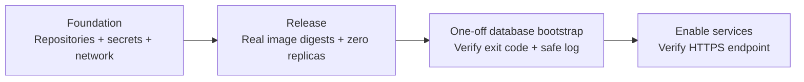

# AWS deployment reference

The local service journey is executable; this AWS topology is defined and mock-plan verified, not deployed. [The service journey](../../docs/aws-service-journey.md) explains what each resource does. This root targets the commercial AWS partition. It creates billable three-AZ messaging, multi-AZ database, private endpoints and Fargate capacity after review.

## Review prerequisites

Choose the account/region, three standard AZs, supported PostgreSQL17 minor/instance class, RabbitMQ4.3 mq.m7g capacity and Bedrock model/profile availability. Confirm model access and exact resource ARNs (include underlying foundation models for inference profiles). Confirm the selected provider output matches the application evidence contract. The existing delegated public Route53 zone must contain the chosen hostname. The deploying role needs scoped Terraform provisioning permissions and permission to create AWS service-linked roles/grants. Supply existing SNS alarm destinations if notifications are needed; without them alarms remain visible in CloudWatch but send no notifications.

Bootstrap remote state separately: existing private encrypted versioned S3 bucket, state KMS key, TLS-only bucket policy and least-privilege operator/automation access. Terraform state, local caches and saved plans contain generated application/broker/reviewer credentials. Use S3 native lockfile and encryption; never upload plans/state into GitHub or place AWS keys in tfvars. The state bucket is an account prerequisite, not the application's document store. Backend IAM must permit state Get/Put, lockfile Get/Put/Delete and KMS as appropriate. Use short-lived authorized AWS identity; do not copy credentials into files or CLI arguments.

## Validate without an account

From `infra/terraform/`:

```sh
terraform fmt -check -recursive
terraform init -backend=false -input=false
terraform validate
terraform test
```

Tests mock AWS/random; every run is plan-only. Initialization downloads providers.
A normal `terraform plan` contacts AWS and belongs to the reviewed deployment below.

## Deploy in three reviewed phases



These are operator release stages, not AWS service icons or request-processing hops.

1. Copy backend.hcl.example to a private ignored backend.hcl; copy terraform.tfvars.example to ignored terraform.tfvars and replace every illustrative value. Keep image_digests=null, enable_services=false and bootstrap_completed=false. Initialize the protected backend, review a saved plan privately, approve and apply it. This creates foundation, repositories and secrets, with no fake image/task placeholders. The HTTPS endpoint has no healthy application yet.
2. Build backend and web images for linux/amd64 from repository root, scan and publish to the output ECR repositories under immutable release tags. Use normal ECR login via stdin in your own terminal. Capture each actual digest; fill image_digests with sha256 values. Review/apply a second plan: task definitions and services are created with desired_count=0. The task definitions use immutable ECR images, private networking, injected secrets, verified RDS/MQ TLS and co-located nginx/API. Terraform does not build images, execute SQL or run ECS tasks.
3. In your operator terminal save `terraform output -json bootstrap_network > bootstrap-network.json` (ignored) and run `aws ecs run-task --region <chosen-region> --cluster <cluster_name-output> --task-definition <bootstrap_task_definition-output> --launch-type FARGATE --platform-version 1.4.0 --network-configuration file://bootstrap-network.json --query 'tasks[].taskArn' --output text`. Inspect the result for a started task, wait for it to stop, then query only `tasks[].containers[].{name:name,exitCode:exitCode,reason:reason}` using describe-tasks. Require exit code 0 and the metadata-only success log before proceeding. A failed run may leave some migrations applied; repair privately then rerun. Do not enable services on failure. Run bootstrap on one task at a time.

Bootstrap receives the RDS-managed master password, application password and bootstrap-only reviewer password through ECS secret injection. It creates a non-superuser non-inheriting application role, rejects elevated existing roles/membership, grants database/schema privileges, migrates through the ordinary application connection and creates a nonstaff reviewer only if absent. Existing reviewer passwords are not reset. The application role owns its tables and can run migrations; separate migration-only ownership is a future hardening decision. Normal execution roles cannot read the master/reviewer secrets. No password is printed or passed in the task's command arguments.

Set bootstrap_completed=true and enable_services=true only after successful bootstrap. Review/apply: app 2, worker 2, relay 1 replicas start. Each deployment uses circuit-breaker rollback; database schema migrations still require a separate reviewed one-off task before compatible service rollout. Retrieve the initial reviewer password privately through authorized SecretsManager access in your own console; never paste it into a ticket, shell command or tool transcript.

## Verify the actual endpoint

Open application_url over HTTPS, sign in as the chosen reviewer, submit synthetic text and weighted requirements, observe receipt, queued/running state and persisted report. Record job/admission request IDs. Use the saved CloudWatch query (filter by the admission UUID) to connect API acceptance, relay confirmation, worker/provider events and final save. Poll HTTP requests have their own request UUIDs. Review target health, ECS tasks, MQ backlog, database storage and alarms. Validate duplicate submissions, provider failure/recovery and managed-service failover only after a deliberate account/cost test plan. Logs omit resume bodies, filenames, usernames, model payloads and credentials. Model output is still validated against the uploaded source before deterministic scoring.

## Operating limits and cleanup

Costs include three MQ nodes, multi-AZ RDS/storage/backups, five interface endpoint types across three AZs, ALB, ECR, CloudWatch/ContainerInsights, SecretsManager/KMS, Fargate replicas and Bedrock usage. No NAT or document bucket exists; S3 gateway access is scoped only to regional ECR layer objects. No CloudFront/API Gateway/Redis/Kafka/StepFunctions are implied. CloudWatch lifecycle logs are best effort/nonblocking with 30-day retention; alarms detect failures/backlog/storage and target health, but do not establish an SLO. The SDK has bounded retries and worker job budgets; provider calls may repeat while the database permits one committed report.

Application/broker passwords are generated once by Terraform and retained in protected state. Rotate through a reviewed coordinated update: pause affected tasks, change database/broker credentials and matching SecretsManager version, rerun migrations/bootstrap where appropriate and redeploy; changing an MQ user block alone is not a supported RabbitMQ password rotation workflow. RDS rotates its managed master secret independently. Source text is cleared on terminal jobs; evidence quotes remain until report deletion, so choose lawful retention before real applicant data.

Deletion protection defaults on for RDS/ALB. First stop admission and set services off; export required reports and verify backups. Review deletion protection changes separately before destroy. RDS always takes a final snapshot (set final_snapshot_identifier to an unused name if an older snapshot has the same name); log groups are retained with skip_destroy and SecretsManager uses 30-day recovery. ECR repositories refuse deletion while images remain. Preserve the state bucket, snapshots/logs and KMS key as long as any retained encrypted data is needed; Terraform schedules key deletion only after 30 days, and an indiscriminate destroy would make retained data unreadable. Remove image tags and retained resources only under a separate data-preservation decision.

## Sources

- [Fargate networking](https://docs.aws.amazon.com/AmazonECS/latest/developerguide/fargate-task-networking.html), [bind mounts](https://docs.aws.amazon.com/AmazonECS/latest/developerguide/bind-mounts.html) and [private ECR pulls](https://docs.aws.amazon.com/AmazonECR/latest/userguide/vpc-endpoints.html).
- [MQ RabbitMQ 4.3](https://docs.aws.amazon.com/amazon-mq/latest/developer-guide/rabbitmq-43.html), [encryption](https://docs.aws.amazon.com/amazon-mq/latest/developer-guide/data-protection.html), [monitoring](https://docs.aws.amazon.com/amazon-mq/latest/developer-guide/rabbitmq-logging-monitoring.html) and [pinned Terraform broker resource](https://registry.terraform.io/providers/hashicorp/aws/6.69.1/docs/resources/mq_broker).
- [Terraform provider mocking](https://developer.hashicorp.com/terraform/language/tests/mocking).
